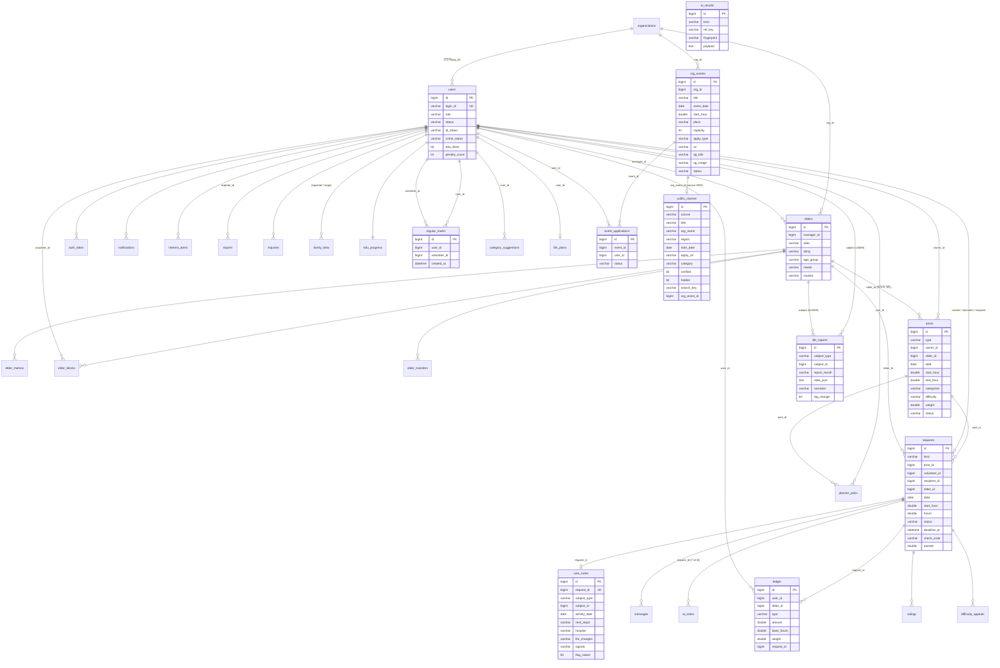

# 시간 적금 DB

- `schema.sql` — 실제 JPA 엔티티(`backend/src/main/java/com/timesavings/domain`)에서 Hibernate 스키마 생성으로 뽑은 MySQL 8 DDL(테이블 35개). 요구사항 명세서 41판(2026-11-12) 기준이고, 칸마다의 설명은 `schema.sql` 주석과 계약서(`docs/design/contract.md`) 7.17 절을 본다.
- 기본 실행은 **H2 파일 DB**(`backend/data/timesavings.mv.db`, `MODE=MySQL`)이고 `ddl-auto=update`로 같은 구조가 자동 생성된다.
- 데모 데이터는 SQL 파일이 아니라 서버 첫 기동 때 `DataSeeder`가 넣는다(DB가 비어 있을 때만, 오늘 날짜 기준 상대 날짜).

## 테이블

| 테이블 | 설명 | 요구사항 |
|---|---|---|
| `users` | 사용자·기관 담당자·운영자 계정. `role`(USER/ORG/ADMIN), 신원(`id_status`)·범죄경력(`crime_status`) 인증, 패널티·경고 횟수, 프로필(지역·시간대·카테고리), 가입 약관 동의(`terms_agreed_at`·`privacy_agreed_at`·`loc_consent`·`interest_consent`), 알림 설정(`noti_*`, `voice_alert`, `sms_alert`), 퇴출(`banned`). `edu_done`은 41판부터 쓰지 않음(수료 배지 없음) | A-01~A-04, A-09, B-01, B-43 |
| `auth_token` | 로그인 토큰(만료 30일, 로그인 유지 안 하면 1일) | A-02 |
| `organizations` | 기관 서비스 신청·승인 상태. `proof_file_url`=재직 증빙 파일(운영자만 열 수 있음) | C-01, D-01 |
| `elders` | 도움 대상(독거노인). **별칭·동·나이대·필요 도움·주의사항만** 저장(이름·주소·연락처 없음). 등록 때 서비스 이용 동의 확인(`service_consent_at/by`), 현관 QR 카드 번호(`qr_code`, `qr_issued_at`) | C-02, C-11 |
| `elder_memos` | 담당자 메모(원문 `text` + AI·규칙 정리본 `tidy_text`, `source`) | C-02, C-14 |
| `care_notes` | 전달 메모 정리(요청 한 건에 하나, `request_id` 유일). `subject_type`·`subject_id`(받는 사람: ELDER/USER), `next_steps`(다음에 챙길 것)·`hospital`("병원 안내 있음 (…)" — 병명·약 이름 없음)·`life_changes`(줄바꿈 구분), `signals`(생활 변화 신호 이름: 쓰러짐·넘어짐·식사 거름·외출 감소·기운 없음·잠 못 잠·말수·기분 변화 — 앞의 셋은 한 건만 있어도 담당자에게 알림, B-36), `flag_raised`(이 일지·메모로 담당자 알림을 보냄), `source`(ai/rule) | 7.14 C1 |
| `ai_results` | 이벤트 때 한 번 만든 LLM 결과 저장·재사용(`kind`+`ref_key` 유일): `ORG_BRIEFING`(담당자 id)·`REPORT_TRIAGE`(신고 id)·`ANOMALY_NOTE`(봉사자:대상)·`INQUIRY_DRAFT`(문의 id). `fingerprint`가 바뀌면(큰 변화·근거 변경) 다시 만든다. `payload`는 화면용 JSON | 7.14 C3·C5·C6·C7 |
| `elder_blocks` | 담당자의 "이 봉사자 받지 않기"(`elder_id`, `volunteer_id`, `reason` 필수, `manager_id`, `request_id`). 있으면 그 봉사자는 그 대상 건에 요청·제안할 수 없음(403 `VOLUNTEER_BLOCKED`) | 회의반영 O1 |
| `elder_transfers` | 담당자 간 이관(PENDING/ACCEPTED/REJECTED, 운영자 대리 = ADMIN) | C-03, D-01 |
| `posts` | 공고. `type` OFFER(봉사 가능)/NEED(도움 요청), 시간 범위, 카테고리, 난이도·가중치, 상태. `created_by`=올린 사람(가족 대신 올리면 주인 `owner_id`와 다름, B-57). 자동 반복은 41판에서 없어져 `repeat_rule`·`series_id`는 쓰지 않음(다시 올리기는 새 공고 1건). LLM 추가 A: `easy_text`(쉬운 말 읽어 주기 문장, 공고별 1회 생성·수정하면 지움), `fix_tips_json`·`fix_checked_at`(24시간 요청 없는 공고 고치기 제안·근거, 공고당 1회) | B-03~B-11, C-04, 7.12 |
| `requests` | 요청·제안·단골 요청과 활동 진행 전체(상태, 응답 기한, 시작·종료 시각과 확인 방법 `check_method` qr/code, 30초마다 바뀌는 번호의 비밀값 `qr_secret`, 지각·노쇼 의심 알림 표시, 자동 마감 `auto_closed`, 일지, 시간 조정, 적립, 이상 패턴 보류). `check_code`는 시작·종료 확인에 쓰지 않음. `match_reason`="왜 이 봉사자?" 한 줄(요청 생성 때 1회, 숫자는 코드 값, LLM 추가 A). `care_memo`=일지와 함께 남기는 전달 메모(선택, 500자, 건강 정보가 들어갈 수 있는 민감정보 — 봉사자 본인·받은 사람·담당자·공유 동의한 가족만) | A-05, B-12~B-25, C-05~C-10, 회의반영 4장 |
| `messages` | 요청별 메시지(시스템 메시지 포함, 연락처·계좌 패턴이면 `warn`) | A-08, C-09 |
| `ledger` | 시간 통장 거래(EARN/HOLD/RELEASE/USE/GIFT_OUT/GIFT_IN/ADJUST/REFUND). CLASS_FEE/CLASS_EARN/POOL은 삭제된 동네 클래스 기록을 읽기 위해 enum에만 남김(새로 쓰지 않음) | A-06, B-26~B-34 |
| `ratings` | 평가(봉사자 평가는 공개, 받는 사람 평가는 `is_private`) | B-38~B-40 |
| `notifications` | 알림. `voice_text`=음성 알림 켠 사용자에게 전화로 읽을 문장(숫자는 한글 읽기, LLM 추가 A) | A-07, C-08, B-42 |
| `interest_alerts` | 관심 조건(지역·카테고리·평일/주말·날짜 범위 `date_from`~`date_to`) | B-21 |
| `reports` | 신고와 처리 결과(경고·정지·퇴출). `kind`=WELFARE 면 독거노인 이상 징후(안부 확인) 접수로 제재 없는 기록(`elder_id`) | B-36, B-37, D-02 |
| `inquiries` | 1:1 문의·답변. 처리 단계 `stage`(RECEIVED/CHECKING/ANSWERED/CLOSED) | B-48, B-49, D-08 |
| `notices` | 공지 | A-10, D-09 |
| `family_links` | 가족 연결. `share_report`=신청한 쪽의 리포트 공유 동의, `target_share_report`=받은 쪽의 동의 | B-32, B-44, P-04, P-06 |
| `difficulty_appeals` | 난이도 이의 신청 | B-28 |
| `public_services` | 공공 서비스 안내 DB(AI는 여기 있는 것만 안내) | P-01, P-02 |
| `life_reports` | 월간 생활 변화 리포트(`report_month`=YYYY-MM, 숫자는 `stats_json`, 서술은 `narrative`) | P-03~P-07 |
| `edu_progress` | 첫 활동 연습 진행(진단·카드·퀴즈·역할극 결과). 선택 연습이라 수료(`completed_at`)는 쓰지 않음 | B-54 |
| `roleplay_personas` | 첫 활동 연습 역할극의 가상 상대(대본 `turns_json`) | B-54 |
| `regular_marks` | 수동 단골 등록(받는 사람 `user_id` → 봉사자 `volunteer_id`, 한 쌍에 하나). 자동 단골(DONE 3회 이상)과 합쳐 `/api/regulars`에 나온다. 함께한 활동이 없어도 등록할 수 있고, 등록한 쪽·등록된 쪽 모두 해지할 수 있다(`removed`, `removed_by` — 줄은 지우지 않음) | B-42, B-65 |
| `org_events` | 동네 기관 소식: 담당자가 올리는 행사·클래스 홍보(제목·내용·일시·장소·기관 페이지 `url` 필수, 링크 미리보기 `og_title`/`og_image`/`og_desc`, `status` OPEN/CLOSED). 앱 안 신청이 없어져 `capacity`·`apply_type`은 쓰지 않음 | B-64, C-15 |
| `event_applications` | 41판부터 쓰지 않음(앱 안 신청 삭제). 예전 기록을 읽기 위해 표만 남김 | — |
| `ai_notes` | 7.13 LLM 추가 B: 이벤트 때 한 번 만든 AI(키 없으면 규칙) 결과 저장·재사용. `kind`+`ref_id`(+`ref_key`) 하나에 한 행 — BRIEFING(요청 id, 확정 때 방문 전 체크리스트) · MESSAGE(메시지 id, 안전 감지 `warn_level` none/caution/warn·답장 후보·일정 변경, 메시지당 1회) · ADJUST(요청 id, 시간 조정 판단 보조) · APPEAL(이의 신청 id) · GOAL(사용자 id, 거꾸로 플랜 추천) · MONTH(사용자 id + `ref_key`=YYYY-MM, 월별 결산 한 줄). `fingerprint`가 바뀌면(그 달 거래·목표 입력·조정 시간) 다시 만든다. 결과는 `body_json`, `source` ai/rule, `provider`. 지난 전달 메모·연락처는 넣지 않음 | 계약서 7.13 |
| `public_classes` | 기관 클래스 추천: 공공기관 강좌 한 테이블. `source` AI_SEARCH(Gemini 구글 검색 그라운딩 — 서버가 `apply_url`을 열어 제목을 얻은 것만 `verified`, 아니면 `hidden`, `search_key`=지역별 하루 1회 캐시 키)/PUBLIC_DATA(공공데이터포털 평생학습강좌 CSV)/ORG(동네 소식 `org_events`를 옮겨 둔 것, `org_event_id`). 제목·기관·지역(시군구·동)·장소·기간·일정·대상·수강료·정원·신청 주소·`category`(디지털/정서·건강/생활/기타)·`expires_at`·`raw_json`(CSV 나머지 열·AI 원본) | 2026-11-10 기관 클래스 추천 |
| `category_suggestions` | 카테고리 추가 건의(2026-11-11): 사용자·담당자 `user_id`가 낸 이름 `name`·이유 `reason`. 같은 이름 묶기용 `name_key`(공백·가운뎃점 제거), `status` RECEIVED/REVIEWING/ADOPTED/HELD, 운영자 `answer`·`answered_by`·`answered_at`. 실제 카테고리 6종은 바꾸지 않는다(운영자 결정용 기록) | 2026-11-11 역할별 기능 목록 |
| `life_plans` | 생애 플랜 조건(사용자당 1행, PK `user_id`): `age`, `start_age`, `monthly_hours`, 받고 싶은 도움 `needs_json`({카테고리: 한 달 시간}). 결과 숫자는 저장하지 않고 볼 때마다 서버가 계산. 상속 칸 없음 | 플래너 3번째 칸 |
| `planner_picks` | 플래너 "추천 봉사"에서 내 계획에 넣은 봉사 요청 공고(`user_id`+`post_id` 한 쌍에 하나). 계획 시각 `start_hour`·`hours`·`plan_source`(ai/rule). 계획일 뿐이고 제안은 사용자가 직접 보낸다 | 플래너 2번째 칸 |
| `app_settings` | 운영 설정 키-값(`setting_key`, `setting_value`). `verify.items`(봉사 인증 항목 켜짐·필수 JSON), `edu.situations`(첫 활동 연습 상황 목록 JSON) | a_verify, B-54 |
| `upload_files` | 올린 파일의 주인 기록(`file_id`=파일 이름, `uploader_id` — null 이면 로그인 없이 올린 재직 증빙). 파일은 로그인하고 볼 수 있는 사람만 연다: 신분증·회보서는 본인·운영자, 재직 증빙은 운영자, 일지 사진은 그 요청의 당사자·담당자·운영자, 프로필 사진은 로그인한 사용자 | 계약서 7.17 ⑪ |

동네 클래스용 `classes`·`class_enrollments`·`spaces` 테이블과 `ledger.class_id`는 2026-11-10 사용자 결정으로 삭제했다(동네 소식 `org_events`는 유지).

외래 키는 DB 제약 대신 `*_id` 숫자 칸으로 두고 서버 코드에서 검사한다(데모 규모, H2·MySQL 공통 단순화).

## ERD



> 2026-11-11: `posts.issue_note`(300자) — 담당자 대리 공고의 "관리 대상 이슈". 비어 있으면 `elders.caution`을 보여 준다. 연락처·주소는 저장 전에 막고 병명은 걸러 낸다.

## H2 ↔ MySQL 전환

- 기본(H2 파일): 아무 설정 없이 실행. 접속 정보 `jdbc:h2:file:./data/timesavings;MODE=MySQL;AUTO_SERVER=FALSE`, 사용자 `sa`, 비밀번호 없음. 콘솔 `http://localhost:8080/h2-console`.
- MySQL 8:
  ```bash
  mysql -u root -p -e "CREATE DATABASE timesavings DEFAULT CHARACTER SET utf8mb4 COLLATE utf8mb4_0900_ai_ci;"
  mysql -u root -p timesavings < db/schema.sql      # 선택: 미리 만들기(안 해도 ddl-auto=update 가 만든다)
  cd backend
  SPRING_PROFILES_ACTIVE=mysql DB_URL='jdbc:mysql://localhost:3306/timesavings?serverTimezone=Asia/Seoul&characterEncoding=UTF-8' \
    DB_USER=timesavings DB_PASSWORD='(비밀번호)' ./mvnw spring-boot:run
  ```
  접속 정보는 환경변수로만 준다(파일에 적지 않는다).
- DB를 처음부터 다시: 서버를 내리고 `backend/data/` 를 지우면 다음 기동 때 시드가 다시 들어간다.

## schema.sql 다시 만들기

엔티티를 바꾼 뒤:
```bash
cd backend
./mvnw -q spring-boot:run -Dspring-boot.run.profiles=schema \
  "-Dspring-boot.run.arguments=--spring.main.web-application-type=none --app.seed.enabled=false --app.scheduler.enabled=false --spring.datasource.url=jdbc:h2:mem:schema;MODE=MySQL --spring.jpa.hibernate.ddl-auto=none"
# ../db/schema.generated.sql 이 생긴다 → 머리말을 붙여 schema.sql 로 바꾼다
```
