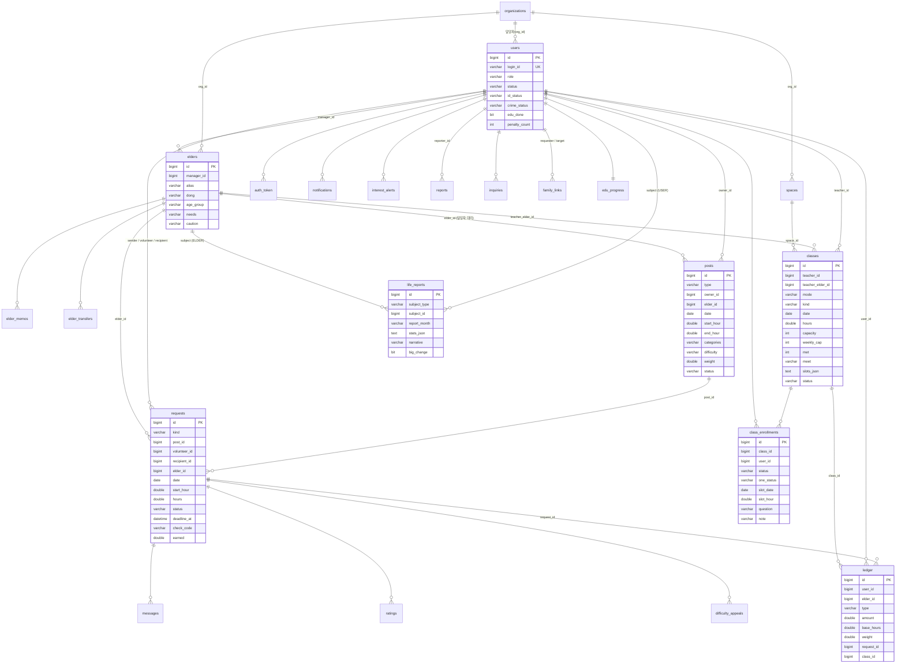

# 시간 적금 DB

- `schema.sql` — 실제 JPA 엔티티(`backend/src/main/java/com/timesavings/domain`)에서 Hibernate 스키마 생성으로 뽑은 MySQL 8 DDL(테이블 25개).
- 기본 실행은 **H2 파일 DB**(`backend/data/timesavings.mv.db`, `MODE=MySQL`)이고 `ddl-auto=update`로 같은 구조가 자동 생성된다.
- 데모 데이터는 SQL 파일이 아니라 서버 첫 기동 때 `DataSeeder`가 넣는다(DB가 비어 있을 때만, 오늘 날짜 기준 상대 날짜).

## 테이블

| 테이블 | 설명 | 요구사항 |
|---|---|---|
| `users` | 사용자·기관 담당자·운영자 계정. `role`(USER/ORG/ADMIN), 신원(`id_status`)·범죄경력(`crime_status`) 인증, 교육 수료, 패널티·경고 횟수, 프로필(지역·시간대·카테고리) | A-01~A-04, A-09, B-01, B-43 |
| `auth_token` | 로그인 토큰(만료 30일, 로그인 유지 안 하면 1일) | A-02 |
| `organizations` | 기관 서비스 신청·승인 상태 | C-01, D-01 |
| `elders` | 도움 대상(독거노인). **별칭·동·나이대·필요 도움·주의사항만** 저장(이름·주소·연락처 없음) | C-02 |
| `elder_memos` | 담당자 메모 | C-02 |
| `elder_transfers` | 담당자 간 이관(PENDING/ACCEPTED/REJECTED, 운영자 대리 = ADMIN) | C-03, D-01 |
| `posts` | 공고. `type` OFFER(봉사 가능)/NEED(도움 요청), 시간 범위, 카테고리, 난이도·가중치, 반복(`series_id`), 상태 | B-03~B-11, C-04 |
| `requests` | 요청·제안·단골 요청과 활동 진행 전체(상태, 응답 기한, 체크인 코드·시각, 일지, 시간 조정, 적립, 이상 패턴 보류) | A-05, B-12~B-25, C-05~C-10 |
| `messages` | 요청별 메시지(시스템 메시지 포함, 연락처·계좌 패턴이면 `warn`) | A-08, C-09 |
| `ledger` | 시간 통장 거래(EARN/HOLD/RELEASE/USE/GIFT_OUT/GIFT_IN/CLASS_FEE/CLASS_EARN/ADJUST/REFUND/POOL). `user_id`가 비면 시스템 기록(공동 적립, 기관이 대신 받은 어르신 선생님 적립 — 이때 `elder_id`) | A-06, B-26~B-34 |
| `ratings` | 평가(봉사자 평가는 공개, 받는 사람 평가는 `is_private`) | B-38~B-40 |
| `notifications` | 알림 | A-07, C-08 |
| `interest_alerts` | 관심 조건(지역·카테고리·평일/주말) | B-21 |
| `reports` | 신고와 처리 결과(경고·정지·퇴출) | B-36, B-37, D-02 |
| `inquiries` | 1:1 문의·답변 | B-48, B-49, D-08 |
| `notices` | 공지 | A-10, D-09 |
| `family_links` | 가족 연결. `share_report`=신청한 쪽의 리포트 공유 동의, `target_share_report`=받은 쪽의 동의 | B-32, B-44, P-04, P-06 |
| `difficulty_appeals` | 난이도 이의 신청 | B-28 |
| `public_services` | 공공 서비스 안내 DB(AI는 여기 있는 것만 안내) | P-01, P-02 |
| `life_reports` | 월간 생활 변화 리포트(`report_month`=YYYY-MM, 숫자는 `stats_json`, 서술은 `narrative`) | P-03~P-07 |
| `edu_progress` | 첫 활동 교육 진행(진단·카드·퀴즈·역할극 결과) | B-01 |
| `roleplay_personas` | 교육 역할극 가상 상대(대본 `turns_json`) | 교육 |
| `classes` | 동네 클래스(선생님=사용자 또는 도움 대상, 공간·정원·출석 코드·배움 노트). `mode`=ONE(1:1 배우기, 공간 배정 없이 바로 OPEN)/GROUP(같이 해 보기, 4명까지). 1:1은 `bio`·`tags`·`met`(만난 수)·`weekly_cap`(주당 정원)·`qs_json`(질문 예시)·`slots_json`(가능한 시간)·`meet`(열린 공공장소)·`teacher_label`/`teacher_age_label`(가림 표시 이름·나이) | 동네 클래스 |
| `class_enrollments` | 수강 신청·출석·후기. 1:1 신청은 `one_status`(WAIT/OK/MET/DONE/CANCELLED)·`slot_date`·`slot_hour`·`question`(궁금한 점)·`proposed`(다른 시간 제안 중)·`note`(오늘 배운 한 줄)·`check_in_at`·`check_out_at` | 동네 클래스 |
| `spaces` | 기관 공간 | 동네 클래스 |

외래 키는 DB 제약 대신 `*_id` 숫자 칸으로 두고 서버 코드에서 검사한다(데모 규모, H2·MySQL 공통 단순화).

## ERD



## H2 ↔ MySQL 전환

- 기본(H2 파일): 아무 설정 없이 실행. 접속 정보 `jdbc:h2:file:./data/timesavings;MODE=MySQL;AUTO_SERVER=FALSE`, 사용자 `sa`, 비밀번호 없음. 콘솔 `http://localhost:8080/h2-console`.
- MySQL 8:
  ```bash
  mysql -u root -p -e "CREATE DATABASE timesavings DEFAULT CHARACTER SET utf8mb4 COLLATE utf8mb4_0900_ai_ci;"
  mysql -u root -p timesavings < db/schema.sql      # 선택: 미리 만들기(안 해도 ddl-auto=update 가 만든다)
  cd backend
  SPRING_PROFILES_ACTIVE=mysql DB_URL='jdbc:mysql://localhost:3306/timesavings?serverTimezone=Asia/Seoul&characterEncoding=UTF-8' \
    DB_USER=timesavings DB_PASSWORD='(비밀번호)' ./mvnw spring-boot:run
  ```
  접속 정보는 환경변수로만 준다(파일에 적지 않는다).
- DB를 처음부터 다시: 서버를 내리고 `backend/data/` 를 지우면 다음 기동 때 시드가 다시 들어간다.

## schema.sql 다시 만들기

엔티티를 바꾼 뒤:
```bash
cd backend
./mvnw -q spring-boot:run -Dspring-boot.run.profiles=schema \
  "-Dspring-boot.run.arguments=--spring.main.web-application-type=none --app.seed.enabled=false --app.scheduler.enabled=false --spring.datasource.url=jdbc:h2:mem:schema;MODE=MySQL --spring.jpa.hibernate.ddl-auto=none"
# ../db/schema.generated.sql 이 생긴다 → 머리말을 붙여 schema.sql 로 바꾼다
```
