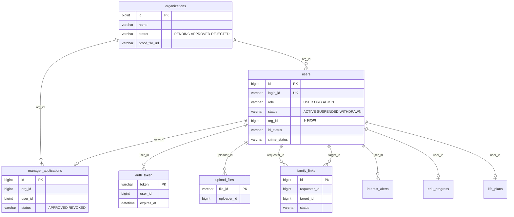
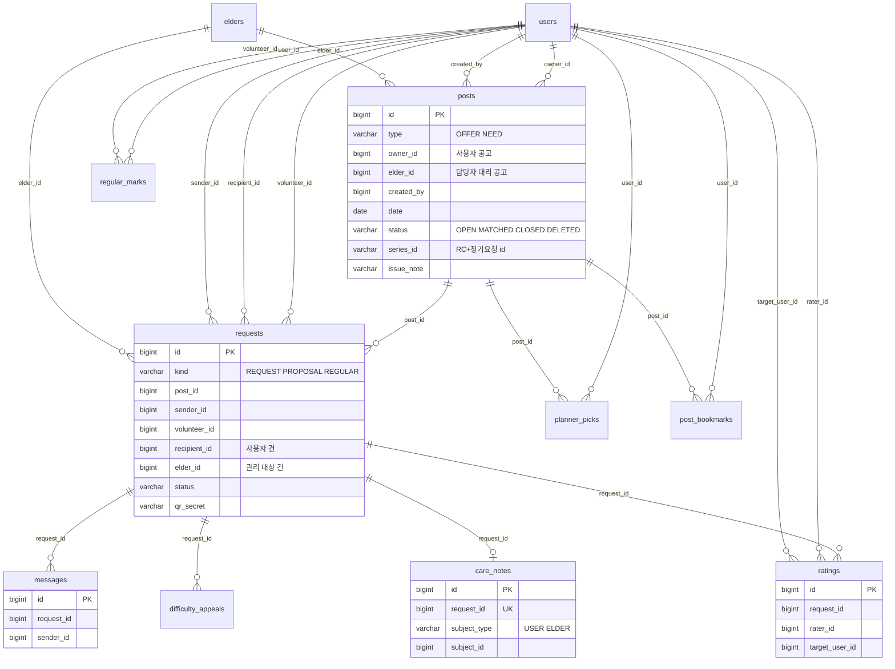
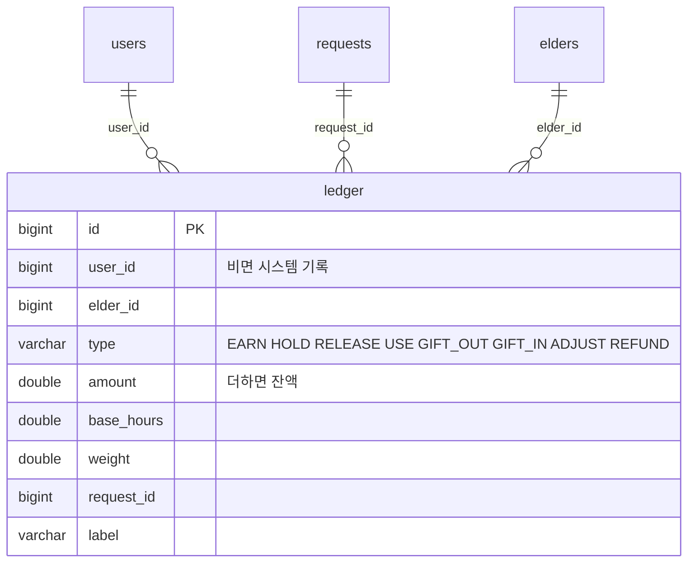
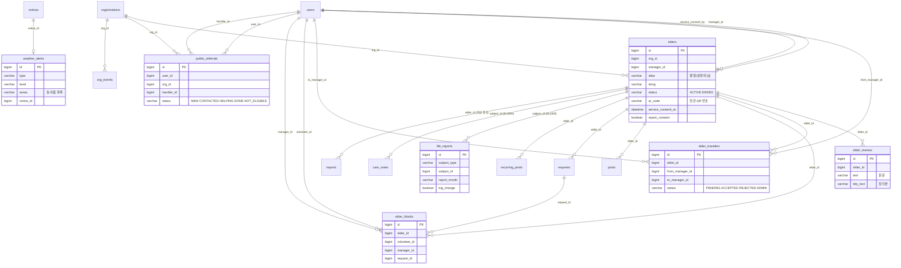
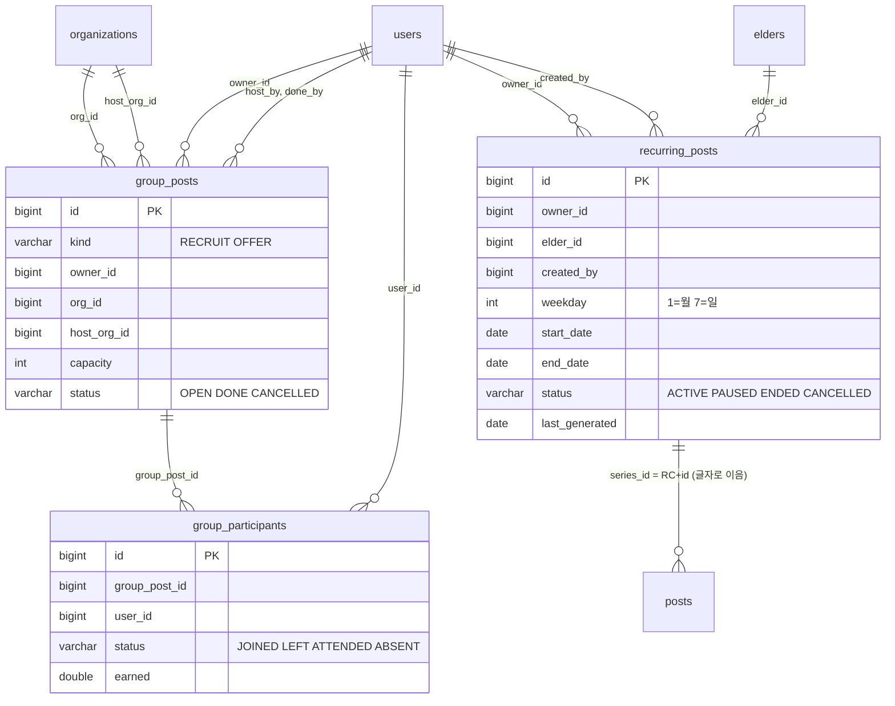
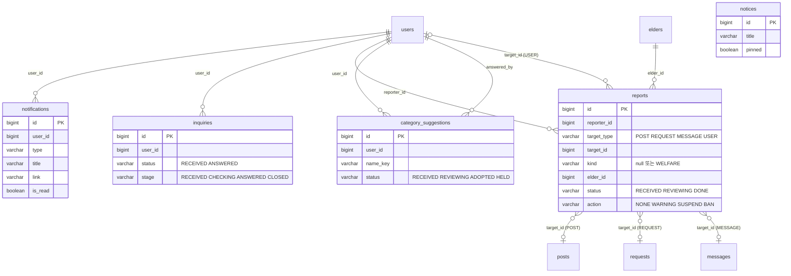
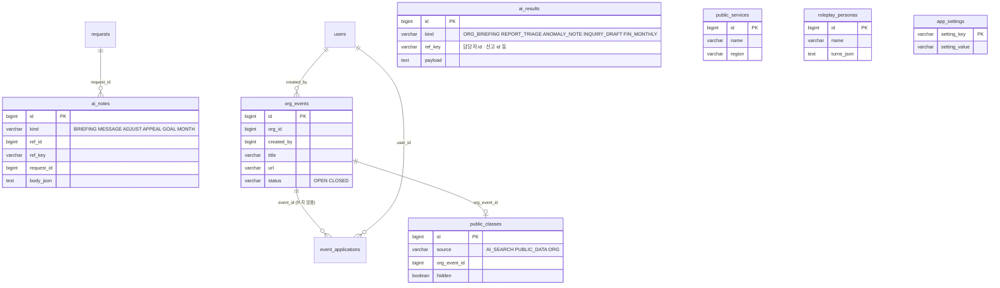

# 시간 적금 — ERD (데이터 구조)

- 작성일: 2026-11-13
- 기준 커밋: `9f78dc4 사용자 화면을 2026-11-13 대표 지시대로: 하단바·홈·공고·통장·플래너·마이` (백엔드·DB는 바로 앞 `aeed99f`까지 반영 — 표 `post_bookmarks` 추가). 쓰기 시작할 때는 `c68c72e`였고, 쓰는 동안 올라온 두 커밋에 맞춰 끝에 다시 확인했다.
- 근거: `backend/src/main/java/com/timesavings/domain/*.java`(엔티티 42개 + `Enums` + `StringListConverter`). **엔티티 코드가 기준**이고 `db/schema.sql`·`db/README.md`는 참고만 했다(다른 곳은 6장).
- **기관 담당자 관련 표는 5장에 따로 모아 더 자세히** 적었다. 3장에는 그 표들의 칸 정의를 다시 싣지 않고 5장을 가리킨다.

---

## 1. 개요

### 1.1 표 수와 DB
- 표 **42개**(엔티티 42개). 이 가운데 `event_applications`는 더 쓰지 않는다(예전 자료를 읽으려고 남김).
- 실행 DB: 기본은 H2 파일 DB(`MODE=MySQL`, `ddl-auto=update`로 엔티티에서 자동 생성). `db/schema.sql`은 같은 구조의 MySQL 8 DDL이다.
- 데모 데이터는 SQL이 아니라 서버 첫 기동 때 `DataSeeder`가 넣는다.

### 1.2 이름 규칙
- 표 이름: 복수형 snake_case(`users`, `elder_memos`). 예외: `ledger`, `auth_token`, `ai_notes`(엔티티 `ActivityAiNote`), `edu_progress`.
- 칸 이름: 엔티티 필드(camelCase)를 snake_case로 바꾼 것(`elderId` → `elder_id`, `isRead` → `is_read`). 다르게 정한 칸: `life_reports.report_month`(필드 `month`), `app_settings.setting_key`·`setting_value`(필드 `key`·`value`).
- 기본 키: 대부분 `id BIGINT` 자동 증가. 예외: `auth_token.token`, `upload_files.file_id`, `app_settings.setting_key`, `life_plans.user_id`, `edu_progress.user_id`(사용자 한 명에 한 줄).
- 목록형 칸(`categories`, `needs`, `tags`, `time_slots`, `keywords`, `signals`, `areas`)은 **쉼표로 이은 글자 한 칸**이다(`StringListConverter`). 값에 쉼표가 들어가면 안 된다.
- `*_json` 칸은 JSON 문자열이다.
- enum은 이름 문자열로 저장한다(`EnumType.STRING`). 일부 상태는 enum이 아니라 그냥 글자 칸이다(4.2).
- 형식 표기: `BIGINT`(Long), `INT`, `DOUBLE`, `BOOLEAN`, `VARCHAR(n)`, `TEXT`, `DATE`, `DATETIME`. 길이를 안 정한 글자 칸은 `VARCHAR(255)`.
- 시각은 소수 시(`9.5` = 9시 30분), 시간의 양은 0.5 단위 실수.

### 1.3 관계를 잇는 방식 — JPA 연관 없음
- **엔티티에 `@ManyToOne` 같은 JPA 연관이 하나도 없다.** 표와 표는 `owner_id`, `elder_id`, `manager_id`, `org_id`, `post_id` 같은 **숫자 칸으로만** 이어지고, DB에 **외래 키 제약도 없다**(코드가 `findById`로 찾아 잇는다).
- 그래서 가리키는 행이 없어도 DB가 막지 않는다. 코드는 못 찾으면 null로 다룬다.
- 아래 그림의 선은 "이 칸이 저 표의 id를 담는다"는 뜻이고, 엔티티 코드의 칸 이름·주석에서 확인한 것만 그었다.
- 한 칸이 여러 표를 가리키는 곳(다형 참조): `reports.target_type + target_id`(POST·REQUEST·MESSAGE·USER), `care_notes`·`life_reports`의 `subject_type + subject_id`(USER·ELDER), `ai_results.ref_key`, `ai_notes.ref_id`.

### 1.4 삭제 대신 상태값을 쓰는 곳
| 표 | 지우지 않고 바꾸는 값 |
|---|---|
| `users` | `status = WITHDRAWN`(탈퇴, 전화번호만 지움) · `SUSPENDED`(정지) · `banned = true`(퇴출, 되돌릴 수 없음) |
| `elders` | `status = ENDED`(지원 종료) |
| `posts` | `status = DELETED`(삭제) · `CLOSED`(마감) |
| `requests` | 끝난 상태(`REJECTED, DECLINED, EXPIRED, CANCELLED, NOSHOW, DONE`)로 남김 |
| `recurring_posts` | `status = CANCELLED`(해지) · `ENDED` · `PAUSED` |
| `group_posts` | `status = CANCELLED` · `group_participants.status = LEFT` |
| `org_events` | `status = CLOSED`(내림) |
| `regular_marks` | `removed = true`(단골 해지 기록) |
| `manager_applications` | `status = REVOKED`(운영자가 취소) |
| `organizations` | `status = REJECTED` |
| `family_links`, `elder_transfers` | `status = REJECTED` |
| `public_classes` | `hidden = true` |

실제로 행을 지우는 곳: `elder_blocks`(받지 않기 풀기), `family_links`(연결 끊기), `interest_alerts`, `post_bookmarks`, `planner_picks`, `notices`, `public_services`, `roleplay_personas`, `public_classes`(운영자 삭제), `weather_alerts`(전달 전), `auth_token`(로그아웃).

### 1.5 개인정보를 일부러 저장하지 않는 칸
| 대상 | 저장하지 않는 것 | 대신 |
|---|---|---|
| 관리 대상(`elders`) | **실명·주소·연락처** | 별칭(`alias`, 10자)·동(`dong`)·나이대·필요 도움·주의사항만. 연락처·상세 주소가 보이면 서버가 받지 않는다(`PII_NOT_ALLOWED`) |
| 담당자 메모·공고 이슈(`elder_memos`, `posts.issue_note`) | 연락처·상세 주소·병명 | 같은 검사, 병명은 규칙 문장으로 바꿈 |
| 전달 메모 정리(`care_notes`) | 병명·약 이름·진단 문장 | `hospital`은 "병원 안내 있음 (…)" 요약만 |
| 현관 QR 카드(`elders.qr_code`) | 이름·주소 | 6자리 번호만 |
| 단체 봉사(`group_posts.place`) | 개인 주소 | 기관·공공장소 이름만 |
| 공공 서비스 안내 | 전달하지 않은 질문·답 | 사용자가 "담당자에게 전달"에 동의한 것만 `public_referrals`에 저장 |
| 음성 인식 | 녹음 파일 | 메모리에서만 처리 |
| 위치 | 좌표(`lat`, `lng`) | 거리 계산에만 쓰고 저장 안 함(`public_classes`의 좌표는 강좌 장소) |
| 비밀번호 | 원문 | `password_hash`만(응답에도 안 나감) |
| 탈퇴 회원 | 전화번호 | 탈퇴 때 `phone = null` |

---

## 2. ERD 그림 (Mermaid)

선의 글자는 잇는 칸 이름이다. 모두 **숫자 칸으로만 잇는 논리 관계**이고 DB 외래 키 제약은 없다.

### 2.1 회원·기관



### 2.2 공고·요청·진행



### 2.3 시간 통장



- 잔액은 따로 저장하지 않는다. 원장을 더해서 그때그때 계산한다(`HOLD`·`RELEASE`는 잔액을 바꾸지 않고 쓸 수 있는 양만 바꾼다).
- 선물은 보낸 쪽 `GIFT_OUT`(음수)과 받은 쪽 `GIFT_IN`(양수) 두 줄이다. 두 줄을 잇는 칸은 없다.

### 2.4 관리 대상 (기관 담당자)



### 2.5 단체·정기·묶음



- **묶음 추천은 표가 없다.** 추천은 그때 계산하고, "한 번에 제안"은 공고마다 보통 제안(`requests`, kind `PROPOSAL`)을 한 줄씩 만든다.
- 단체 봉사 적립은 `ledger`에 `type = EARN`, `request_id = null`, `label = "단체 봉사 · …"`로 들어간다(`group_posts`를 가리키는 칸은 없음).

### 2.6 알림·문의·신고·공지



### 2.7 AI·리포트·설정·기관 소식



---

## 3. 표 정의

"필수 ✓"는 NOT NULL(또는 기본 키·기본형 값). "참조"는 그 칸이 담는 다른 표의 id(제약 없음).
모든 표의 `created_at DATETIME`은 만든 시각(코드가 넣음)이라 표마다 되풀이해 설명하지 않는다.

### 3.1 회원·인증

#### `users` — 사용자·기관 담당자·운영자 계정
| 칸 | 형식 | 필수 | 설명 | 참조 |
|---|---|---|---|---|
| id | BIGINT | ✓ | PK | |
| login_id | VARCHAR(50) | ✓ | 로그인 아이디. 유일(`ux_users_login`) | |
| password_hash | VARCHAR(100) | ✓ | 비밀번호 해시(응답에 안 나감) | |
| name | VARCHAR(50) | ✓ | 이름 | |
| phone | VARCHAR(20) | | 전화번호(탈퇴하면 null) | |
| role | VARCHAR(10) | ✓ | `USER`·`ORG`·`ADMIN` | |
| status | VARCHAR(10) | ✓ | `ACTIVE`·`SUSPENDED`·`WITHDRAWN` | |
| area | VARCHAR(30) | | 활동 동네(담당자는 null) | |
| age_group | VARCHAR(20) | | 나이대 | |
| intro, experience, personality | VARCHAR(300) | | 소개·경험·성격 | |
| categories | VARCHAR(200) | | 관심 카테고리(쉼표 목록) | |
| time_slots | VARCHAR(200) | | 가능한 시간대(쉼표 목록) | |
| photo_url | VARCHAR(200) | | 프로필 사진(`/api/files/…`) | upload_files |
| org_id | BIGINT | | **담당자의 소속 기관** | organizations |
| id_status | VARCHAR(10) | | 신분증 인증 `NONE·PENDING·APPROVED·REJECTED` | |
| id_file_url | VARCHAR(200) | | 신분증 파일 | upload_files |
| crime_status | VARCHAR(10) | | 범죄경력 회보서 확인(같은 값) | |
| crime_file_url | VARCHAR(200) | | 회보서 파일 | upload_files |
| edu_done | BOOLEAN | ✓ | 첫 활동 교육 이수 | |
| voice_alert | BOOLEAN | ✓ | 음성 전화 알림 | |
| text_size | VARCHAR(10) | | 글자 크기(기본 `normal`, 바꾸면 `BIG`·`NORMAL`) | |
| terms_agreed_at, privacy_agreed_at | DATETIME | | 필수 약관 동의 시각 | |
| loc_consent, interest_consent | BOOLEAN | | 선택 동의(null = 예전 가입자) | |
| noti_req, noti_msg, noti_result, noti_remind, noti_interest | BOOLEAN | | 알림 종류별 켜기(null = 켜짐) | |
| sms_alert | BOOLEAN | | 문자 병행 | |
| banned | BOOLEAN | | 퇴출(되돌릴 수 없음) | |
| penalty_count, warning_count | INT | ✓ | 패널티·경고 횟수 | |
| created_at | DATETIME | | | |

#### `auth_token` — 로그인 토큰
| 칸 | 형식 | 필수 | 설명 | 참조 |
|---|---|---|---|---|
| token | VARCHAR(64) | ✓ | PK. `Authorization: Bearer` 값 | |
| user_id | BIGINT | ✓ | | users |
| expires_at | DATETIME | ✓ | 만료 시각 | |

#### `upload_files` — 올린 파일의 주인
| 칸 | 형식 | 필수 | 설명 | 참조 |
|---|---|---|---|---|
| file_id | VARCHAR(40) | ✓ | PK. 파일 이름(무작위 32자 + 확장자). 주소는 `/api/files/{file_id}` | |
| uploader_id | BIGINT | | 올린 사람. **null = 로그인 없이 올림(재직 증빙) → 운영자만 연다** | users |
| created_at | DATETIME | | | |

#### `family_links` — 가족 연결
| 칸 | 형식 | 필수 | 설명 | 참조 |
|---|---|---|---|---|
| id | BIGINT | ✓ | PK | |
| requester_id | BIGINT | ✓ | 신청한 쪽 | users |
| target_id | BIGINT | ✓ | 받은 쪽 | users |
| relation | VARCHAR(20) | | 관계 | |
| status | VARCHAR(10) | ✓ | `PENDING·ACCEPTED·REJECTED` | |
| share_report | BOOLEAN | ✓ | 신청한 쪽이 자기 리포트를 상대에게 공유 | |
| target_share_report | BOOLEAN | ✓ | 받은 쪽의 공유 동의 | |
| created_at | DATETIME | | | |

#### `interest_alerts` — 관심 조건 알림
| 칸 | 형식 | 필수 | 설명 | 참조 |
|---|---|---|---|---|
| id | BIGINT | ✓ | PK | |
| user_id | BIGINT | ✓ | | users |
| area | VARCHAR(30) | | 지역 | |
| categories | VARCHAR(200) | | 쉼표 목록 | |
| day_type | VARCHAR(10) | | 평일·주말·상관없음 | |
| date_from, date_to | DATE | | 날짜 범위(양 끝 포함, 비면 상관없음) | |
| enabled | BOOLEAN | ✓ | 켜짐 | |

### 3.2 공고·요청·진행

#### `posts` — 공고(봉사 가능 OFFER / 도움 요청 NEED)
색인: `ix_posts_date(date)`, `ix_posts_owner(owner_id)`
| 칸 | 형식 | 필수 | 설명 | 참조 |
|---|---|---|---|---|
| id | BIGINT | ✓ | PK | |
| type | VARCHAR(10) | ✓ | `OFFER`·`NEED` | |
| owner_id | BIGINT | | 공고 주인(사용자). **담당자 대리 공고는 null** | users |
| elder_id | BIGINT | | **담당자 대리 공고의 관리 대상** | elders |
| created_by | BIGINT | | 올린 사람(가족 대신·담당자면 주인과 다름) | users |
| date | DATE | ✓ | 활동 날짜 | |
| start_hour, end_hour | DOUBLE | ✓ | 가능한 시간 범위 | |
| area | VARCHAR(30) | | 동 | |
| categories | VARCHAR(200) | | 쉼표 목록 | |
| title | VARCHAR(100) | | | |
| detail | VARCHAR(1000) | | | |
| note | VARCHAR(500) | | 공개 메모(누구에게나 보임) | |
| est_hours | DOUBLE | | 예상 활동 시간(NEED) | |
| difficulty | VARCHAR(12) | | `BASIC·EFFORT·RESPONSIBLE` | |
| difficulty_reason | VARCHAR(300) | | | |
| weight | DOUBLE | | 가중치 | |
| repeat_rule | VARCHAR(50) | | 정기 요청 회차면 "매주 목요일" | |
| series_id | VARCHAR(40) | | 정기 요청 회차면 `"RC{recurring_posts.id}"` | recurring_posts(글자) |
| status | VARCHAR(10) | ✓ | `OPEN·MATCHED·CLOSED·DELETED` | |
| easy_text | VARCHAR(300) | | 쉬운 말 읽어 주기 문장(1회 생성, 고치면 지움) | |
| fix_tips_json | VARCHAR(3000) | | 고치기 제안 `{tips, evidence, source}` | |
| fix_checked_at | DATETIME | | 고치기 제안 확인 시각 | |
| issue_note | VARCHAR(300) | | **대리 공고의 "관리 대상 이슈"**(확정된 봉사자에게만 보임. 비면 대상의 기본 주의사항) | |
| created_at | DATETIME | | | |

#### `requests` — 요청·제안·단골 요청 한 건과 그 활동 진행 기록
색인: `ix_req_status(status)`, `ix_req_post(post_id)`
| 칸 | 형식 | 필수 | 설명 | 참조 |
|---|---|---|---|---|
| id | BIGINT | ✓ | PK | |
| kind | VARCHAR(10) | ✓ | `REQUEST`(도움 요청)·`PROPOSAL`(봉사 제안)·`REGULAR`(단골 직접 요청) | |
| post_id | BIGINT | | 공고(단골 요청은 null) | posts |
| sender_id | BIGINT | ✓ | 보낸 사람(담당자가 대신 보냈으면 담당자) | users |
| elder_id | BIGINT | | **관리 대상 건이면 그 대상** | elders |
| volunteer_id | BIGINT | ✓ | 봉사자 | users |
| recipient_id | BIGINT | | 도움 받는 사용자(관리 대상 건은 null) | users |
| date | DATE | ✓ | | |
| start_hour | DOUBLE | ✓ | 시작 시각 | |
| hours | DOUBLE | ✓ | 활동 시간 | |
| category | VARCHAR(20) | | | |
| content | VARCHAR(1000) | | 도움 내용 | |
| memo | VARCHAR(500) | | | |
| difficulty | VARCHAR(12) | | | |
| weight, est_earn | DOUBLE | ✓ | 가중치·예상 적립 | |
| status | VARCHAR(15) | ✓ | 4.1 요청 상태 | |
| reject_reason | VARCHAR(300) | | 거절·거부 사유("담당자 거부: …" 포함) | |
| deadline_at | DATETIME | | 응답 기한 | |
| check_code | VARCHAR(6) | | 예전 6자리 번호(확인에는 더 안 씀) | |
| check_in_at, check_out_at | DATETIME | | 시작·종료 기록 | |
| check_method | VARCHAR(10) | | `qr`·`code`(예전 기록에 `manual`) | |
| log_raw | VARCHAR(500) | | 봉사자가 적은 한 줄 | |
| log_text | VARCHAR(1000) | | 다듬은 일지 | |
| log_photo_url | VARCHAR(200) | | 영수증 또는 "하기 전" 사진 | upload_files |
| log_photo_url2 | VARCHAR(200) | | "한 뒤" 사진 | upload_files |
| photo_consent | BOOLEAN | ✓ | 사진 저장 동의 | |
| match_reason | VARCHAR(200) | | "왜 이 봉사자?" 한 줄(생성 때 1회) | |
| log_submitted_at | DATETIME | | | |
| care_memo | VARCHAR(500) | | 전달 메모(당사자·담당자·공유 동의 가족만) | |
| adjust_hours | DOUBLE | | 시간 조정 요청 값 | |
| adjust_status | VARCHAR(10) | | `PENDING`·`ACCEPTED`·(거절 값은 서비스, 확인 필요) | |
| adjust_reason | VARCHAR(300) | | | |
| earned | DOUBLE | | 확정된 적립 | |
| anomaly_hold | BOOLEAN | ✓ | 이상 적립 점검으로 보류 | |
| reminded, late_notified | BOOLEAN | ✓ | 알림 보냈는지 | |
| qr_secret | VARCHAR(64) | | 30초마다 바뀌는 번호의 비밀값(화면에 안 나감) | |
| noshow_notified, auto_closed, gap_notified | BOOLEAN | ✓(기본 false) | 노쇼 의심 알림·자동 마감·시간 차이 안내 | |
| confirmed_at, done_at, created_at | DATETIME | | | |

#### `messages` — 요청별 메시지
색인 `ix_msg_req(request_id)`
| 칸 | 형식 | 필수 | 설명 | 참조 |
|---|---|---|---|---|
| id | BIGINT | ✓ | PK | |
| request_id | BIGINT | ✓ | | requests |
| sender_id | BIGINT | | 보낸 사람(시스템 메시지는 null) | users |
| sender_label | VARCHAR(50) | | 화면에 보일 이름표 | |
| system_msg | BOOLEAN | ✓ | 시스템 메시지 | |
| text | VARCHAR(1000) | ✓ | | |
| warn | VARCHAR(200) | | 연락처·계좌 패턴 경고 | |
| created_at | DATETIME | | | |

#### `ratings` — 평가
| 칸 | 형식 | 필수 | 설명 | 참조 |
|---|---|---|---|---|
| id | BIGINT | ✓ | PK | |
| request_id | BIGINT | ✓ | | requests |
| rater_id | BIGINT | ✓ | 평가한 사람 | users |
| target_user_id | BIGINT | ✓ | 평가받은 사람 | users |
| stars | INT | ✓ | 1~5 | |
| tags | VARCHAR(300) | | 칭찬(쉼표 목록) | |
| comment | VARCHAR(500) | | | |
| is_private | BOOLEAN | ✓ | 비공개(받는 사람 평가) | |
| created_at | DATETIME | | | |

#### `difficulty_appeals` — 난이도 이의 신청
| 칸 | 형식 | 필수 | 설명 | 참조 |
|---|---|---|---|---|
| id | BIGINT | ✓ | PK | |
| request_id | BIGINT | ✓ | | requests |
| user_id | BIGINT | ✓ | 신청한 봉사자 | users |
| reason | VARCHAR(500) | | | |
| requested_level | VARCHAR(12) | | 바라는 등급 | |
| status | VARCHAR(10) | ✓ | `RECEIVED·ACCEPTED·REJECTED` | |
| result_level | VARCHAR(12) | | | |
| admin_note | VARCHAR(500) | | | |
| created_at | DATETIME | | | |

#### `regular_marks` — 단골 직접 등록·해지 기록
유일: `uq_regular_mark(user_id, volunteer_id)`
| 칸 | 형식 | 필수 | 설명 | 참조 |
|---|---|---|---|---|
| id | BIGINT | ✓ | PK | |
| user_id | BIGINT | ✓ | 도움 받는 사람(등록한 쪽) | users |
| volunteer_id | BIGINT | ✓ | 단골 봉사자 | users |
| removed | BOOLEAN | | true = 해지(자동 3회 단골도 풀림) | |
| removed_by | BIGINT | | 해지한 사람 | users |
| created_at | DATETIME | | | |

자동 단골(완료 3회 이상)은 저장하지 않고 `requests`에서 센다. **관리 대상의 단골은 이 표를 쓰지 않는다**(자동만).

#### `planner_picks` — 플래너에 넣은 추천 봉사
유일: `uq_planner_pick(user_id, post_id)`
| 칸 | 형식 | 필수 | 설명 | 참조 |
|---|---|---|---|---|
| id | BIGINT | ✓ | PK | |
| user_id | BIGINT | ✓ | | users |
| post_id | BIGINT | ✓ | | posts |
| start_hour, hours | DOUBLE | | 계획한 시작 시각·시간 | |
| plan_source | VARCHAR(10) | | `ai`·`rule` | |
| created_at | DATETIME | | | |

#### `post_bookmarks` — 관심 공고 (2026-11-13 추가)
유일: `uq_post_bookmark(user_id, post_id)`, 색인 `ix_post_bookmark_user(user_id)`
| 칸 | 형식 | 필수 | 설명 | 참조 |
|---|---|---|---|---|
| id | BIGINT | ✓ | PK | |
| user_id | BIGINT | ✓ | | users |
| post_id | BIGINT | ✓ | | posts |
| created_at | DATETIME | | | |

### 3.3 시간 통장

#### `ledger` — 시간 통장 거래(원장)
색인 `ix_ledger_user(user_id)`
| 칸 | 형식 | 필수 | 설명 | 참조 |
|---|---|---|---|---|
| id | BIGINT | ✓ | PK | |
| user_id | BIGINT | | 통장 주인. 비면 시스템 기록 | users |
| elder_id | BIGINT | | 관리 대상 관련 기록 | elders |
| type | VARCHAR(12) | ✓ | 4.1 원장 종류 | |
| amount | DOUBLE | ✓ | 양(+ 적립·받음, − 사용·보냄) | |
| base_hours | DOUBLE | | 기준 시간 | |
| weight | DOUBLE | | 가중치 | |
| request_id | BIGINT | | 관련 요청(선물·단체 봉사는 null) | requests |
| label | VARCHAR(200) | | 화면에 보일 설명 | |
| created_at | DATETIME | | | |

#### `life_plans` — 생애 플랜 조건(사용자당 1줄)
| 칸 | 형식 | 필수 | 설명 | 참조 |
|---|---|---|---|---|
| user_id | BIGINT | ✓ | PK | users |
| age, start_age | INT | ✓ | 나이·쓰기 시작할 나이 | |
| monthly_hours | DOUBLE | ✓ | 한 달에 모을 시간 | |
| needs_json | VARCHAR(500) | | `{카테고리: 한 달 시간}` | |
| updated_at | DATETIME | | | |

결과 숫자는 저장하지 않고 볼 때마다 계산한다.

### 3.4 단체·정기

#### `recurring_posts` — 정기 요청(매주 ○요일)
색인 `ix_recur_owner(owner_id)`, `ix_recur_status(status)`
| 칸 | 형식 | 필수 | 설명 | 참조 |
|---|---|---|---|---|
| id | BIGINT | ✓ | PK. 회차 공고의 `posts.series_id = "RC{id}"` | |
| owner_id | BIGINT | | 도움 받는 사용자. **담당자 대리면 null** | users |
| elder_id | BIGINT | | **담당자 대리 정기 요청의 관리 대상** | elders |
| created_by | BIGINT | ✓ | 등록한 사람(본인·가족·담당자) | users |
| weekday | INT | ✓ | 1=월 … 7=일 | |
| start_hour, end_hour | DOUBLE | ✓ | | |
| est_hours | DOUBLE | | | |
| area | VARCHAR(30) | | | |
| categories | VARCHAR(200) | | | |
| title | VARCHAR(100) | | | |
| detail | VARCHAR(1000) | | | |
| note | VARCHAR(500) | | 공개 메모 | |
| issue_note | VARCHAR(300) | | 관리 대상 이슈(회차 공고로 복사) | |
| start_date, end_date | DATE | ✓ | 첫·마지막 회차 날짜 | |
| status | VARCHAR(10) | ✓ | `ACTIVE·PAUSED·ENDED·CANCELLED` | |
| stop_reason | VARCHAR(200) | | 자동으로 멈춘 까닭 | |
| last_generated | DATE | | 회차 공고를 만든 마지막 날짜 | |
| created_at, updated_at | DATETIME | | | |

스케줄러가 7일 안 회차만 `posts`로 만든다.

#### `group_posts` — 단체 봉사 공고
색인 `ix_group_posts_date(date)`, `ix_group_posts_owner(owner_id)`
| 칸 | 형식 | 필수 | 설명 | 참조 |
|---|---|---|---|---|
| id | BIGINT | ✓ | PK | |
| kind | VARCHAR(8) | ✓ | `RECRUIT`(모집형 — 담당자)·`OFFER`(제공형 — 단체) | |
| owner_id | BIGINT | ✓ | 올린 사람(사용자 또는 담당자) | users |
| org_id | BIGINT | | **담당자가 올렸으면 그 기관** | organizations |
| group_name | VARCHAR(50) | | 단체 이름 | |
| date | DATE | ✓ | | |
| start_hour, hours | DOUBLE | ✓ | | |
| area | VARCHAR(30) | | | |
| place | VARCHAR(100) | | 모이는 곳(기관·공공장소. 개인 주소 금지) | |
| category | VARCHAR(30) | | | |
| title | VARCHAR(100) | | | |
| detail | VARCHAR(1000) | | | |
| capacity | INT | ✓ | 인원(2명 이상) | |
| status | VARCHAR(10) | ✓ | `OPEN·DONE·CANCELLED` | |
| host_org_id | BIGINT | | **제공형을 받기로 한 기관** | organizations |
| host_by | BIGINT | | 받기를 누른 담당자 | users |
| hosted_at | DATETIME | | | |
| done_by | BIGINT | | 참석 확인한 담당자 | users |
| done_at, created_at | DATETIME | | | |

#### `group_participants` — 단체 봉사 참여자
색인 `ix_group_part_post(group_post_id)`, `ix_group_part_user(user_id)`
| 칸 | 형식 | 필수 | 설명 | 참조 |
|---|---|---|---|---|
| id | BIGINT | ✓ | PK | |
| group_post_id | BIGINT | ✓ | | group_posts |
| user_id | BIGINT | ✓ | | users |
| status | VARCHAR(10) | ✓ | `JOINED·LEFT·ATTENDED·ABSENT` | |
| earned | DOUBLE | | 참석 확인으로 적립된 시간 | |
| created_at | DATETIME | | | |

### 3.5 알림·문의·신고·공지

#### `notifications` — 알림
색인 `ix_noti_user(user_id)`
| 칸 | 형식 | 필수 | 설명 | 참조 |
|---|---|---|---|---|
| id | BIGINT | ✓ | PK | |
| user_id | BIGINT | ✓ | 받는 사람 | users |
| type | VARCHAR(30) | | 종류(`TRANSFER, WELFARE, PUBLIC_REFERRAL, WEATHER, MANAGER_APPLY, MANAGER_REJECTED, INQUIRY, REPORT …`) | |
| title | VARCHAR(200) | ✓ | | |
| body | VARCHAR(500) | | | |
| link | VARCHAR(200) | | 눌렀을 때 갈 화면 경로 | |
| is_read | BOOLEAN | ✓ | | |
| voice_text | VARCHAR(300) | | 음성 전화로 읽을 문장 | |
| created_at | DATETIME | | | |

#### `notices` — 공지
| 칸 | 형식 | 필수 | 설명 |
|---|---|---|---|
| id | BIGINT | ✓ | PK |
| title | VARCHAR(100) | ✓ | 특보 전달로 만든 공지는 "[특보] …" |
| content | VARCHAR(4000) | | |
| pinned | BOOLEAN | | 고정 공지(null·false = 아님) |
| created_at | DATETIME | | |

#### `inquiries` — 1:1 문의
| 칸 | 형식 | 필수 | 설명 | 참조 |
|---|---|---|---|---|
| id | BIGINT | ✓ | PK | |
| user_id | BIGINT | ✓ | 문의한 사람(사용자·담당자) | users |
| type | VARCHAR(30) | | | |
| title | VARCHAR(100) | ✓ | | |
| content | VARCHAR(2000) | | | |
| status | VARCHAR(10) | ✓ | `RECEIVED·ANSWERED`(사용자 화면 표시용) | |
| stage | VARCHAR(10) | | 운영자 처리 단계 `RECEIVED·CHECKING·ANSWERED·CLOSED`(null이면 status를 그대로 봄) | |
| answer | VARCHAR(2000) | | | |
| answered_at, created_at | DATETIME | | | |

#### `reports` — 신고와 이상 징후(안부 확인) 접수
| 칸 | 형식 | 필수 | 설명 | 참조 |
|---|---|---|---|---|
| id | BIGINT | ✓ | PK | |
| reporter_id | BIGINT | ✓ | 낸 사람 | users |
| target_type | VARCHAR(10) | ✓ | `POST·REQUEST·MESSAGE·USER` | |
| target_id | BIGINT | | target_type에 따라 | posts·requests·messages·users |
| target_label | VARCHAR(100) | | 화면용 이름("안부 확인 · 가린 이름 (동)") | |
| type | VARCHAR(30) | | 유형(이상 징후는 "이상 징후(안부 확인)") | |
| content | VARCHAR(1000) | | | |
| status | VARCHAR(10) | ✓ | `RECEIVED·REVIEWING·DONE` | |
| action | VARCHAR(10) | | `NONE·WARNING·SUSPEND·BAN` | |
| result | VARCHAR(500) | | 처리 결과 글 | |
| kind | VARCHAR(10) | | null = 일반 신고, **`WELFARE` = 이상 징후 접수(제재 없음)** | |
| elder_id | BIGINT | | **이상 징후 접수가 가리키는 관리 대상** | elders |
| created_at, handled_at | DATETIME | | | |

#### `category_suggestions` — 카테고리 추가 건의
색인 `ix_cat_sug_user(user_id)`
| 칸 | 형식 | 필수 | 설명 | 참조 |
|---|---|---|---|---|
| id | BIGINT | ✓ | PK | |
| user_id | BIGINT | ✓ | 건의한 사람(사용자·담당자) | users |
| name | VARCHAR(30) | ✓ | 건의한 이름 | |
| name_key | VARCHAR(30) | ✓ | 같은 이름 묶기용(공백·기호 제거, 소문자) | |
| reason | VARCHAR(500) | | | |
| status | VARCHAR(10) | ✓ | `RECEIVED·REVIEWING·ADOPTED·HELD` | |
| answer | VARCHAR(500) | | | |
| answered_by | BIGINT | | 답한 운영자 | users |
| answered_at, created_at | DATETIME | | | |

### 3.6 AI·리포트·설정·교육

#### `life_reports` — 월별 생활 변화 리포트 → **5.7**
#### `care_notes` — 전달 메모 정리 → **5.8**

#### `ai_results` — 한 번 만든 AI 결과 저장(다시 쓰기)
유일 색인 `ix_ai_result_key(kind, ref_key)`
| 칸 | 형식 | 필수 | 설명 |
|---|---|---|---|
| id | BIGINT | ✓ | PK |
| kind | VARCHAR(20) | ✓ | `ORG_BRIEFING`(ref_key = **담당자 id**) · `REPORT_TRIAGE`(신고 id) · `ANOMALY_NOTE`(봉사자:대상) · `INQUIRY_DRAFT`(문의 id) · `FIN_MONTHLY`(연-월) |
| ref_key | VARCHAR(60) | ✓ | |
| fingerprint | VARCHAR(300) | | 바뀌면 다시 만든다 |
| payload | TEXT | | 화면에 그대로 주는 JSON |
| source | VARCHAR(10) | | `ai`·`rule` |
| provider | VARCHAR(20) | | |
| created_at | DATETIME | | |

#### `ai_notes` — 활동·메시지·통장 쪽 AI 결과(엔티티 `ActivityAiNote`)
유일 `ux_ai_note(kind, ref_id, ref_key)`, 색인 `ix_ai_note_req(request_id)`
| 칸 | 형식 | 필수 | 설명 | 참조 |
|---|---|---|---|---|
| id | BIGINT | ✓ | PK | |
| kind | VARCHAR(10) | ✓ | `BRIEFING`(ref_id=요청) · `MESSAGE`(메시지) · `ADJUST`(요청) · `APPEAL`(이의) · `GOAL`(사용자) · `MONTH`(사용자, ref_key=YYYY-MM) | |
| ref_id | BIGINT | ✓ | kind에 따라 | requests·messages·difficulty_appeals·users |
| ref_key | VARCHAR(20) | ✓ | 기본 "" | |
| request_id | BIGINT | | | requests |
| warn_level | VARCHAR(10) | | 메시지 안전 감지 `none·caution·warn` | |
| fingerprint | VARCHAR(120) | | | |
| body_json | TEXT | | 결과 JSON | |
| source | VARCHAR(10) | | | |
| provider | VARCHAR(20) | | | |
| created_at | DATETIME | | | |

#### `app_settings` — 운영 설정(키-값)
| 칸 | 형식 | 필수 | 설명 |
|---|---|---|---|
| setting_key | VARCHAR(50) | ✓ | PK. `verify.items`(봉사 인증 항목) · `categories.extra`(운영자가 더한 카테고리 `{이름: 등급}`) · `edu.situations`(연습 상황 목록) |
| setting_value | VARCHAR(2000) | | JSON |
| updated_at | DATETIME | | |

#### `edu_progress` — 첫 활동 교육 진행(사용자당 1줄)
| 칸 | 형식 | 필수 | 설명 | 참조 |
|---|---|---|---|---|
| user_id | BIGINT | ✓ | PK | users |
| diag_json | TEXT | | 사전 진단 | |
| cards_done | BOOLEAN | ✓ | | |
| quiz_score | INT | | | |
| roleplay_json | TEXT | | 역할극 기록 | |
| completed_at | DATETIME | | 이수 시각 | |
| practice_json | TEXT | | 끝낸 연습 상황 key 목록 | |

#### `roleplay_personas` — 교육 역할극 가상 상대
| 칸 | 형식 | 필수 | 설명 |
|---|---|---|---|
| id | BIGINT | ✓ | PK |
| name | VARCHAR(30) | ✓ | |
| initial | VARCHAR(5) | | |
| age_label | VARCHAR(30) | | |
| fit_category | VARCHAR(20) | | |
| trait, goal | VARCHAR(200) | | |
| opening | VARCHAR(300) | | 첫 마디 |
| turns_json | TEXT | | `[{options:[{t,q,f}], next}]` |
| active | BOOLEAN | ✓ | |

### 3.7 기관 소식·공공 서비스

#### `organizations`, `manager_applications`, `org_events`, `public_referrals`, `weather_alerts` → **5장**

#### `event_applications` — 기관 행사 앱 신청 **(쓰지 않음)**
| 칸 | 형식 | 필수 | 설명 | 참조 |
|---|---|---|---|---|
| id | BIGINT | ✓ | PK | |
| event_id | BIGINT | ✓ | | org_events |
| user_id | BIGINT | ✓ | | users |
| status | VARCHAR(10) | ✓ | `APPLIED·CANCELLED` | |
| created_at | DATETIME | | | |

#### `public_services` — 공공 서비스 안내용 정보(AI는 여기 있는 것만 안내)
| 칸 | 형식 | 필수 | 설명 |
|---|---|---|---|
| id | BIGINT | ✓ | PK |
| name | VARCHAR(100) | ✓ | 서비스 이름 |
| target | VARCHAR(300) | | 대상 |
| content | VARCHAR(1000) | | 내용 |
| apply_how | VARCHAR(300) | | 신청 방법 |
| contact | VARCHAR(200) | | 연락처(기관 대표 번호) |
| region | VARCHAR(50) | | 지역(기본 "전국") |
| keywords | VARCHAR(500) | | 쉼표 목록 |
| created_at | DATETIME | | |

#### `public_classes` — 기관 클래스(공공 강좌)
색인 `ix_pc_source(source)`, `ix_pc_start(start_date)`, `ix_pc_search_key(search_key)`
| 칸 | 형식 | 필수 | 설명 | 참조 |
|---|---|---|---|---|
| id | BIGINT | ✓ | PK | |
| source | VARCHAR(12) | ✓ | `AI_SEARCH`(AI 웹 검색) · `PUBLIC_DATA`(공공데이터 CSV) · `ORG`(기관 소식에서 옮김) | |
| title | VARCHAR(200) | ✓ | | |
| org_name | VARCHAR(100) | | | |
| region | VARCHAR(60) | | 시군구·동 | |
| place | VARCHAR(200) | | | |
| start_date, end_date | DATE | | | |
| schedule_text | VARCHAR(200) | | | |
| target | VARCHAR(200) | | | |
| fee_text, capacity_text | VARCHAR(60) | | | |
| apply_url | VARCHAR(500) | | 신청은 이 기관 페이지에서 | |
| apply_how | VARCHAR(200) | | | |
| image_url | VARCHAR(500) | | | |
| category | VARCHAR(10) | ✓ | 디지털·정서·건강·생활·기타 | |
| description | VARCHAR(1000) | | | |
| verified | BOOLEAN | ✓ | 서버가 주소를 실제로 열어 확인했는지 | |
| verified_at | DATETIME | | | |
| page_title | VARCHAR(200) | | | |
| fetched_at, expires_at | DATETIME | | | |
| hidden | BOOLEAN | ✓ | 운영자 숨김·검증 실패 | |
| search_key | VARCHAR(80) | | AI 검색 지역 키(하루 1회 캐시) | |
| org_event_id | BIGINT | | `ORG`면 원래 기관 소식 | org_events |
| lat, lng | DOUBLE | | 강좌 장소 좌표 | |
| raw_json | TEXT | | 원본 한 줄 | |
| created_at | DATETIME | | | |

---

## 4. 상태값(enum) 목록과 흐름

### 4.1 enum (`Enums.java`)
| enum | 값 | 쓰는 칸 |
|---|---|---|
| Role | `USER, ORG, ADMIN` | users.role |
| UserStatus | `ACTIVE, SUSPENDED, WITHDRAWN` | users.status |
| VerifyStatus | `NONE, PENDING, APPROVED, REJECTED` | users.id_status, crime_status |
| OrgStatus | `PENDING, APPROVED, REJECTED` | organizations.status |
| ElderStatus | `ACTIVE, ENDED` | elders.status |
| TransferStatus | `PENDING, ACCEPTED, REJECTED, ADMIN` | elder_transfers.status |
| PostType | `OFFER, NEED` | posts.type |
| PostStatus | `OPEN, MATCHED, CLOSED, DELETED` | posts.status |
| Level | `BASIC, EFFORT, RESPONSIBLE` (가중치 1.0·1.2·1.5) | posts.difficulty, requests.difficulty, difficulty_appeals |
| Kind | `REQUEST, PROPOSAL, REGULAR` | requests.kind |
| ReqStatus | `SENT, VOL_ACCEPTED, CONFIRMED, IN_PROGRESS, CHECKED_OUT, LOG_SUBMITTED, DONE, REJECTED, DECLINED, EXPIRED, CANCELLED, NOSHOW` | requests.status |
| LedgerType | `EARN, HOLD, RELEASE, USE, GIFT_OUT, GIFT_IN, ADJUST, REFUND` (+ 더 안 쓰는 `CLASS_FEE, CLASS_EARN, POOL`) | ledger.type |
| ReportTarget | `POST, REQUEST, MESSAGE, USER` | reports.target_type |
| ReportStatus | `RECEIVED, REVIEWING, DONE` | reports.status |
| ReportAction | `NONE, WARNING, SUSPEND, BAN` | reports.action |
| InquiryStatus | `RECEIVED, ANSWERED` | inquiries.status |
| LinkStatus | `PENDING, ACCEPTED, REJECTED` | family_links.status |
| AppealStatus | `RECEIVED, ACCEPTED, REJECTED` | difficulty_appeals.status |
| SubjectType | `USER, ELDER` | care_notes·life_reports.subject_type |
| FilterLevel | `ALLOW, CAUTION, BLOCK` | 저장 안 함(AI 금지 요청 판정 응답) |

### 4.2 enum이 아닌 글자 상태 칸
| 칸 | 값 |
|---|---|
| manager_applications.status | `APPROVED`(자동 승인) · `REVOKED`(운영자 취소) |
| public_referrals.status | `NEW` · `CONTACTED` · `HELPING` · `DONE` · `NOT_ELIGIBLE` |
| recurring_posts.status | `ACTIVE` · `PAUSED` · `ENDED` · `CANCELLED` |
| group_posts.kind / status | `RECRUIT` · `OFFER` / `OPEN` · `DONE` · `CANCELLED` |
| group_participants.status | `JOINED` · `LEFT` · `ATTENDED` · `ABSENT` |
| org_events.status / apply_type | `OPEN` · `CLOSED` / `APP`(예전) · `LINK`(지금은 늘 이것) |
| inquiries.stage | `RECEIVED` · `CHECKING` · `ANSWERED` · `CLOSED` |
| category_suggestions.status | `RECEIVED` · `REVIEWING` · `ADOPTED` · `HELD` |
| reports.kind | null · `WELFARE` |
| requests.adjust_status | `PENDING` · `ACCEPTED` · (그 밖의 값 확인 필요) |
| requests.check_method | `qr` · `code` · (예전 `manual`) |
| weather_alerts.type / level / source | 폭염·한파·호우·대설·강풍·태풍·건조 / 주의보·경보 / `MANUAL`·`SAMPLE`·`KMA` |
| public_classes.source | `AI_SEARCH` · `PUBLIC_DATA` · `ORG` |
| `source` 칸들(elder_memos, care_notes, life_reports, ai_results …) | `ai` · `rule` |

### 4.3 상태 흐름

**공고(`posts.status`)**
```
OPEN ──(요청이 최종 수락됨)──▶ MATCHED
OPEN ──(날짜 지남·대상 지원 종료·주인 퇴출)──▶ CLOSED
OPEN ──(주인·담당자가 삭제)──▶ DELETED
MATCHED ──(담당자가 봉사자를 거부했고 날짜가 남음)──▶ OPEN
```

**요청(`requests.status`)** — `pending` = SENT·VOL_ACCEPTED, `active` = CONFIRMED~LOG_SUBMITTED, 끝 = 나머지
```
[도움 요청 REQUEST·단골 요청 REGULAR]
SENT ──봉사자 수락──▶ VOL_ACCEPTED ──받는 쪽(담당자) 최종 수락──▶ CONFIRMED
  └─봉사자 거절─▶ REJECTED      └─받는 쪽 거부─▶ DECLINED

[봉사 제안 PROPOSAL]
SENT ──받는 쪽(담당자) 수락──▶ CONFIRMED          (거절 ─▶ REJECTED)

CONFIRMED ──시작 QR·번호──▶ IN_PROGRESS ──종료 QR·번호(또는 자동 마감)──▶ CHECKED_OUT
          ──일지 제출──▶ LOG_SUBMITTED ──받는 쪽(담당자) 확인──▶ DONE (적립 확정)

어디서든: 기한 지남 ─▶ EXPIRED / 취소 ─▶ CANCELLED / 시작 뒤 안 옴 ─▶ NOSHOW
담당자의 봉사자 거부: 받은 제안 ─▶ REJECTED, VOL_ACCEPTED ─▶ DECLINED, CONFIRMED ─▶ CANCELLED
```

**원장 종류(`ledger.type`)**
| 값 | 뜻 | 부호 |
|---|---|---|
| EARN | 활동 적립(단체 봉사 포함) | + |
| HOLD | 도움 요청 때 쓸 시간 보류(잔액은 그대로) | − |
| RELEASE | 보류 해제 | + |
| USE | 도움 받은 시간 사용 | − |
| GIFT_OUT / GIFT_IN | 가족에게 선물 보냄 / 받음 | − / + |
| ADJUST | 난이도 조정·이상 적립 보류와 해제 | ± |
| REFUND | 되돌려 줌 | + |
| CLASS_FEE, CLASS_EARN, POOL | 삭제된 동네 클래스 기록(새로 쓰지 않음) | |

(부호와 쓰는 때의 세부는 `BankService` 기준 — HOLD·RELEASE·REFUND의 정확한 발생 시점은 확인 필요)

**신고(`reports.status`)** `RECEIVED ─(운영자가 열어 봄)▶ REVIEWING ─(조치)▶ DONE`. 이상 징후(`WELFARE`)는 조치 `NONE`만.

**문의** 사용자 화면용 `status`: `RECEIVED ▶ ANSWERED`. 운영자 처리 `stage`: `RECEIVED ▶ CHECKING ▶ ANSWERED ▶ CLOSED`(되돌릴 수 있음, ANSWERED는 답변이 있어야).

**이관(`elder_transfers.status`)** `PENDING ▶ ACCEPTED`(담당자 바뀜) 또는 `REJECTED`. 운영자가 직접 옮기면 `ADMIN` 한 줄이 바로 생기고 걸려 있던 PENDING은 REJECTED.

**공공 서비스 연계** `NEW ▶ CONTACTED ▶ HELPING ▶ DONE` 또는 `NOT_ELIGIBLE`(순서 강제 없음, NEW로는 못 돌림).

**기관·담당자** 기관 신청 `PENDING ▶ APPROVED`(담당자 계정 1개 자동 생성) 또는 `REJECTED`. 담당자 계정 신청 `APPROVED`(본인인증으로 자동) `▶ REVOKED`(운영자 취소 → 계정 정지).

---

## 5. 기관 담당자 관련 표 (자세히)

대표가 직접 맡는 담당자 화면이 읽고 쓰는 표를 모았다. 화면 흐름과 API는 `docs/산출물/API-정의서.md` 16장.

### 5.1 `organizations` — 기관(서비스 신청과 승인)
| 칸 | 형식 | 필수 | 설명 |
|---|---|---|---|
| id | BIGINT | ✓ | PK. `users.org_id`·`elders.org_id`·`org_events.org_id`·`public_referrals.org_id`·`group_posts.org_id/host_org_id`·`manager_applications.org_id`가 가리킨다 |
| name | VARCHAR(100) | ✓ | 기관 이름 |
| org_type | VARCHAR(30) | | 기관 종류(복지관·주민센터 등) |
| address | VARCHAR(200) | | 기관 주소(신청 때 필수). 동네 판단("near")에 쓴다 |
| phone | VARCHAR(20) | | 기관 전화 |
| manager_name | VARCHAR(50) | | 신청한 담당자 이름(승인 때 만드는 계정 이름) |
| manager_phone | VARCHAR(20) | | 신청한 담당자 전화 |
| manager_email | VARCHAR(100) | | |
| status | VARCHAR(10) | ✓ | `PENDING·APPROVED·REJECTED` |
| memo | VARCHAR(500) | | 신청 메모 |
| proof_file_url | VARCHAR(200) | | 재직 증빙 파일(`/api/files/…`, 운영자만 열 수 있음). 예전 신청은 null |
| created_at | DATETIME | | |

- 쓰는 곳: `POST /api/orgs/apply`(만듦) → `POST /api/admin/orgs/{id}/approve`(승인 + 담당자 계정 `mgr####` 생성).
- **담당자는 `users` 표의 `role = ORG`, `org_id = 기관 id`인 계정이다.** 담당자 전용 표는 따로 없다. 한 기관에 담당자가 여러 명일 수 있다.

### 5.2 `manager_applications` — 담당자 계정 신청(자동 승인 내역)
색인 `ix_mgrapp_org(org_id)`
| 칸 | 형식 | 필수 | 설명 | 참조 |
|---|---|---|---|---|
| id | BIGINT | ✓ | PK | |
| org_id | BIGINT | ✓ | 신청한 기관(승인된 기관만) | organizations |
| user_id | BIGINT | | 자동 승인으로 만든 담당자 계정 | users |
| name | VARCHAR(50) | | | |
| phone | VARCHAR(20) | | 본인인증한 번호 | |
| login_id | VARCHAR(50) | | | |
| proof_file_url | VARCHAR(200) | | 재직 증빙(운영자만) | upload_files |
| status | VARCHAR(10) | ✓ | `APPROVED` · `REVOKED` | |
| existing_managers | INT | | 신청 때 그 기관에 이미 있던 담당자 수 | |
| revoke_reason | VARCHAR(300) | | | |
| revoked_at, created_at | DATETIME | | | |

- 기관 승인으로 생긴 첫 담당자 계정은 이 표에 줄이 없다(이 표는 `POST /api/auth/manager-apply`로 들어온 것만).

### 5.3 `elders` — 관리 대상(도움 대상, 독거노인)
| 칸 | 형식 | 필수 | 설명 | 참조 |
|---|---|---|---|---|
| id | BIGINT | ✓ | PK | |
| org_id | BIGINT | | 소속 기관(등록한 담당자의 기관. 운영자 이관 때 받는 담당자의 기관으로 바뀜) | organizations |
| manager_id | BIGINT | | **지금 담당자.** 담당자 API의 "내 대상" 판단은 전부 이 칸이다 | users |
| alias | VARCHAR(30) | ✓ | 별칭(서버는 1~10자만 받음). **실명이 아니다** | |
| dong | VARCHAR(30) | | 동 단위 지역("…동"으로 끝나야 함) | |
| age_group | VARCHAR(20) | | 나이대(담당자에게만 보임) | |
| needs | VARCHAR(200) | | 필요한 도움(카테고리 쉼표 목록) | |
| caution | VARCHAR(500) | | 방문 주의사항(담당자와 **일정이 확정된 봉사자**에게만 보임) | |
| status | VARCHAR(10) | ✓ | `ACTIVE` · `ENDED`(지원 종료) | |
| report_consent | BOOLEAN | ✓ | 리포트 공유 동의(담당자가 대신 입력) | |
| qr_code | VARCHAR(12) | | 현관 QR 카드 번호(6자리). 다시 발급하면 바뀌어 이전 카드는 못 씀 | |
| qr_issued_at | DATETIME | | 카드 발급 시각 | |
| service_consent_at | DATETIME | | "서비스 이용을 설명하고 동의를 받았음" 확인 시각(예전 등록분은 null) | |
| service_consent_by | BIGINT | | 그것을 확인한 담당자 | users |
| created_at | DATETIME | | | |

- **없는 칸(일부러)**: 실명, 주소, 전화번호, 주민번호, 병명. 넣으려 하면 API가 막는다.
- 다른 사람에게는 별칭도 가린 이름(`Rules.maskAlias`)으로 나간다.
- 지원 종료는 끝나지 않은 요청이 없어야 하고, 종료하면 열려 있는 그 대상 공고가 마감된다.

### 5.4 `elder_memos` — 담당자 메모
| 칸 | 형식 | 필수 | 설명 | 참조 |
|---|---|---|---|---|
| id | BIGINT | ✓ | PK | |
| elder_id | BIGINT | ✓ | | elders |
| text | VARCHAR(1000) | ✓ | 담당자가 적은 원문(그대로 보존) | |
| tidy_text | VARCHAR(1000) | | 읽기 쉽게 정리한 글(줄바꿈으로 구분). 예전 메모는 null → 화면은 원문 | |
| source | VARCHAR(5) | | 정리한 쪽 `ai` · `rule` | |
| created_at | DATETIME | | | |

- 담당자만 본다. 누가 썼는지(작성 담당자) 칸은 **없다** — 이관 뒤에도 메모는 대상에 붙어 새 담당자가 본다.
- 수정·삭제 API가 없어 쌓이기만 한다.

### 5.5 `elder_transfers` — 담당자 간 이관
| 칸 | 형식 | 필수 | 설명 | 참조 |
|---|---|---|---|---|
| id | BIGINT | ✓ | PK | |
| elder_id | BIGINT | ✓ | 옮길 대상 | elders |
| from_manager_id | BIGINT | | 보내는 담당자 | users |
| to_manager_id | BIGINT | ✓ | 받는 담당자 | users |
| status | VARCHAR(10) | ✓ | `PENDING` · `ACCEPTED` · `REJECTED` · `ADMIN`(운영자 대리) | |
| created_at | DATETIME | | | |

- 담당자 신청은 같은 기관 안에서만. 수락하면 `elders.manager_id`만 바뀐다. 운영자 대리는 기관이 달라도 되고 `elders.org_id`도 바뀐다.
- 답한 시각·사유 칸은 없다.

### 5.6 `elder_blocks` — 이 봉사자 받지 않기(차단)
색인 `ix_block_elder_vol(elder_id, volunteer_id)`
| 칸 | 형식 | 필수 | 설명 | 참조 |
|---|---|---|---|---|
| id | BIGINT | ✓ | PK | |
| elder_id | BIGINT | ✓ | 대상 | elders |
| volunteer_id | BIGINT | ✓ | 받지 않을 봉사자 | users |
| reason | VARCHAR(300) | ✓ | 사유(거부 때 적은 것) | |
| manager_id | BIGINT | | 정한 담당자 | users |
| request_id | BIGINT | | 계기가 된 요청 | requests |
| created_at | DATETIME | | | |

- 차단은 **대상 한 명 단위**다(기관 전체 차단이 아님). 있으면 그 봉사자의 요청·제안이 403으로 막히고, 편성표 후보에서도 빠진다.
- 풀면 행을 지운다(기록이 남지 않음).

### 5.7 `life_reports` — 월별 생활 변화 리포트
색인 `ix_lr_subject(subject_type, subject_id, report_month)`
| 칸 | 형식 | 필수 | 설명 | 참조 |
|---|---|---|---|---|
| id | BIGINT | ✓ | PK | |
| subject_type | VARCHAR(10) | ✓ | `ELDER`(관리 대상) · `USER` | |
| subject_id | BIGINT | ✓ | | elders 또는 users |
| report_month | VARCHAR(7) | ✓ | `YYYY-MM` | |
| stats_json | TEXT | | 코드가 집계한 숫자(`count, prevCount, receivedCount, helpCount …`) | |
| narrative | VARCHAR(2000) | | 서술(AI 또는 규칙) | |
| big_change | BOOLEAN | ✓ | "큰 변화" 표시(담당자가 켜고 끌 수 있음) | |
| source | VARCHAR(5) | | `ai` · `rule` | |
| created_at | DATETIME | | | |

- 만드는 때: 스케줄러 또는 `POST /api/admin/reports/generate`.

### 5.8 `care_notes` — 전달 메모 정리(생활 변화 신호)
유일 `ix_care_note_req(request_id)`, 색인 `ix_care_note_subject(subject_type, subject_id)`
| 칸 | 형식 | 필수 | 설명 | 참조 |
|---|---|---|---|---|
| id | BIGINT | ✓ | PK | |
| request_id | BIGINT | ✓ | 요청 한 건에 하나(다시 내면 덮어씀) | requests |
| subject_type | VARCHAR(10) | ✓ | `ELDER` · `USER` | |
| subject_id | BIGINT | ✓ | 받는 사람 | elders 또는 users |
| activity_date | DATE | | 활동 날짜 | |
| next_steps | VARCHAR(600) | | 다음에 챙길 것(줄바꿈 구분) | |
| hospital | VARCHAR(200) | | 병원 안내 요약 — 병명 없이 | |
| life_changes | VARCHAR(600) | | 생활 변화 문장 | |
| signals | VARCHAR(200) | | 신호 이름 목록(식사 거름·외출 감소·기운 없음·잠 못 잠·말수·기분 변화) | |
| flag_raised | BOOLEAN | ✓ | 이 메모로 '확인 권장'이 처음 켜졌는지(알림 1번만) | |
| source | VARCHAR(10) | | | |
| provider | VARCHAR(20) | | | |
| created_at, updated_at | DATETIME | | | |

- 봉사자가 일지를 낼 때(`POST /api/requests/{id}/log`) 한 번 만들어진다.
- 최근 3건 중 신호가 2건 이상이거나 뚜렷한 표현이 있으면 담당자에게 "확인 권장"(`GET /api/org/care-signals`).

### 5.9 `public_referrals` — 공공 서비스 연계
| 칸 | 형식 | 필수 | 설명 | 참조 |
|---|---|---|---|---|
| id | BIGINT | ✓ | PK | |
| user_id | BIGINT | ✓ | 전달한 사용자 | users |
| org_id | BIGINT | ✓ | 받는 기관(그 기관의 모든 담당자가 봄) | organizations |
| question | VARCHAR(1000) | ✓ | 사용자가 물어본 말 | |
| answer | VARCHAR(2000) | | AI의 안내 문장 | |
| services_json | VARCHAR(6000) | | AI가 찾은 서비스 목록(JSON 배열, 최대 10개) | |
| note | VARCHAR(300) | | 담당자에게 한마디 | |
| status | VARCHAR(15) | ✓ | `NEW·CONTACTED·HELPING·DONE·NOT_ELIGIBLE` | |
| memo | VARCHAR(500) | | 담당자 처리 메모(사용자에게 안 보임) | |
| handler_id | BIGINT | | 마지막으로 처리한 담당자 | users |
| consent_at | DATETIME | | 전달에 동의한 시각 | |
| created_at, updated_at | DATETIME | | | |

- 사용자가 동의해 "전달하기"를 눌렀을 때만 줄이 생긴다. 담당자에게는 그 사용자의 이름·전화·동네·나이대가 함께 보인다(`users`에서 읽음).
- 처리 이력(상태가 바뀐 기록)은 남지 않고 마지막 상태만 있다.

### 5.10 `weather_alerts` — 기상 특보
| 칸 | 형식 | 필수 | 설명 | 참조 |
|---|---|---|---|---|
| id | BIGINT | ✓ | PK | |
| type | VARCHAR(10) | ✓ | 폭염·한파·호우·대설·강풍·태풍·건조 | |
| level | VARCHAR(10) | ✓ | 주의보·경보 | |
| areas | VARCHAR(300) | | 동 이름 쉼표 목록. `elders.dong`과 글자가 같아야 맞춰진다 | |
| start_date, end_date | DATE | | 기간(없으면 만든 날부터 3일로 봄) | |
| source | VARCHAR(10) | | `MANUAL`·`SAMPLE`·`KMA` | |
| memo | VARCHAR(300) | | | |
| report_json | VARCHAR(3000) | | `{summary, actions[], source, provider}`(만들 때 1번 저장) | |
| notice_id | BIGINT | | 전달하며 만든 공지 | notices |
| sent_at | DATETIME | | 전달 시각(null = 아직 안 보냄) | |
| sent_managers | INT | | 알림을 받은 담당자 수 | |
| created_at | DATETIME | | | |

- 담당자별 "내 대상 수·예정 활동 수"는 저장하지 않고 볼 때마다 센다. 어느 담당자가 읽었는지도 저장하지 않는다(알림 `notifications`의 `is_read`만).

### 5.11 `org_events` — 기관 소식(행사·클래스 홍보)
색인 `ix_org_events_date(event_date)`
| 칸 | 형식 | 필수 | 설명 | 참조 |
|---|---|---|---|---|
| id | BIGINT | ✓ | PK | |
| org_id | BIGINT | | 올린 기관 | organizations |
| created_by | BIGINT | | 올린 담당자 | users |
| title | VARCHAR(100) | ✓ | | |
| content | VARCHAR(2000) | | | |
| event_date | DATE | | 행사 날짜 | |
| start_hour | DOUBLE | | | |
| place | VARCHAR(100) | | | |
| capacity | INT | ✓ | 정원(표시용, 0 = 제한 없음) | |
| apply_type | VARCHAR(5) | ✓ | 지금은 늘 `LINK` | |
| url | VARCHAR(500) | | 기관 페이지 링크(새 글은 필수) | |
| og_title | VARCHAR(200) | | 링크 미리보기 제목 | |
| og_image | VARCHAR(500) | | 미리보기 그림 | |
| og_desc | VARCHAR(300) | | 미리보기 설명 | |
| status | VARCHAR(10) | ✓ | `OPEN` · `CLOSED` | |
| created_at | DATETIME | | | |

### 5.12 저장하지 않는 것 — 현관 QR·변화 리포트·편성표·브리핑
| 화면 | 저장 | 읽는 표 |
|---|---|---|
| **현관 QR 카드** | 표가 따로 없다. `elders.qr_code`·`qr_issued_at` 두 칸뿐. 발급 이력 없음 | elders, requests(확정·진행 중 건수) |
| **대상 변화 리포트**(`/api/org/change-report`) | **DB에 저장하지 않는다.** 점수·순위는 볼 때마다 계산, AI 문장은 서버 메모리에 잠깐 둠(재시작하면 사라짐) | elders, requests(최근 30일 일지·신청 내역), posts(안 맞춰진 공고), care_notes(신호 — `CareSignalService` 경유, 확인 필요) |
| **돌봄 편성표**(`/api/org/schedule`) | 표가 없다. 한 주 표는 볼 때마다 만든다. "빈 일정(gap)"은 지난 4주 같은 요일 방문 2번 이상을 코드가 셈 | elders, requests, posts, users(봉사자 이름·동네), ratings(평점), elder_blocks(후보 제외) |
| 편성 대안 추천·일괄 공고 | 추천은 저장 안 함. 일괄 등록은 칸마다 `posts` 한 줄 | 위와 같음 + posts(쓰기) |
| **이번 주 브리핑** | 요약 글만 `ai_results`(kind `ORG_BRIEFING`, ref_key = 담당자 id)에 1줄 | elders, requests, posts, elder_blocks, care_notes |
| 특보 알림 | 5.10 + 전달 때 `notices` 1줄, 담당자마다 `notifications` 1줄 | weather_alerts, elders, requests, notices |
| 월별 생활 변화 리포트 | 5.7 `life_reports` | |
| 대리 공고·대리 요청·정기 요청 | `posts.elder_id`, `requests.elder_id`, `recurring_posts.elder_id` | |
| 이상 징후 접수 | `reports`(kind `WELFARE`, `elder_id`) + 담당자 `notifications` | |

### 5.13 담당자 화면이 닿는 표 한눈에
| 표 | 담당자가 하는 일 | 잇는 칸 |
|---|---|---|
| users | 내 계정(role ORG), 같은 기관 담당자 목록 | `org_id` |
| organizations | 소속 기관 | `id` |
| manager_applications | (가입 때 1번) | `org_id`, `user_id` |
| elders | 등록·수정·종료·동의·QR | `manager_id`, `org_id` |
| elder_memos | 메모 추가·보기 | `elder_id` |
| elder_transfers | 이관 신청·답 | `elder_id`, `from_manager_id`, `to_manager_id` |
| elder_blocks | 받지 않기 정하기·풀기 | `elder_id`, `volunteer_id` |
| posts | 대리 공고(도움 요청만) | `elder_id`, `created_by` |
| recurring_posts | 대리 정기 요청 | `elder_id`, `created_by` |
| requests | 대리 요청, 수락·거부, 일지 확인, 봉사자 거부 | `elder_id`, `sender_id` |
| messages, ratings | 메시지, 봉사자 평가 | `request_id` |
| care_notes, life_reports | 읽기(리포트 표시 토글) | `subject_type = ELDER`, `subject_id` |
| reports | 이상 징후 접수·받기 | `elder_id` |
| public_referrals | 연계 요청 처리 | `org_id`, `handler_id` |
| org_events | 기관 소식 올리기·내리기 | `org_id`, `created_by` |
| group_posts, group_participants | 단체 모집·받기·참석 확인 | `org_id`, `host_org_id`, `done_by` |
| weather_alerts, notices | 읽기 | `areas` ↔ `elders.dong` |
| public_classes | 읽기(대상별 추천) | |
| notifications, inquiries, category_suggestions | 알림·문의·건의 | `user_id` |
| ai_results | 브리핑 요약 저장 | `ref_key = 담당자 id` |

---

## 6. 끝

### 6.1 더 쓰지 않는 칸·표
| 표·칸 | 상태 |
|---|---|
| 표 `event_applications` | 기관 소식의 앱 안 신청을 없앴다. 예전 신청 기록을 읽으려고 엔티티·표만 남음(쓰는 API 없음) |
| `org_events.apply_type` | 새 소식은 늘 `LINK`. 응답도 늘 `"LINK"` |
| `requests.check_code` | 값은 들어가지만 시작·종료 확인에는 쓰지 않는다(`qr_secret`이 없는 예전 자료의 대용 값) |
| `requests.check_method = 'manual'` | 더 만들지 않는다(번호 없이 기록 불가). 예전 기록에만 |
| `ledger.type`의 `CLASS_FEE, CLASS_EARN, POOL` | 삭제된 동네 클래스 기록을 읽으려고 enum에만 남김 |
| 표 `classes`, `class_enrollments`, `spaces`, 칸 `ledger.class_id` | 엔티티에서 삭제됨. 예전 DB에는 남아 있을 수 있다(`ddl-auto=update`는 지우지 않음) |
| `inquiries.status` | `stage`가 생긴 뒤로는 사용자 화면 표시(접수/답변 완료)에만 쓴다 |
| `edu_progress`의 `diag_json, cards_done, quiz_score, roleplay_json` | API는 남아 있지만 이수 판단은 `practice_json`·`completed_at`·`users.edu_done`으로 한다(화면에서 아직 쓰는지는 확인 필요) |

다시 쓰게 된 칸(예전 문서에 "쓰지 않음"으로 적혔던 것): `users.edu_done`, `edu_progress.completed_at`(첫 활동 교육 이수), `posts.repeat_rule`·`series_id`(정기 요청 회차), `org_events.capacity`(표시용 정원).

### 6.2 `db/schema.sql`·`db/README.md`와 엔티티가 다른 곳
1. **표 수**: 엔티티는 **42개**, schema.sql은 **41개**, README는 머리말에 "테이블 40개"라고 적혀 있다.
   - **`public_referrals`(공공 서비스 연계, 2026-11-13 추가)가 schema.sql에 없다.** 실행 때는 `ddl-auto=update`가 만들어 주지만, schema.sql로 MySQL을 새로 만들면 이 표가 없다.
   - `post_bookmarks`는 커밋 `aeed99f`에서 schema.sql에 더해졌다. `db/README.md`의 표 목록에는 `post_bookmarks`·`public_referrals` 둘 다 없다.
2. `public_referrals`를 뺀 **나머지 41개 표의 칸 이름은 엔티티와 같았다**(표·칸 이름을 기계로 견줌. 형식·길이까지는 한 칸씩 견주지 않았다 — 확인 필요).
3. schema.sql에는 외래 키 제약이 없다(엔티티에 연관이 없어서). 이 문서의 관계선은 논리 관계다.
4. `users.text_size`: 엔티티 기본값은 `normal`(소문자), API로 바꾸면 `BIG`·`NORMAL`(대문자)이 들어간다 — 한 칸에 대소문자가 섞인다.
5. `elders.alias`: 칸 길이는 30자인데 API는 10자까지만 받는다.
6. `db/README.md`의 `elder_memos` 요구사항 번호(C-14)와 코드 주석(C-13)이 다르다(번호 표기만 다름).

### 6.3 "(확인 필요)"로 남긴 것
- `requests.adjust_status`의 거절 값, `ledger`의 HOLD·RELEASE·REFUND가 생기는 정확한 시점(`RequestService`·`BankService`).
- 변화 리포트가 `care_notes`를 읽는 경로(`ElderChangeService` → `CareSignalService`).
- schema.sql의 칸 형식·길이가 엔티티와 한 칸씩 같은지.
- `edu_progress`의 예전 칸을 화면이 아직 쓰는지.
