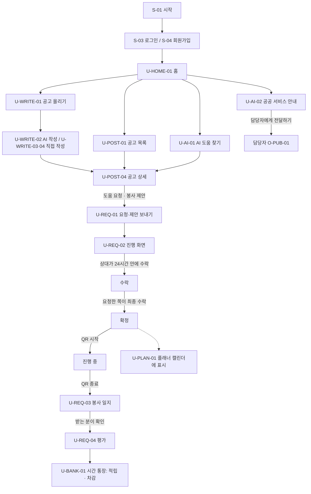
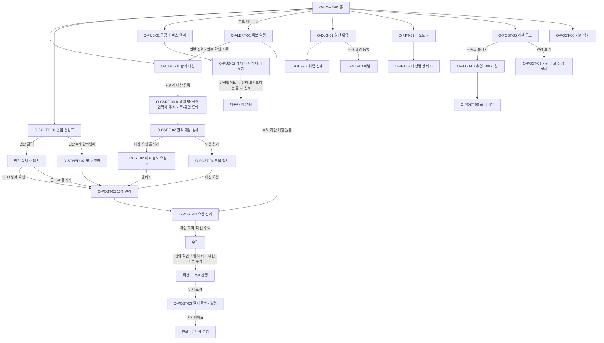
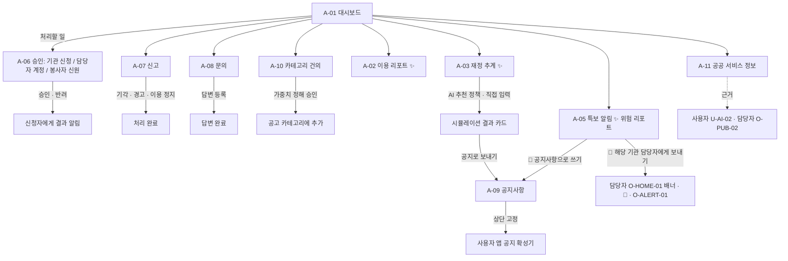

# 시간 적금 화면 기획서

| 항목 | 내용 |
| --- | --- |
| 기준일 | 2026-11-13 |
| 기준 커밋 | `c68c72e 2026-11-13 대표 화면 지시 정리와 담당자·운영자 PC 프로토타입 추가` (작업 폴더에는 커밋 전 변경이 있음: `home.jsx`, `Frame.jsx`, `main.jsx`, `styles/u1113.css`, 서버 관심 공고 `PostBookmark`) |
| 주의 | **사용자 화면은 11/13 대표 지시 반영 중**입니다. 이 문서의 사용자 화면은 "지금 코드"가 아니라 대표 지시와 사용자 프로토타입 기준의 **목표 모습**입니다. |
| 범위 | 사용자(모바일) · 기관 담당자(PC) · 운영자(PC) 전체 화면 |
| 근거 | `docs/specs/2026-11-13-대표-화면-지시.md`, `docs/specs/화면명세서-기관담당자·운영자-2026-11-13.md`, `docs/prototypes/proto-2026-11-13-사용자.html`(파일 끝 "11/13 수정" 묶음), `docs/prototypes/proto-2026-11-13-기관운영자-PC-4.html`(최신), `docs/design/contract.md` 7.19 절, `docs/requirements/기능명세서.txt`(73개), 지금 코드(`frontend/src`) |
| 함께 볼 문서 | `docs/산출물/컴포넌트-정의서.md` |
| Figma | 이 문서를 바탕으로 총괄이 따로 만듭니다(맨 끝 "Figma 프레임 목록" 참고) |

읽는 법: 화면 명세서와 PC 프로토타입(최신판)이 다르면 **프로토타입을 따르고** 차이를 "명세서와 다른 점"에 적었습니다. 담당자 화면마다 "지금 구현과의 차이" 칸이 있습니다.

---

## 1. 개요

### 1-1. 반응형 원칙
| 액터 | 기준 기기 | 원칙 |
| --- | --- | --- |
| 사용자 | 모바일 (폭 390 기준) | PC에서 열어도 **모바일 모양 그대로** 가운데에 보입니다. 지금 코드는 `#app` 최대 폭 430~600px. 프로토타입은 1024px 이상에서 왼쪽 위에 로고를 더하고 아래 탭을 계속 보여 줍니다. |
| 기관 담당자 | PC 1280px 이상 | 왼쪽 메뉴 220px + 본문. 900px 아래에서는 메뉴가 위로 올라가고 두 칸 화면이 한 칸이 됩니다. |
| 운영자 | PC 1280px 이상 | 담당자와 같은 틀, 색만 다름 |

### 1-2. 색
PC 프로토타입(`proto-…-PC-4.html`의 `:root`) 값입니다.

| 이름 | 값 | 쓰는 곳 |
| --- | --- | --- |
| 브랜드 파랑 `--brand` | `#5B8DEF` (연한 배경 `#EEF3FF`) | 사용자 기본 |
| 봉사하기 초록 `--give` | `#6DB3A0` (연한 `#E9F6F1`) | 사용자 봉사하기 모드, 그래프의 공급·봉사 |
| 봉사받기 `--recv` | PC 프로토타입 `#6F9CF0`(연한 `#E8F0FE`) / 지금 사용자 코드 `#EE9A7E`(연한 `#FDF0EA`) | 사용자 도움 받기 모드. **두 값이 다릅니다 → 회의에서 정할 것** |
| 담당자 초록 `--org` | `#4FAE96` (연한 `#E6F4F0`) | 담당자 화면의 강조색(`--acc`) |
| 운영자 주황 `--admin` | `#E0A23E` (연한 `#FCF3E3`) | 운영자 화면의 강조색(`--acc`) |
| 빨강 `--red` | `#E5655B` (연한 `#FDECEA`) | 빈칸, 우선, 특보, 위험 |
| 노랑 `--amber` | `#D9962B` (연한 `#FCF3E3`) | 주의, 대기 |
| AI 보라 | 제목 `#5B48C8`, 버튼 `#6B57D6`, 카드 배경 `#F3F0FF → #EEF3FF`, 테두리 `#E2DCFB` | 모든 ✨ AI 카드·버튼 |
| 글자 | `--ink #1B1D22`, `--sub #5F6672`, `--mute #9AA1AC` | 본문 / 보조 / 흐린 글 |
| 바탕 | `--fill #F6F7F9`, `--line #F0F1F4`, 왼쪽 메뉴 `#1F232B` | 본문 배경 / 선 / PC 메뉴 |

지금 코드의 담당자 색은 파랑 `#3A6FD8`, 운영자는 검정 `#1B1D22`(`ui/Frame.jsx`의 `ROLES`)입니다. PC 화면을 만들 때 위 값으로 바꿉니다.

### 1-3. 공통 레이아웃
| 영역 | 사용자 (모바일) | 기관 담당자 (PC) | 운영자 (PC) |
| --- | --- | --- | --- |
| 위 | 헤더 56px: 제목, 봉사하기/봉사받기 토글, 🔔 알림. 그 아래 공지 확성기 띠(탭 첫 화면에서만) | 상단 바 60px: 화면 제목, 화면 ID(시연용), 날짜 `2026.11.13 (금)`, 🔔 → O-HOME-02, 프로필 `박지현 ▾` → O-HOME-03 | 상단 바 60px: 화면 제목(+ A-02에서는 봉사하기/봉사받기 토글), 날짜 |
| 왼쪽 | 없음 | 메뉴 220px: 로고 `⏳ 시간 적금` + `행복요양원 · 기관 담당자` / [돌봄] 🏠 홈 · ❄️ 특보 알림 · 👥 관리 대상 · 🗓 돌봄 편성표 · 📋 요청 관리 · 🏛 공공 서비스 연계 / [기관 공고] 📣 기관 공고 · 🎪 기관 행사 / [관리] 🔑 권한 위임 · 📈 리포트 / ↩ 로그아웃 | 메뉴 220px: 로고 + `운영자 · 김운영` / [운영] 📊 대시보드 · 📈 이용 리포트 · 🔮 재정 추계·시뮬레이션 · ❄️ 특보 알림 / [관리] ✅ 승인 · 🚩 신고 · 💬 문의 · 📢 공지사항 · 🏷 카테고리 건의 · 🏛 공공 서비스 정보 / ↩ 로그아웃 |
| 본문 | 좌우 16~20px 여백, 세로 스크롤 | 회색 바탕, 여백 24×28px, 카드 간격 16px | 같음 |
| 아래 | 탭 5개: 홈 · 공고 · 시간 통장 · 플래너 · 마이 (11/13 지시 순서) | 없음 | 없음 |
| 겹쳐 뜨는 것 | 바텀시트, 토스트(아래 가운데) | (패널) 오른쪽 480px, (창) 가운데 820px, 알림 드롭다운 420px, 토스트 | 같음 |

### 1-4. PC 화면 원칙 (담당자·운영자)
| 원칙 | 설명 | 쓰는 화면 |
| --- | --- | --- |
| 목록 + 상세 한 화면 | 왼쪽 목록(340px)에서 고르면 오른쪽 상세가 바뀜. 화면을 넘기지 않음 | 관리 대상, 요청 관리, 공공 서비스 연계, 권한 위임, 리포트, 특보 알림, 승인, 신고, 문의 |
| 작은 일은 그 자리에서 | 수락·거절·상태 변경은 표 안이나 상세 버튼으로 끝냄 | 홈, 요청 관리, 공공 서비스 연계 |
| 입력은 오른쪽 패널 | 등록·수정은 오른쪽에서 밀려 나오는 패널. 뒤 화면이 그대로 보임 | 관리 대상 등록, 기관 공고 쓰기, 새 위임, 담당자 정보, 공공 서비스 정보 |
| 고르기는 가운데 창 | 여러 개 중 고르거나 한꺼번에 처리 | 공고 유형 고르기, 빈칸 한꺼번에 올리기 |
| AI 결과 카드 | 보라색 카드: `✨ 제목` + 내용 + `근거 · …` 한 줄 | 모든 ✨ 화면 |

### 1-5. 표기 규칙
| 표기 | 뜻 |
| --- | --- |
| ✨ | AI(LLM)를 쓰는 기능 |
| `[버튼]` | 누르는 버튼 |
| → | 이동하는 화면 |
| (패널) | 오른쪽에서 열리는 입력 창 |
| (창) | 가운데 창 |
| (시트) | 모바일에서 아래에서 올라오는 창 |
| 화면 ID | 사용자 `U-…`·시작 `S-…`, 담당자 `O-…`, 운영자 `A-…`. 기능 ID(`C-01`, `U-01`, `O-01`, `A-01`…)와는 다른 번호입니다. 헷갈리지 않게 이 문서에서 기능 ID는 "기능 O-01"처럼 앞에 "기능"을 붙입니다. |

### 1-6. 상태 값
| 구분 | 화면 표시 | 서버 값(지금 코드) |
| --- | --- | --- |
| 요청·제안 | 요청 → 수락 → 확정 → 진행 중 → 일지 확인 → 완료 (거절·만료·취소) | `SENT` → `VOL_ACCEPTED` → `CONFIRMED` → `IN_PROGRESS`·`CHECKED_OUT` → `LOG_SUBMITTED` → `DONE` / `REJECTED`·`DECLINED`·`EXPIRED`·`CANCELLED`·`NOSHOW` |
| 기관 공고 신청 | 처리할 일(신청) → 확정 → 완료 (거절) | 없음(새로 필요). 단체 봉사만 `/group-posts`에 신청·받기·참석 확인이 있음 |
| 공공 서비스 연계 | 새 요청 → 연락함 → 신청 도움 중 → 완료 (대상이 아니에요) | `NEW` → `CONTACTED` → `HELPING` → `DONE` / `NOT_ELIGIBLE` |
| 권한 위임 | 확인 대기 → 위임 중 → 만료 임박(30일 전) → 해지·만료 | 없음(새로 필요) |
| 승인 | 대기 → 승인 / 반려 | `PENDING` → `APPROVED` / `REJECTED` |
| 신고 | 검토 중 → 처리 완료 (기각·경고·이용 정지) | 처리 `NONE`·`WARNING`·`SUSPEND`·`BAN` |
| 문의 | 미답변 → 답변 완료 | `RECEIVED`·`CHECKING`·`ANSWERED`·`CLOSED` |

---

## 2. 화면 목록

구현 상태: **구현됨** / **모바일 모양으로만 구현**(기능은 있으나 PC 모양이 아님) / **일부 구현** / **미구현**. 경로는 `frontend/src/App.jsx` 기준입니다.

### 2-1. 사용자 (모바일) — 48개
| 액터 | 메뉴 | 화면 ID | 화면 이름 | 형태 | 경로 | 관련 기능 ID | AI | 구현 상태 |
| --- | --- | --- | --- | --- | --- | --- | --- | --- |
| 공통 | 시작 | S-01 | 시작 | 전체 화면 | `/` | - |  | 구현됨 |
|  |  | S-02 | 온보딩·로그인 고르기 | 전체 화면 | `/login` | C-02 |  | 구현됨 |
|  |  | S-03 | 로그인 | 폼 | `/login/form` | C-02 |  | 구현됨 |
|  |  | S-04 | 회원가입 | 단계 폼 | `/signup` | C-01 |  | 구현됨 (담당 기관 칸은 미구현) |
|  |  | S-05 | 비밀번호 찾기 | 폼 | `/pw-reset` | C-02 |  | 구현됨 |
|  |  | S-06 | 기관 서비스 신청 | 폼 | `/org-apply` | C-03 |  | 구현됨 |
|  |  | S-07 | 담당자 계정 신청 | 폼 | `/manager-apply` | C-04 |  | 구현됨 |
| 사용자 | 홈 | U-HOME-01 | 홈 (도움 받기 / 봉사하기 두 모드) | 탭 첫 화면 | `/u/home` | U-01, U-21, U-26, U-31 | ✨ 홈 AI 검색(도움 받기) | 구현됨 · 11/13 지시 반영 중 |
|  |  | U-HOME-02 | 알림 | 목록 | `/notif` | C-05 |  | 구현됨 |
|  |  | U-HOME-03 | 공지 확성기 (헤더 아래 띠) | 띠 | 홈·공고·통장·플래너·마이 첫 화면 | C-08 |  | 반영 중 (`ui/Frame.jsx`, `styles/u1113.css`) |
|  |  | U-HOME-04 | 공지사항 목록·상세 | 목록 | `/notice`, `/notice/:id` | C-08 |  | 구현됨 |
|  | 공고 | U-POST-01 | 공고 · 1:1 공고 탭 | 탭 + 필터 + 카드 | `/board` | U-02 |  | 구현됨 · 11/13 지시 반영 중 |
|  |  | U-POST-02 | 공고 · 단체 봉사 탭 | 탭 + 필터 + 카드 | `/board?tab=group` | U-10 |  | 구현됨 · 카드 모양 반영 중 |
|  |  | U-POST-03 | 공고 · 동네 기관 소식 탭 | 탭 + 카드 | 지금은 `/news`(따로 화면) | U-31 |  | 일부 구현 (공고 탭 안으로 옮겨야 함) |
|  |  | U-POST-04 | 공고 상세 | 상세 | `/post/:id` | U-03, O-04 | ✨ 예상 적립 | 구현됨 · 순서 반영 중 |
|  |  | U-POST-05 | 단체 봉사 상세 | 상세 | `/group/:id` | U-10 |  | 구현됨 |
|  |  | U-POST-06 | 기관 소식 상세 | 상세 | `/news/:id`, `/news/class/:id` | U-31 |  | 구현됨 |
|  |  | U-POST-07 | 관심 공고 (☆) | 공고 탭 위쪽 묶음 | `/board` 안 | U-02 |  | 반영 중 (서버 `PostBookmark` 추가 중) |
|  | 공고 작성 | U-WRITE-01 | 공고 올리기 (고르기) | 선택 | `/write` | U-04, U-05, U-06, U-08 |  | 구현됨 · 가족 대신 올리기 옮기는 중 |
|  |  | U-WRITE-02 | AI 공고 작성 (도움 요청) | 대화 | `/write/need` | U-04 | ✨ | 구현됨 |
|  |  | U-WRITE-03 | 직접 공고 작성 (도움 요청) | 폼 | `/write/need/manual` | U-05, U-07 |  | 구현됨 |
|  |  | U-WRITE-04 | 도움 가능 공고 작성 | 폼 | `/write/offer` | U-05 |  | 구현됨 |
|  |  | U-WRITE-05 | 공고 수정 | 폼 | `/post/:id/edit` | U-05 |  | 구현됨 |
|  |  | U-WRITE-06 | 단체 봉사 공고 올리기 | 폼 | `/group/new` | U-11 |  | 구현됨 |
|  |  | U-WRITE-07 | 정기 요청 목록·등록 | 목록 + 폼 | `/recurring`, `/recurring/new` | U-09 |  | 구현됨 |
|  |  | U-WRITE-08 | 말로 요청 | 대화(음성) | `/voice` | U-04 | ✨ | 구현됨 |
|  |  | U-WRITE-09 | 빈 시간 묶음 추천 | 폼 + 결과 | `/bundle` | U-12 | ✨ | 구현됨 |
|  | 요청·진행 | U-REQ-01 | 요청·제안 보내기 | 폼 | `/req/new` | U-13 |  | 구현됨 |
|  |  | U-REQ-02 | 진행 화면 (요청 상세, QR, 메시지) | 상세 | `/req/:id` | U-14, U-15 | ✨ 방문 전 브리핑, 메시지 도우미 | 구현됨 · 완료 뒤 봉사일지 칸 반영 중 |
|  |  | U-REQ-03 | 봉사 일지 쓰기 | 폼 | `/req/:id/log` | U-16, U-17 | ✨ 일지 다듬기 | 구현됨 |
|  |  | U-REQ-04 | 평가 | 폼 | `/req/:id/rate` | U-18 |  | 구현됨 |
|  |  | U-REQ-05 | 단골에게 요청 | 목록 + 폼 | `/regular` | U-19, U-20 |  | 구현됨 |
|  | 시간 통장 | U-BANK-01 | 시간 통장 | 탭 첫 화면 | `/bank` | U-21, U-22 |  | 구현됨 · 11/13 지시 반영 중 |
|  |  | U-BANK-02 | 거래 상세 (영수증) | (시트) | `/bank` 안 | U-22 |  | 미구현 (프로토타입에만) |
|  |  | U-BANK-03 | 가족에게 선물 | 폼 | `/gift` | U-23 |  | 구현됨 |
|  |  | U-BANK-04 | 시간 플랜 · 월별 리포트 | 상세 | `/bank/time-plan`, `/bank/report`, `/bank/plan` | U-24, U-25 | ✨ | 구현됨 |
|  | 플래너 | U-PLAN-01 | 시간 플래너 (생애 플랜 → 캘린더 → AI 추천) | 세 탭 | `/planner` | U-24, U-26, U-27, U-28 | ✨ | 구현됨 · 순서 반영 중 |
|  | AI 안내 | U-AI-01 | AI 도움 찾기 | 대화 | `/recommend` | U-27 | ✨ | 구현됨 |
|  |  | U-AI-02 | 공공 서비스 안내 AI | 대화 | `/public` | U-30 | ✨ | 구현됨 |
|  |  | U-AI-03 | 전달한 공공 서비스 요청 | 목록 | `/public-referrals` | U-30 |  | 구현됨 |
|  |  | U-AI-04 | 물어보기 (음성 비서) | 대화 | `/ask` | - | ✨ | 구현됨 |
|  | 마이 | U-MY-01 | 마이 | 탭 첫 화면 | `/my` | U-32~U-35 |  | 구현됨 · 메뉴 빼는 중 |
|  |  | U-MY-02 | 프로필 관리 | 폼 | `/my/profile` | U-32 |  | 구현됨 |
|  |  | U-MY-03 | 봉사 인증 · 첫 활동 교육 | 목록 + 교육 | `/my/verify`, `/edu`, `/edu/card`, `/edu/quiz`, `/edu/rp/:id` | U-34 | ✨ 역할극 | 구현됨 |
|  |  | U-MY-04 | 가족 연결 | 목록 + 폼 | `/my/family` | U-33 |  | 구현됨 |
|  |  | U-MY-05 | 내 활동 내역 | 목록 | `/act` | U-29 |  | 구현됨 |
|  |  | U-MY-06 | 봉사 확인서 | 폼 + PDF | `/my/cert` | U-35 |  | 구현됨 |
|  |  | U-MY-07 | 담당 기관 · 권한 위임 | 상세 + 폼 | 미구현 | (새 기능) |  | 미구현 (프로토타입 `myOrg`) |

표에 넣지 않은 보조 화면(구현됨): 알림 설정 `/my/noti`, 관심 공고 알림 `/my/alerts`, 내 정보 수정 `/my/info`, 회원 탈퇴 `/my/withdraw`, 카테고리 건의 `/my/suggest`, 문의·신고 `/qna`·`/qna/new`. 11/13 지시로 **빼는 화면**: 가족 최근 기록 `/my/family/:userId/report`, 내 리포트 공유(`/my/report`의 공유 스위치).

### 2-2. 기관 담당자 (PC) — 25개
| 액터 | 메뉴 | 화면 ID | 화면 이름 | 형태 | 경로(지금 코드) | 관련 기능 ID | AI | 구현 상태 |
| --- | --- | --- | --- | --- | --- | --- | --- | --- |
| 기관 담당자 | 홈 | O-HOME-01 | 홈 | 대시보드 | `/o/home` | O-02, O-05, O-08, O-10, O-11 | ✨ 안부 Top 3 | 모바일 모양으로만 구현 |
|  |  | O-HOME-02 | 알림 | 드롭다운 | `/notif` (따로 화면) | C-05 |  | 모바일 모양으로만 구현 |
|  |  | O-HOME-03 | 담당자 정보 | (패널) | `/o/my` (따로 화면) | C-06, C-08 |  | 모바일 모양으로만 구현 |
|  | 특보 알림 | O-ALERT-01 | 특보 알림 (기상 특보 / 운영자 안내) | 두 탭, 목록 + 상세 | `/o/weather` | A-08, A-09 받는 쪽 | ✨ 권하는 조치 | 모바일 모양으로만 구현 |
|  | 관리 대상 | O-CARE-01 | 관리 대상 | 목록 + 상세 | `/o/elders` | O-02 |  | 모바일 모양으로만 구현 |
|  |  | O-CARE-02 | 관리 대상 상세 | 오른쪽 상세 | `/o/elders/:id` | O-02 |  | 모바일 모양으로만 구현 (연락처·위임 칸 없음) |
|  |  | O-CARE-03 | 관리 대상 등록·수정 | (패널) | `/o/elders/new`, `/o/elders/:id/edit` | O-01 |  | 모바일 모양으로만 구현 (실명·연락처·주소·위임 칸 없음) |
|  | 돌봄 편성표 | O-SCHED-01 | 돌봄 편성표 | 표 + 오른쪽 패널 | `/o/schedule` | O-11, O-12 | ✨ 빈칸 대안 | 모바일 모양으로만 구현 |
|  |  | O-SCHED-02 | 빈칸 한꺼번에 올리기 | (창) | `/o/schedule` 안 시트 | O-13 | ✨ 공고 초안 | 모바일 모양으로만 구현 |
|  | 요청 관리 | O-POST-01 | 요청 관리 (관리 대상 요청 / 기관 공고 신청) | 두 탭, 목록 + 상세 | `/o/reqs` | O-05, O-08 |  | 모바일 모양으로만 구현 (기관 공고 신청 탭 없음) |
|  |  | O-POST-02 | 대리 봉사 요청 | 두 칸 | `/write/need?elder=`, `/write/need/manual?elder=`, `/o/memo-posts`, `/voice?elder=` | O-03, O-04 | ✨ 공고 정리 | 모바일 모양으로만 구현 |
|  |  | O-POST-03 | 관리 대상 요청 상세 | 오른쪽 상세 | `/o/reqs/:id` | O-05, O-08 |  | 모바일 모양으로만 구현 |
|  |  | O-POST-04 | 도움 찾기 | 필터 + 카드 | `/board?elder=` | O-06 |  | 모바일 모양으로만 구현 |
|  |  | O-POST-09 | 기관 공고 신청 상세 | 오른쪽 상세 | 미구현 (단체 봉사만 `/group/:id`) | O-07 |  | 미구현 |
|  | 공공 서비스 연계 | O-PUB-01 | 공공 서비스 연계 | 목록 + 상세 | `/o/public` | U-30 받는 쪽 |  | 모바일 모양으로만 구현 |
|  |  | O-PUB-02 | 공공 서비스 요청 상세 | 오른쪽 상세 | `/o/public` 안 펼침 | U-30 받는 쪽 | ✨ 자격 미리 보기 | 모바일 모양으로만 구현 (자격 미리 보기 없음) |
|  | 기관 공고 | O-POST-05 | 기관 공고 | 카드 목록 | `/board?tab=group&kind=mine` (단체 봉사만) | O-07 |  | 일부 구현 (단체 봉사만, 모바일 모양) |
|  |  | O-POST-07 | 공고 유형 고르기 | (창) | 미구현 | O-07 |  | 미구현 |
|  |  | O-POST-08 | 기관 공고 쓰기 | (패널) | `/group/new` (단체 봉사만) | O-07 | ✨ 문장 다듬기 | 일부 구현 (단체 봉사만, 모바일 모양) |
|  | 기관 행사 | O-POST-06 | 기관 행사 | 목록 + 폼 | `/o/events`, `/o/events/new` | O-09 |  | 모바일 모양으로만 구현 |
|  | 권한 위임 | O-DLG-01 | 권한 위임 (위임 목록 / 받은 요청 / 담당자 간 위임) | 세 탭 | 미구현 (이관만 `/o/elders` 안) | (새 기능) |  | 미구현 |
|  |  | O-DLG-02 | 위임 상세 | 오른쪽 상세 | 미구현 | (새 기능) |  | 미구현 |
|  |  | O-DLG-03 | 새 위임 등록 | (패널) | 미구현 | (새 기능) |  | 미구현 |
|  | 리포트 | O-RPT-01 | 관리 대상 리포트 | 목록 + 상세 | `/o/report` | O-10 | ✨ 주간 요약, 안부 순서 | 모바일 모양으로만 구현 |
|  |  | O-RPT-02 | 대상별 리포트 상세 | 오른쪽 상세 | `/o/report?elder=` | O-10 | ✨ 동향 요약, 추천 조치 | 모바일 모양으로만 구현 |

### 2-3. 운영자 (PC) — 10개
| 액터 | 메뉴 | 화면 ID | 화면 이름 | 형태 | 경로(지금 코드) | 관련 기능 ID | AI | 구현 상태 |
| --- | --- | --- | --- | --- | --- | --- | --- | --- |
| 운영자 | 운영 | A-01 | 대시보드 | 대시보드 | `/a/dash` | A-01 | ✨ 한 줄 요약 | 모바일 모양으로만 구현 (상단 네 칸은 7.19대로 반영됨) |
|  |  | A-02 | 이용 리포트 | 다섯 탭 + 토글 | `/a/stats` | A-02, A-03, A-04 | ✨ 탭별 해석 | 모바일 모양으로만 구현 (봉사하기/봉사받기 토글은 `by-type` API로 반영됨) |
|  |  | A-03 | 재정 추계 · 정책 시뮬레이션 | 한 화면 | `/a/forecast`, `/a/sim`, `/a/recruit` (세 화면으로 나뉨) | A-05, A-06, A-07 | ✨ 요약, 정책 추천, 시뮬레이션 | 모바일 모양으로만 구현 |
|  |  | A-05 | 특보 알림 | 두 칸 | `/a/weather` | A-08, A-09 | ✨ 위험 리포트 | 모바일 모양으로만 구현 |
|  | 관리 | A-06 | 승인 | 세 탭, 표 + 상세 | `/a/approve`, `/a/mgr-apps`, `/a/managers` | A-10, A-11, A-12 |  | 모바일 모양으로만 구현 |
|  |  | A-07 | 신고 | 표 + 상세 | `/a/safety` | A-13 | (지금 코드에 ✨ 신고 정리) | 모바일 모양으로만 구현 |
|  |  | A-08 | 문의 | 표 + 답변 | `/a/inquiries` | A-14 | (지금 코드에 ✨ 답변 초안) | 모바일 모양으로만 구현 |
|  |  | A-09 | 공지사항 | 표 + 폼 | `/a/notices` | A-16 | ✨ 문장 다듬기 | 모바일 모양으로만 구현 (AI 다듬기·특보로 쓰기 없음) |
|  |  | A-10 | 카테고리 건의 | 표 | `/a/suggest` | A-15 |  | 모바일 모양으로만 구현 |
|  |  | A-11 | 공공 서비스 정보 | 표 + 패널 | `/a/pub` | A-17 | (AI 근거 데이터) | 모바일 모양으로만 구현 |

지금 코드에만 있고 PC 프로토타입·명세서에 없는 운영자 화면: 회원 관리 `/a/members`, 관리 메뉴 `/a/manage`, 봉사 인증 항목 `/a/verify`, 역할극 상대 `/a/persona`, 기관 클래스 `/a/classes`. PC 메뉴에 넣을지 회의에서 정합니다.

### 2-4. 화면 수 요약
| 액터 | 전체 | 구현됨 | 모바일 모양으로만 구현 | 일부 구현·반영 중 | 미구현 |
| --- | --- | --- | --- | --- | --- |
| 사용자·시작 | 48 | 43 | - | 3 (U-HOME-03, U-POST-03, U-POST-07) | 2 (U-BANK-02, U-MY-07) |
| 기관 담당자 | 25 | 0 | 18 | 2 (O-POST-05, O-POST-08) | 5 (O-POST-07, O-POST-09, O-DLG-01, O-DLG-02, O-DLG-03) |
| 운영자 | 10 | 0 | 10 | 0 | 0 |
| 합계 | 83 | 43 | 28 | 5 | 7 |

- 사용자 "구현됨" 43개 가운데 홈·공고·공고 상세·공고 올리기·진행 화면·시간 통장·플래너·마이는 11/13 지시를 반영하는 중이라 화면 모양이 바뀌고 있습니다.
- 담당자 "모바일 모양으로만 구현" 18개: O-HOME-01~03, O-ALERT-01, O-CARE-01~03, O-SCHED-01~02, O-POST-01~04, O-PUB-01~02, O-POST-06, O-RPT-01~02. 기능은 대부분 돌아가지만 PC 배치(왼쪽 메뉴, 목록 + 상세, 패널)가 아니고, 화면마다 빠진 칸이 있습니다(4장의 "지금 구현과의 차이").

---

## 3. 화면 흐름

### 3-1. 사용자
메뉴 구조: 홈 · 공고(1:1 / 단체 봉사 / 동네 기관 소식) · 시간 통장 · 플래너(생애 플랜 / 캘린더 / AI 추천) · 마이. 헤더의 봉사하기/봉사받기 토글이 홈·공고·플래너·활동 내역을 그 모드로 바꿉니다.

### 3-2. 기관 담당자

### 3-3. 운영자

---

## 4. 화면별 상세 — 기관 담당자 (전부)

기준: PC 프로토타입 최신판(`proto-2026-11-13-기관운영자-PC-4.html`, `?s=화면ID`로 열기). 시연 데이터의 기관은 "행복요양원", 담당자는 "박지현(사회복지사)", 관리 대상은 5명(이순례 82·정말순 85·한영자 77·오덕수 88·김영자 72)입니다.

### O-HOME-01 홈
| 항목 | 내용 |
| --- | --- |
| 목적 | 오늘 처리할 일과 챙길 분을 한눈에 보고 그 자리에서 처리 |
| 진입 | 로그인 직후, 왼쪽 메뉴 🏠 홈 |
| 관련 API | `/org/home`, `/org/elders`, `/org/requests?box=all`, `/org/schedule`, `/org/change-report`, `/org/briefing`, `/org/weather`, `/org/public-referrals` |
| 관련 기능 ID | 기능 O-02, O-05, O-08, O-10, O-11, O-12 |

| 영역 | 구성 요소 | 표시 내용·규칙 | 동작 |
| --- | --- | --- | --- |
| 맨 위 | 특보 배너 (빨간 띠) | `❄️ 기상 특보 · 한파주의보 11/12~14 행복구 전역` + `📨 운영자 안내: 혼자 사는 관리 대상 3분께 안부 전화를 권해요. 동행 일정은 실내 대기로 바꿔 주세요.` 진행 중이고 우리 지역인 특보가 있을 때만 | `[기상 특보]` → O-ALERT-01(기상 특보 탭) · `[운영자 안내]` → O-ALERT-01(운영자 안내 탭) · `[혼자 사는 분 보기]` → O-CARE-01("혼자 사는 분" 필터) · `[닫기]` |
| KPI 4칸 | 관리 대상 / 이번 주 돌봄 / 처리할 일 / 편성 빈칸 | `5명 · 우선순위 높음 2명` / `9건 · 완료 7건 · 예정 2건` / `3건 · 대신 수락 · 일지 확인` / `3개 · ✨ 대안 있음 2개` | 카드 클릭 → O-CARE-01 / O-SCHED-01 / O-POST-01 / O-SCHED-01 |
| 왼쪽 (넓게 1.6) | 오늘 처리할 일 표 | 열: 관리 대상 · 내용(카테고리 + 할 일 한 줄) · 봉사자 · 일시 · 버튼. 대상: 상태가 요청·수락·일지 확인인 건. 할 일 문구: `봉사 제안 도착` / `봉사자 수락 · 대신 최종 수락 필요` / `일지 도착 · 확인 필요`. 머리에 `요청 관리 ›` | 제안 도착: `[대신 거절]` `[대신 수락]`(표 안에서 끝남) · 봉사자 수락: `[전화 확인 후 수락]` → O-POST-03 · 일지: `[일지 확인]` → O-POST-03 |
| 왼쪽 | 이번 주 편성 (작은 표) | 행: 관리 대상 × 오전·오후, 열: 월~금. 채워진 칸은 카테고리만, 빈칸은 빨간 점 + 카테고리. 머리에 `편성표 열기 ›` | 빈칸 클릭 → O-SCHED-01 |
| 오른쪽 (1) | ✨ 먼저 안부를 물어볼 분 | 순위 1~3, 이름·나이, 이유 한 줄(예: `일지에 "식사를 거르셨다" 2회 · 활동 3회 → 1회`). 근거 · `최근 4주 일지 12건 · 요청·취소 기록` | 행 클릭 → O-RPT-02 |
| 오른쪽 | 새로 온 요청 | 네 줄, 줄마다 아이콘 · 이름 · 한 줄 요약 · 건수 배지(빨강): ❄️ 특보 알림 / 🏛 공공 서비스 연계 / 📣 기관 공고 신청 / 🔑 권한 위임 요청 | → O-ALERT-01 / O-PUB-01 / O-POST-09 / O-DLG-01(받은 요청 탭) |
| 오른쪽 | 최근 도착한 일지 | 이름, 날짜·도움, 일지 한 문장(따옴표) | 클릭 → O-POST-03 |

| 상태 | 화면 |
| --- | --- |
| 처리할 일 없음 | 표 안에 `오늘 할 일을 다 처리했어요` |
| 특보 없음 / 닫음 | 배너를 그리지 않음 |
| 관리 대상 0명 | KPI는 0, 표·편성표 자리에 "관리 대상을 먼저 등록해 주세요" + `[+ 관리 대상 등록]` (프로토타입에 없음 — 제안) |
| 권한 없음 | 담당자 계정이 아니면 자기 역할의 홈으로 돌려보냄(`App.jsx`의 `Guard`) |

**명세서와 다른 점**: 배너 버튼이 2개 → 4개(`[기상 특보]` `[운영자 안내]` 추가). "새로 온 요청"에 **특보 알림** 줄이 더해져 세 줄 → 네 줄.

**지금 구현과의 차이** (`screens/org.jsx`의 `OHome`, 모바일 한 줄 배치)
| 구분 | 내용 |
| --- | --- |
| 있는 것 | 특보 배너(`WeatherBanner`: `[닫기]` `[특보 알림 보기]` 두 버튼), 처리할 일 목록(`todo` 줄 → 상세로 이동), 살펴볼 대상 3명(`/org/change-report`), 이번 주 브리핑(`OrgBriefing`), 특보·공공 서비스 진입 줄 |
| 없는 것 | KPI 4칸(지금은 파란 통장 모양 카드에 담당 대상·이번 달 활동·처리할 일·진행 중), 표 안에서 바로 `[대신 거절]` `[대신 수락]`, 작은 편성표, "새로 온 요청" 네 줄, "최근 도착한 일지" |
| 프로토타입에 없는데 코드에 있는 것 | 빠른 메뉴 네 칸(대상 등록·공고 대신 등록·봉사 공고 찾기·단골에게 요청), 말로 공고 만들기, 통화 메모로 여러 건 만들기, 기관 소식·단체 봉사 진입 줄 → PC에서는 왼쪽 메뉴와 각 화면 버튼으로 옮김 |
| 서버에 새로 필요한 것 | ① 이번 주 돌봄 수(완료·예정)와 편성 빈칸 수를 한 번에 주는 값(지금은 `/org/schedule`의 `counts`에서 따로 계산), ② "우선순위 높음" 수(관리 대상에 우선순위 칸이 없음), ③ 기관 공고 신청 수·권한 위임 요청 수, ④ 최근 도착한 일지 목록(지금은 요청 목록에서 걸러 써야 함) |

### O-HOME-02 알림 (드롭다운)
| 항목 | 내용 |
| --- | --- |
| 목적 | 새 알림을 보고 관련 화면으로 바로 이동 |
| 진입 | 상단 바 🔔 (안 읽은 알림이 있으면 빨간 점) |
| 관련 API | `/notifications`, `/notifications/unread-count`, `/notifications/{id}/read`(읽음), `/notifications/read-all` |
| 관련 기능 ID | 기능 C-05 |

| 영역 | 구성 요소 | 표시 내용·규칙 | 동작 |
| --- | --- | --- | --- |
| 위 | 제목 줄 | `알림` · `모두 읽음` | `모두 읽음` → 토스트 `모두 읽었어요` |
| 목록 | 알림 행 | 둥근 아이콘, 내용(안 읽음은 굵게), 시간, 안 읽음 빨간 점. 종류와 가는 곳: 🙋 제안 도착 → O-POST-03 · ✅ 봉사자 수락 → O-POST-03 · 📝 일지 도착 → O-POST-03 · ❄️ `[기상 특보] 한파주의보 · 행복구 전역 (11/12~14)` → O-ALERT-01(기상 특보) · 📨 `[운영자 안내] 한파주의보 대비 안내가 왔어요` → O-ALERT-01(운영자 안내) · 👤 `담당자 계정이 승인됐어요` → O-HOME-03. 명세서의 "공공 서비스 요청", "위임 요청"도 같은 형식 | 행 클릭 → 관련 화면 |
| 바깥 | 흐린 배경 | 드롭다운 폭 420px, 상단 바 아래 오른쪽 | 바깥 클릭 → 닫힘 |

상태: 알림 없음 → `새 알림이 없어요`(제안).

**지금 구현과의 차이**: 알림은 따로 화면 `/notif`(`common.jsx`의 `Notif`)로 구현돼 있고 읽음 처리·이동(`goLink`)이 됩니다. 드롭다운 모양만 새로 만들면 됩니다. 알림 종류에 "권한 위임 요청", "기관 공고 신청"은 그 기능이 생길 때 서버에서 추가해야 합니다.

### O-HOME-03 담당자 정보 (패널)
| 항목 | 내용 |
| --- | --- |
| 목적 | 내 정보·소속 기관 확인, 알림 켜기·끄기, 로그아웃 |
| 진입 | 상단 바 프로필 `박지현 ▾` |
| 관련 API | `/me`, `/me/noti-settings`, `/me/password`, `/auth/logout`, `/notices` |
| 관련 기능 ID | 기능 C-02, C-06, C-08 |

| 영역 | 구성 요소 | 표시 내용·규칙 | 동작 |
| --- | --- | --- | --- |
| 프로필 | 담당자 | 큰 아바타, 이름 `박지현`, `사회복지사 · 010-****-1234`(가운데 가림) | - |
| 소속 | 기관 정보 카드 | 소속 기관 `행복요양원` / 기관 종류 `요양원` / 주소 `서울 행복구 행복동` / 승인일 `2026.10.02` | - |
| 설정 | 알림 스위치 3개 | `새 제안·수락 알림` / `일지 도착 알림` / `운영자 특보` | 켜기·끄기(바로 저장) |
| 기타 | 메뉴 | `공지사항 ›` / `비밀번호 변경 ›` | 각 화면(또는 패널)으로 |
| 아래 | 버튼 | `[로그아웃]` | 로그아웃 → 시작 화면 |

**지금 구현과의 차이** (`org.jsx`의 `OMy`, 탭 화면)
| 구분 | 내용 |
| --- | --- |
| 있는 것 | 이름·소속 기관, 알림 설정(`/my/noti`), 공지사항, 내 정보 수정·비밀번호 변경(`/my/info`), 로그아웃, 큰 글씨, 문의·신고 내역, 카테고리 건의, 회원 탈퇴 |
| 없는 것 | 패널 모양, 직무·가린 연락처·기관 종류·주소·승인일 표시, "운영자 특보" 알림 스위치 |
| 서버에 새로 필요한 것 | `/me`에 직무, 기관 종류·주소·승인일이 오는지 확인 필요(지금 화면은 `orgName`만 씀). 알림 종류에 "운영자 특보" 추가 |

### O-ALERT-01 특보 알림
| 항목 | 내용 |
| --- | --- |
| 목적 | 기상 특보와 운영자가 보낸 안내를 한곳에서 보고, 혼자 사는 분께 안부 전화를 하고 기록 |
| 진입 | 왼쪽 메뉴 ❄️ 특보 알림, 홈 배너 버튼, 🔔 알림, 홈 "새로 온 요청" |
| 탭 | `[기상 특보 n | 운영자 안내 n]` (n = 우리 지역 특보 수 / 아직 "확인했어요"를 안 누른 진행 중 안내 수) |
| 관련 API | `/org/weather` → `{alerts[], past[], guides[], banner, myElderTotal}` (계약서 7.19) |
| 관련 기능 ID | 기능 A-08, A-09의 받는 쪽 |

**기상 특보 탭**
| 영역 | 구성 요소 | 표시 내용·규칙 | 동작 |
| --- | --- | --- | --- |
| 왼쪽 (340px) | 기상청 특보 목록 | 머리 `기상청 특보 · 기상청 API`. 행: 아이콘(❄️ 💨 ☀️), 종류, 배지 `우리 지역`(빨강) / `다른 지역`, 지역 · 기간 | 행 클릭 → 오른쪽 바뀜 |
| 왼쪽 아래 | 안내 | `우리 기관(행복구 행복동)이 있는 지역의 특보가 오면 홈 상단에도 보여요.` | - |
| 오른쪽 위 | 특보 머리 (우리 지역이면 빨간 띠) | `한파주의보 · 행복구 전역` / `기상청 · 11/12 ~ 11/14 · 11/12 06:00 발표` / 본문 한 단락 | - |
| 오른쪽 | KPI 3칸 (우리 지역만) | 혼자 사는 관리 대상 `n명` / 안부 확인 완료 `n / n명` / 특보 기간 예정 돌봄 `n건` | - |
| 오른쪽 | 📨 이 특보에 대한 운영자 안내 | 안내 요약 한 단락 | `[안내 보기 ›]` → 운영자 안내 탭 |
| 오른쪽 (다른 지역) | 안내 | `우리 기관 지역이 아니라서 따로 할 일은 없어요.` | - |

**운영자 안내 탭**
| 영역 | 구성 요소 | 표시 내용·규칙 | 동작 |
| --- | --- | --- | --- |
| 왼쪽 | 운영자가 보낸 안내 목록 | 행: 아이콘, `한파주의보 안내`, 배지 `진행 중`(빨강) / `종료`, 안 읽음 빨간 점, 지역 · 기간 · 도착 시각 | 행 클릭 |
| 왼쪽 아래 | 안내 | `운영자가 특보를 보고 담당자에게 "이렇게 대비해 주세요" 하고 보낸 안내예요.` | - |
| 오른쪽 위 | 안내 머리 | `📨 [운영자 안내] 한파주의보 · 행복구 전역` / `운영자 김운영 · 11/12 ~ 11/14 · 오늘 08:10 도착` / 안내 본문 | `[확인했어요]` → `✓ 확인했어요` (탭 숫자와 빨간 점이 줄어듦) |
| 오른쪽 | KPI 3칸 | 기상 특보 탭과 같음 | - |
| 오른쪽 | 📞 먼저 안부 전화 드릴 분 (혼자 사는 분) 표 | 열: 관리 대상(이름·나이·동 + 방문 주의사항) · 우선 배지 · 마지막 안부 · 버튼. 머리에 `관리 대상에서 보기 ›` | `[📞 전화]` `[📞 가족]` 전화 걸기 · `[안부 확인 기록]` → `✓ 안부 확인함`, 마지막 안부가 `오늘 (11/13)`로 · `관리 대상에서 보기 ›` → O-CARE-01("혼자 사는 분") |
| 오른쪽 | ✨ 운영자가 권하는 조치 | 네 줄(아이콘 · 제목 · 설명): 📞 혼자 사는 관리 대상께 안부 전화 / 🏠 동행 일정은 실내 대기로 바꾸기 / 🛒 장보기는 오후 시간으로 옮기기 / 🏛 난방비 지원 공공 서비스 안내. 근거 · `기상청 특보 · 관리 대상 가구 형태 · 특보 기간 예정 돌봄` | 줄마다 `[했어요]` → `✓ 했어요` |
| 오른쪽 | 특보 기간에 예정된 돌봄 | 행: 관리 대상, 일시, 카테고리 · 봉사자, 상태 배지. 머리에 `편성표 ›` | 행 클릭 → O-POST-03 · `[봉사자에게 특보 알리기]` → 토스트 `예정된 봉사자에게 특보 안내를 보냈어요` · `[공공 서비스 연계 ›]` → O-PUB-01 |
| 오른쪽 (종료된 안내) | 안내 | `종료된 안내예요. 당시 전달 내용은 운영자 공지사항에서도 볼 수 있어요.` | - |

상태: 특보 없음 → `지금 내려진 특보가 없어요` / 안내 없음 → `운영자가 보낸 안내가 아직 없어요`(지금 코드 문구) / 예정 돌봄 없음 → `예정된 돌봄이 없어요`.

**명세서와 다른 점**: 화면 명세서(24개 화면)에는 이 화면이 없습니다. 대표의 대화 지시와 계약서 7.19로 더해졌고, PC 프로토타입 4판에 처음 들어갔습니다.

**지금 구현과의 차이** (`screens/orgExtra.jsx`의 `OWeather`, 모바일 한 줄 배치)
| 구분 | 내용 |
| --- | --- |
| 있는 것 | 지금 특보 카드(진행 중/지난 특보, 내 담당 대상 n명·이름, 기간 안 예정 활동 n건, 조치 목록), 운영자 안내 카드(접기/전체 보기, `[담당 대상 보기]`), 지난 특보, 119 안내 문구 |
| 없는 것 | 두 탭 + 목록·상세 배치, KPI 3칸, 안부 전화 표(전화 버튼·안부 확인 기록), `[확인했어요]`, 조치별 `[했어요]`, 특보 기간 예정 돌봄 목록, `[봉사자에게 특보 알리기]` |
| 서버에 새로 필요한 것 | ① **안부 확인 기록**(관리 대상 · 날짜 · 담당자) 저장·조회, ② 관리 대상의 **전화번호·가족 연락처·가구 형태(혼자)** 저장(지금은 저장 금지), ③ 안내 "확인했어요" 읽음 기록, ④ 조치별 "했어요" 기록(선택 — 화면에서만 기억해도 됨), ⑤ 특보 기간 예정 돌봄 **목록**(지금은 건수 `myActivities`만 옴), ⑥ 봉사자에게 특보 알림 보내기 |

### O-CARE-01 관리 대상 (목록 + 상세)
| 항목 | 내용 |
| --- | --- |
| 목적 | 돌보는 분들의 연락처·상태를 보고 안부 확인, 대신 요청 |
| 진입 | 왼쪽 메뉴 👥 관리 대상, 홈 KPI, 홈 배너 `[혼자 사는 분 보기]`(필터가 켜진 채로) |
| 데이터 범위 | 이 기관에 등록된 관리 대상만. 실명·연락처는 이 기관 담당자만 봄 |
| 관련 API | `/org/elders` (목록), `/org/elders/{id}` (상세) |
| 관련 기능 ID | 기능 O-02 |

| 영역 | 구성 요소 | 표시 내용·규칙 | 동작 |
| --- | --- | --- | --- |
| 왼쪽 위 | 검색 | `🔍 이름·전화번호 검색` | 입력 즉시 걸러짐 (프로토타입은 칸만 있고 동작은 없음) |
| 왼쪽 위 | 필터 칩 | `전체 / 행복동 / 희망동 / 우선순위 높음 / 혼자 사는 분 / 앱 쓰는 분` (동은 기관의 관리 대상이 사는 동으로 만듦) | 하나 선택 |
| 왼쪽 | 목록 행 | 작은 아바타(이름 첫 글자), 이름, `82세 · 행복동 · 혼자`, `📞 02-555-1201 · 안부 11/10`, 배지 `앱`(파랑) · `우선`(빨강). 고른 행은 연한 초록 배경 | 클릭 → 오른쪽 상세가 바뀜(주소는 `O-CARE-02`) |
| 왼쪽 아래 | 등록 버튼 | - | `[+ 관리 대상 등록]` → O-CARE-03 |
| 오른쪽 | 상세 | O-CARE-02 내용. 처음에는 목록 첫 번째 분 | - |

상태: 조건에 맞는 분 없음 → `조건에 맞는 분이 없어요` / 등록된 분 0명 → `등록된 대상이 없어요` + 등록 버튼 / 다른 기관 대상 → 404(목록에 안 보임).

**지금 구현과의 차이** (`org.jsx`의 `OElders`)
| 구분 | 내용 |
| --- | --- |
| 있는 것 | 관리 중 목록 카드(별칭, 나이대 · 동, 이번 달 활동 n회, 단골 n명, 필요한 도움 칩, `변화 큼`·`확인 권장`·`종료` 배지), 등록 버튼, 이관 요청(받은 것 수락·거절, 보낸 것 대기), 지원 종료 목록 |
| 없는 것 | 목록 + 상세 한 화면, 검색, 필터 칩, 전화번호·마지막 안부·`앱`·`우선` 배지 |
| 서버에 새로 필요한 것 | 관리 대상에 **실명, 나이(숫자), 가구 형태, 본인 전화, 앱 사용 여부, 우선순위, 마지막 안부 확인일** 칸. 지금 저장 칸은 `alias`(별칭), `dong`, `ageGroup`(나이대), `needs`, `caution`, 상태, 현관 QR, 서비스 동의 시각뿐이고, 전화번호·상세 주소가 들어오면 서버가 400 `PII_NOT_ALLOWED`로 막습니다(계약서 3장·7장). → 회의에서 정할 것 1번 |
| 정해야 할 것 | "이관 요청"·"지원 종료 목록"을 PC에서 어디에 둘지(프로토타입은 권한 위임 › 담당자 간 위임으로 옮김, 지원 종료는 없음) |

### O-CARE-02 관리 대상 상세
| 항목 | 내용 |
| --- | --- |
| 목적 | 한 분의 연락처·위임·주의사항·이번 주 돌봄·받은 도움·메모를 한 화면에서 |
| 진입 | O-CARE-01 목록 행, 요청 상세 `관리 대상 정보 ›`, 리포트·공공 서비스 상세의 `[관리 대상 정보]` |
| 관련 API | `/org/elders/{id}`, `/org/elders/{id}/memos`, `/org/requests?box=all`, `/org/schedule?elderId=` |
| 관련 기능 ID | 기능 O-02 |

| 영역 | 구성 요소 | 표시 내용·규칙 | 동작 |
| --- | --- | --- | --- |
| 머리 카드 | 기본 정보 | 큰 아바타, 실명, `82세 · 행복동 · 혼자`, `우선` 배지, 필요한 도움 칩(아이콘 + 이름) | `[정보 수정]` → O-CARE-03 · `[도움 찾기]` → O-POST-04 · `[대신 요청 올리기]`(강조) → O-POST-02 |
| 둘째 줄 왼쪽 | 📞 연락처 · 안부 확인 (머리에 `담당자만 봐요`) | 본인 전화 + `앱 사용`(파랑) / `전화만` 배지 · 주소(상세 주소, 엘리베이터 여부까지) · 가족(관계) 이름 · 전화(여러 명) · 마지막 안부 확인 날짜 | `[📞 본인]` `[📞 딸]`… 전화 걸기(관계 이름이 버튼 이름) · `[안부 확인 기록]` → `✓ 안부 확인함`, 마지막 안부 확인이 `오늘 (11/13)`로 |
| 둘째 줄 오른쪽 | 🔑 권한 위임 | 동의 방법(`앱 동의` / `서면 동의서` / `보호자 동의`), 기간 `~ 2027.03.31`, 맡긴 일 5개 배지(`대신 공고 · 대신 수락 · 일지 확인 · 공공 서비스 · 안부 확인`, 꺼진 일은 흐리게 + 취소선). 안내: 앱 쓰는 분 `앱을 쓰시는 분이라 맡긴 일은 본인이 앱에서 켜고 꺼요.` / 아니면 `앱을 안 쓰셔서 서면·보호자 동의로 위임했어요.` | `위임 관리 ›` → O-DLG-02 |
| 셋째 줄 왼쪽 | ⚠️ 방문 주의사항 (노란 띠) | 확정된 봉사자에게만 보이는 메모 | - |
| 셋째 줄 오른쪽 | 단골 봉사자 | 작은 아바타 + 이름 + `단골` 배지. 없으면 `아직 없어요. 같은 봉사자와 3번 함께하면 자동으로 단골이 돼요.` | - |
| 넷째 줄 | 이번 주 돌봄 | 월~금 5칸. 칸마다 날짜, 채워진 일정 `카테고리 봉사자`, 빈칸은 빨간 글씨 `● 동행 빈칸` | `편성표에서 보기 ›` → O-SCHED-01(이분 필터) |
| 다섯째 줄 왼쪽 | 받은 도움 기록 표 | 열: 날짜 · 도움 · 일지 요약 | - |
| 다섯째 줄 오른쪽 | 담당자 메모 (`봉사자에게 안 보여요`) | 날짜 + 메모, 최신순 | 입력 `메모 남기기` + `[추가]` → 토스트 `메모를 남겼어요` |

상태: 대상을 찾을 수 없음 → `대상을 찾을 수 없어요` / 받은 도움 없음 → 빈 표 + `아직 받은 도움이 없어요` / 메모 없음 → `메모가 없어요`.

**명세서와 다른 점**: 초기판에 있던 `리포트 공유 동의 ✓` 배지는 최신판에서 빠졌습니다(권한 위임 카드가 대신함).

**지금 구현과의 차이** (`org.jsx`의 `EDetail`)
| 구분 | 내용 |
| --- | --- |
| 있는 것 | 별칭·나이대·동, 빠른 버튼(공고 대신 등록, 봉사 공고에 요청, 단골에게 요청, 메모 쓰기), 필요한 도움·단골·이번 달 활동(누적)·서비스 동의 기록, 주의사항 보기·추가, 담당자 메모(음성 입력, ✨ AI 정리), 받은 도움 기록·요청 줄, 변화 리포트, 받지 않기로 한 봉사자, 기관 클래스 추천, 현관 QR 카드, 이관, 지원 종료, 지난 요청 다시 올리기, 정기 요청, 말로 공고 만들기, 리포트 공유 동의 스위치 |
| 없는 것 | 연락처·안부 확인 카드, 권한 위임 카드, 이번 주 돌봄 5칸, `[도움 찾기]`가 머리에 있는 배치 |
| 프로토타입에 없는데 코드에 있는 것 | 현관 QR 카드, 받지 않기로 한 봉사자, 정기 요청, 지난 요청 다시 올리기, 지원 종료, 서비스 동의 기록 → PC 상세의 "더 보기" 묶음으로 남길지 정해야 함 |
| 서버에 새로 필요한 것 | 연락처·주소·가족 연락처 저장, 안부 확인 기록, 권한 위임 조회(O-CARE-01과 같음) |

### O-CARE-03 관리 대상 등록·수정 (패널)
| 항목 | 내용 |
| --- | --- |
| 목적 | 관리 대상을 새로 등록하거나 정보를 고침 |
| 진입 | O-CARE-01 `[+ 관리 대상 등록]`, O-CARE-02 `[정보 수정]` |
| 제목 | 새 등록 `관리 대상 등록` / 수정 `이순례 님 정보 수정` |
| 관련 API | `POST /org/elders`, `PUT /org/elders/{id}` |
| 관련 기능 ID | 기능 O-01 |

| 묶음 | 항목 | 입력 방식·규칙 | 필수 |
| --- | --- | --- | --- |
| 기본 | 이름 | 글자 칸. 아래 안내 `봉사자에게는 "이○례"처럼 가려서 보여요.` | 필수 |
| 기본 | 나이 | 숫자 | 필수 |
| 기본 | 가구 형태 | 칩 하나 `혼자 / 배우자와 / 자녀와 / 기타` (기본 `혼자`) | 필수 |
| 📞 안부 확인 연락처 | 본인 전화번호 | `010-0000-0000` 형식 | 필수 |
| 📞 안부 확인 연락처 | 앱 사용 | 칩 하나 `앱 써요 / 전화만 받아요` (기본 `전화만 받아요`). 앱 쓰면 위임 동의를 앱으로 받음 | 필수 |
| 📞 안부 확인 연락처 | 주소 | 도로명 주소 칸 + `[주소 검색]`, 아래에 상세 주소 `상세 주소 (동·호수, 엘리베이터 여부)` | 필수 |
| 📞 안부 확인 연락처 | 가족 연락처 | 한 줄에 관계(90px) · 이름(120px) · 전화. `[+ 가족 추가]`로 줄 더하기 | 1명 이상 권장 |
| 돌봄 정보 | 동 | 칩 하나 `행복동 / 희망동 / 은빛동` | 필수 |
| 돌봄 정보 | 필요한 도움 | 카테고리 칩 여러 개(6종 + 운영자가 더한 것) | 필수 |
| 돌봄 정보 | 방문 주의사항 | 긴 글 `예: 귀가 어두우세요` (확정 봉사자에게만 공개) | 선택 |
| 권한 위임 동의 (새 등록만) | 동의 방법 | 칩 하나 `앱으로 동의 요청 / 서면 동의서 올리기 / 보호자 동의 (문자)` (기본 서면). 안내 `등록하면 권한 위임 목록에 올라가요` | 필수 |
| 권한 위임 동의 (새 등록만) | 맡길 일 | 칩 여러 개 `대신 공고 / 대신 수락 / 일지 확인 / 공공 서비스 / 안부 확인` (기본: 공공 서비스만 빼고 넷) | 1개 이상 |
| 아래 | 안내 | `🔒 전화번호·주소·가족 연락처는 이 기관 담당자만 봐요. 봉사자에게는 일정이 확정된 뒤 방문 주소만 담당자가 알려요.` | - |
| 아래 | 버튼 | `[취소]` → 패널 닫힘 · `[저장]` → 토스트 `저장했어요`, 패널 닫힘 | - |

상태·검증(제안): 이름 빈칸 `이름을 적어 주세요` / 필요한 도움 0개 `필요한 도움을 골라 주세요` / 전화 형식 오류 / 저장 중 버튼 잠금.

**명세서와 다른 점**: 초기판 패널은 "주소와 연락처는 앱에 저장하지 않아요"와 서비스 동의 스위치였는데, 최신판은 연락처·주소·가족·위임을 **저장하는** 폼으로 바뀌었습니다. 명세서는 최신판과 같습니다.

**지금 구현과의 차이** (`org.jsx`의 `EForm`, 따로 화면)
| 구분 | 내용 |
| --- | --- |
| 있는 것 | 별칭, 나이대 칩(60대~90대 이상), 사는 동(선택 상자), 필요한 도움 칩, 방문 시 주의사항, "서비스 이용을 설명하고 동의를 받았어요" 체크, 저장 |
| 없는 것 | 실명, 나이(숫자), 가구 형태, 본인 전화, 앱 사용, 주소 검색·상세 주소, 가족 연락처, 위임 동의 방법·맡길 일, 패널 모양 |
| 서버에 새로 필요한 것 | ① 위 칸 저장(지금 요청 본문은 `{alias, dong, ageGroup, needs, caution, consent}`), ② **주소 검색**(도로명 주소 API 연동), ③ 등록과 함께 **권한 위임 한 건 만들기**, ④ 동의서 파일 올리기(파일 올리기 `/files`는 있음), ⑤ 보호자 동의 **문자 보내기**, ⑥ 봉사자에게 보이는 이름을 실명에서 가린 값으로 만들기(지금은 별칭을 `maskN`으로 가림) |

### O-SCHED-01 돌봄 편성표 ✨
| 항목 | 내용 |
| --- | --- |
| 목적 | 관리 대상의 주간 돌봄을 한 표로 보고 빈칸을 채움 |
| 진입 | 왼쪽 메뉴 🗓 돌봄 편성표, 홈 KPI·작은 편성표, 관리 대상 상세 `편성표에서 보기 ›`(이분 필터) |
| AI | 빈칸마다 대안 문장. 종류: `같은 시간 가능한 분` / `다른 요일 제안` / `대안이 없어요`(공고 추천). 근거 · `봉사자 가능 시간 · 같은 동 · 단골 여부 · 지난 활동` |
| 관련 API | `GET /org/schedule?week=&elderId=`, `POST /org/schedule/suggest`, `POST /org/schedule/bulk-posts` |
| 관련 기능 ID | 기능 O-11, O-12, O-13 |

| 영역 | 구성 요소 | 표시 내용·규칙 | 동작 |
| --- | --- | --- | --- |
| 위 | 주 이동 | `[‹]` **11/9 ~ 11/13** `[›]` | 이전·다음 주 |
| 위 | 관리 대상 필터 | 칩 `전체` + 이름 칩 | 하나 선택 |
| 위 오른쪽 | 한꺼번에 올리기 | `[빈칸 3개 한꺼번에 공고 올리기]` (빈칸 0개면 흐리게, 못 누름) | → O-SCHED-02 |
| 왼쪽 (2.2) | 편성표 | 열: 이름 칸(96px) + `월 11/9`~`금 11/13`. 행: 관리 대상마다 오전·오후 두 줄(이름은 오전 줄에만). 칸 종류 — 채워짐(연한 초록): **카테고리** + `봉사자 💚 단골` / 빈칸(연한 빨강, 점선 테두리): `● 카테고리` + 보라 글씨 `✨ 대안 이름`(없으면 `✨ 공고`) / 일정 없음(회색 빈 칸) / 처리한 빈칸(초록으로 바뀜): 카테고리 + `김하늘 (요청 중)` 또는 `공고 올림` | 빈칸 클릭 → 오른쪽 빈칸 상세(고른 칸은 빨간 외곽선) |
| 왼쪽 아래 | 범례 | `🟩 채워짐` `💚 단골` `● 빈칸 (누르면 오른쪽에 대안)` | - |
| 오른쪽 (1) | 빈칸 상세 카드 (빨간 테두리) | `오덕수 님 · 월 오후`, `빈칸` 배지 + `동행 (복지관) · 희망동`, ✨ 대안 카드(추천 봉사자 아바타·이름·이유 + 제안 문장, 근거 한 줄) | `[박서준 님께 요청]`(대안이 있을 때, 강조) → 그 칸이 `박서준 (요청 중)`으로, 토스트 `박서준 님께 요청했어요` · `[공고로 올리기]` → 칸이 `공고 올림`으로, 토스트 `공고로 올렸어요` · `✕` 닫기 |
| 오른쪽 | ✨ 이번 주 빈칸 n개 | 빈칸마다 한 줄: `● 이순례 화 오후 동행 (병원)` / `→ 수요일로 옮기면 김하늘 님 가능`. 없으면 `빈칸이 없어요 🎉` | 줄 클릭 → 빈칸 상세 |

상태: 관리 대상 없음 → `담당 대상이 없어요` / 불러오기 실패 → `편성표를 불러오지 못했어요` / 지난 날짜 칸은 고를 수 없음(지금 코드 규칙).

**지금 구현과의 차이** (`screens/schedule.jsx`의 `OSchedule`, `styles/schedule.css`)
| 구분 | 내용 |
| --- | --- |
| 있는 것 | 주 이동(이전 주·다음 주·이번 주로), 대상 필터 칩, 표(대상 × 날짜), 칸 안 일정 버튼(확정·진행 중·응답 대기·열린 공고·완료) → 요청·공고 상세로 이동, 빈 칸 고르기(여러 개), 빈 일정 표시(지난 4주 방문 흐름 기준), ✨ 봉사자 추천 시트(`SuggestSheet`: 후보·이유·다른 요일 후보), 공고 한꺼번에 올리기 시트(`BulkSheet`), 정기 요청 연결, 범례와 건수 |
| 없는 것 | 오전·오후 두 줄 구조(지금은 날짜 한 칸에 일정 여러 개), 칸 안의 봉사자 이름·단골 표시, 오른쪽 빈칸 상세 패널, "이번 주 빈칸" AI 목록의 대안 한 줄, `[OOO 님께 요청]` 한 번에 보내기(지금은 요청 화면 `/req/new`로 가서 보냄) |
| 서버에 새로 필요한 것 | ① 빈칸 **목록용 대안 한 줄**(지금은 칸마다 `/org/schedule/suggest`를 따로 불러야 함 → 주간 조회 응답에 대안 요약을 넣거나 묶음 호출 필요), ② 추천 봉사자에게 **바로 요청 보내기**(공고·단골이 아니면 지금은 바로 요청할 수 없음: 후보의 `action`이 `REQUEST`/`REGULAR`/`POST`), ③ 칸 일정에 봉사자 이름·단골 여부(지금 응답에 있는지 확인 필요) |
| 프런트에서 풀 수 있는 것 | 오전/오후 나누기(일정의 `startHour` < 12), 주 5일만 보이기 |

### O-SCHED-02 빈칸 한꺼번에 올리기 (창)
| 항목 | 내용 |
| --- | --- |
| 목적 | 이번 주 빈칸 여러 개에 대리 공고를 한 번에 올림 |
| 진입 | O-SCHED-01 `[빈칸 n개 한꺼번에 공고 올리기]` |
| 관련 API | `POST /org/schedule/bulk-posts` |
| 관련 기능 ID | 기능 O-13 |

| 영역 | 구성 요소 | 표시 내용·규칙 | 동작 |
| --- | --- | --- | --- |
| 제목 | `빈칸 공고 한꺼번에 올리기` + `✕` | 안내 `✨ 빈칸마다 공고 초안을 만들어 뒀어요. 확인하고 올릴 것만 고르세요.` | - |
| 표 | 빈칸 행 | 열: 체크(☑️ / ⬜, 처음엔 모두 켜짐) · 관리 대상(이름 + 동) · 도움(예: `동행 (병원)`) · 일시(`화 11/10` + 오전 `10:00~12:00` / 오후 `14:00~16:00`) · 이슈 메모(확정 봉사자에게만 — 방문 주의사항으로 채움) | 행 클릭 → 체크 켜기·끄기 |
| 아래 | 버튼 | `[취소]` · `[선택한 n건 올리기]` | 올리기 → 창 닫힘, 빈칸이 `공고 올림`으로, 토스트 `n건을 공고로 올렸어요` |

상태: 0건 고름 → 버튼 못 누름(제안) / 일부 실패 → 실패한 칸과 이유를 보여 줌(지금 코드에 있음: `failed[].reason`).

**지금 구현과의 차이** (`schedule.jsx`의 `BulkSheet`)
| 구분 | 내용 |
| --- | --- |
| 있는 것 | 고른 칸마다 도움 종류·시작 시각·활동 시간 선택, 공통 내용(선택), 금지 요청 판정, 결과 화면(올린 칸 / 못 올린 칸과 이유) |
| 없는 것 | 표 모양, 체크로 빼기, 칸마다 AI 초안(도움·시간이 미리 채워진 상태), 칸마다 이슈 메모 보이기 |
| 서버에 새로 필요한 것 | 칸마다 이슈 메모를 따로 보낼 수 있는지 확인(지금 요청 본문은 `{elderId, date, startHour, endHour, category, detail}`. 주의사항은 대상 등록값이 자동으로 붙는지 확인 필요) |

### O-POST-01 요청 관리
| 항목 | 내용 |
| --- | --- |
| 목적 | 관리 대상 대신 받은 요청과, 우리 기관 공고에 들어온 신청을 한곳에서 처리 |
| 진입 | 왼쪽 메뉴 📋 요청 관리, 홈 KPI "처리할 일", 홈 표의 `요청 관리 ›` |
| 큰 탭 | `[관리 대상 요청 n | 기관 공고 신청 n]` (n = 처리할 일 수). 탭 아래 설명 한 줄: `담당자가 관리 대상 분 대신 올린 요청과 받은 제안이에요.` / `우리 기관이 올린 공고(봉사자 모집 · 단체 봉사 · 해 드려요)에 들어온 신청이에요.` |
| 관련 API | `/org/requests?box=all` (관리 대상 요청). 기관 공고 신청은 새로 필요 |
| 관련 기능 ID | 기능 O-05, O-07, O-08 |

| 탭 | 영역 | 구성 요소 | 표시 내용·규칙 | 동작 |
| --- | --- | --- | --- | --- |
| 관리 대상 요청 | 위 | 상태 탭 | `처리할 일 n / 진행 중 n / 완료 n`. 묶음: 처리할 일 = 요청·수락·일지 확인, 진행 중 = 확정·진행 중, 완료 = 완료(거절·만료·취소 포함) | 탭 전환 |
| 관리 대상 요청 | 위 오른쪽 | 버튼 | - | `[🔍 도움 찾기]` → O-POST-04 · `[+ 대리 요청]`(강조) → O-POST-02 |
| 관리 대상 요청 | 왼쪽 (340px) | 목록 행 | 상태 배지(처리할 일 빨강, 진행 중 초록, 완료 회색) + 날짜, **관리 대상 님 · 카테고리**, `봉사자 김하늘 · 봉사 제안 도착` | 클릭 → 오른쪽 O-POST-03 |
| 관리 대상 요청 | 오른쪽 | 상세 | O-POST-03. 아무것도 없으면 `요청을 골라 주세요` | - |
| 기관 공고 신청 | 위 | 상태 탭 + 종류 칩 | `처리할 일 n / 확정 n / 완료 n` · 칩 `전체 / 봉사자 모집 / 단체 봉사 / 해 드려요` | 탭·칩 전환 · `[기관 공고 보기 ›]` → O-POST-05 |
| 기관 공고 신청 | 왼쪽 | 목록 행 | 종류 배지(봉사자 모집 초록, 단체 봉사 노랑, 해 드려요 파랑) + 신청 시각, **신청자(외 n명) · 참여 신청**(해 드려요는 `신청`), 공고명 · 날짜 | 클릭 → 오른쪽 O-POST-09 |
| 기관 공고 신청 | 오른쪽 | 상세 | O-POST-09. 없으면 `신청을 골라 주세요` | - |

상태: 목록 없음 → `없어요`.

**지금 구현과의 차이** (`org.jsx`의 `OReqs`)
| 구분 | 내용 |
| --- | --- |
| 있는 것 | 처리할 일·진행 중·완료 칩과 건수, 요청 줄(`ReqRow`) → 상세 화면으로 이동 |
| 없는 것 | 큰 탭 두 개, 기관 공고 신청 탭 전체, 목록 + 상세 한 화면, `[도움 찾기]` `[+ 대리 요청]` 버튼 |
| 서버에 새로 필요한 것 | **기관 공고 신청 목록**(종류·상태별, 처리할 일 수). 단체 봉사는 `/group-posts/mine`과 `/group-posts/{id}`의 신청자 목록으로 일부 만들 수 있음 |

### O-POST-03 관리 대상 요청 상세
| 항목 | 내용 |
| --- | --- |
| 목적 | 한 건의 진행 단계를 보고 대신 수락·거절, 최종 수락, 일지 확인·평가, 메시지 |
| 진입 | O-POST-01 목록, 홈 표 버튼, 알림, 최근 도착한 일지 |
| 관련 API | `/requests/{id}`, `POST /org/requests/{id}/…`(대신 수락·거절·확인), `POST /requests/{id}/messages`, `POST /org/requests/{id}/reject-volunteer` |
| 관련 기능 ID | 기능 O-04, O-05, O-08 |

| 영역 | 구성 요소 | 표시 내용·규칙 | 동작 |
| --- | --- | --- | --- |
| 머리 카드 | 요청 정보 | **이순례 님 · 🚶 동행**, `11/17 (화) 14:00~16:00 · 행복동`, 상태 단계 바 6칸(`요청 · 수락 · 확정 · 진행 중 · 일지 확인 · 완료`, 지금 단계는 굵게) | `관리 대상 정보 ›` → O-CARE-02 |
| 둘째 줄 왼쪽 | 봉사자 카드 | 아바타, 이름 + `20대 · 행복동`, `★ 4.9 · 함께한 활동 8회 · 단골`, 소속 배지, 인증 배지(`✓ 신원 확인` 등) | - |
| 둘째 줄 오른쪽 | 📝 이슈 메모 (노란 띠) | `확정된 봉사자에게만 보여요` + 내용 | - |
| 처리 카드 | ① 제안 도착 (요청) | 안내 `수락하면 공고가 닫히고 다른 제안은 자동으로 거절돼요. 24시간 안에 응답해 주세요.` | `[대신 거절]` → 토스트 `대신 거절했어요` · `[대신 수락]` → 토스트 `대신 수락했어요` |
| 처리 카드 | ② 봉사자 수락 | 스위치 `이순례 님께 전화로 일정을 설명하고 확인했어요` | 스위치를 켜야 `[대신 최종 수락]`이 눌림 → 토스트 `대신 최종 수락했어요. 확정됐어요` |
| 처리 카드 | ③ 확정 | `확정됐어요 · 시작 QR 전 · 봉사자에게 이슈 메모가 공개됐어요` | - |
| 처리 카드 | ④ 진행 중 | `진행 중 · 시작 QR 14:02 기록` | - |
| 처리 카드 | ⑤ 일지 확인 | 왼쪽 `📝 이도윤 님의 일지`: 본문, `📷 영수증 1장 · QR 10:01 ~ 11:03 (1시간 2분)` / 오른쪽 `확인하고 평가하기 · 비공개`: 별 5개, 좋았던 점 칩 `시간 약속을 잘 지켜요 / 친절해요 / 꼼꼼해요` | `[확인했어요]` → 완료, 토스트 `일지를 확인했어요` |
| 처리 카드 | ⑥ 완료 | `완료 · QR 10:01 ~ 11:03 · 이도윤 님 적립 1.2시간` (시간 × 가중치) | - |
| 아래 | 메시지 (`이순례 님 대신 보내요`) | 말풍선(상대 왼쪽 회색, 내 것 오른쪽 초록) | 입력 `메시지 보내기` + `[보내기]` |

상태: 거절·만료·취소 → 처리 카드에 결과 한 줄(제안) / 요청을 찾을 수 없음 / 다른 기관 대상의 요청 → 403.

**지금 구현과의 차이** (`screens/request.jsx`의 `RequestDetail`, 사용자와 같은 화면을 담당자 역할로 씀)
| 구분 | 내용 |
| --- | --- |
| 있는 것 | 단계 표시(`FlowBar`), 봉사자 정보, 대신 수락·거절, "대상에게 확인했나요?" 체크 뒤 최종 수락, QR 기록, 일지 확인·평가, 메시지(경고 띠·도우미 포함), 현관 QR 카드, 봉사자 받지 않기 |
| 없는 것 | 두 칸 배치, 목록 옆에 붙는 상세 모양 |
| 서버에 새로 필요한 것 | 없음(모양만 바꾸면 됨). 다만 이 화면 파일이 797줄로 크니, PC용은 상세 조각을 따로 떼어 쓰는 것을 권합니다(컴포넌트 정의서 7장) |

### O-POST-02 대리 봉사 요청 ✨ (두 칸)
| 항목 | 내용 |
| --- | --- |
| 목적 | 전화로 들은 내용을 적으면 AI가 공고 칸에 맞게 정리해 관리 대상 대신 공고를 올림 |
| 진입 | O-POST-01 `[+ 대리 요청]`, O-CARE-02 `[대신 요청 올리기]`(그분이 미리 골라짐), O-POST-05 안내 링크 |
| 관련 API | `POST /ai/tidy-post {text, elderId}`, `POST /ai/filter`, `POST /posts {…, elderId}`, `POST /org/ai/memo-to-posts`(여러 건) |
| 관련 기능 ID | 기능 O-03, O-04 |

| 영역 | 구성 요소 | 표시 내용·규칙 | 동작 |
| --- | --- | --- | --- |
| 왼쪽 카드 | 관리 대상 | 이름 칩 | 하나 선택 |
| 왼쪽 카드 | 전화로 들은 내용 | 긴 글 칸(150px). 예: `다음 주 화요일에 정형외과 가셔야 한대요. 오후 2시 예약이고 혼자 가기 무서우시대요. 끝나고 약국도 들러야 하고요.` | `[✨ AI로 공고 정리]`(보라, 폭 가득) |
| 왼쪽 카드 2 | 이순례 님의 단골 | 안내 `공고 없이 단골에게 바로 요청할 수도 있어요.` + 단골 줄(작은 아바타, 이름). 없으면 `아직 단골이 없어요` | `[바로 요청]` → 토스트 `최미경 님께 바로 요청했어요` |
| 오른쪽 (정리 전) | 빈 안내 | `왼쪽에 전화 내용을 적고 ✨ AI로 공고 정리를 누르면 여기에 공고가 채워져요` | - |
| 오른쪽 (정리 중) | 로딩 | 보라 카드 + 도는 표시 `전화 내용을 정리하고 있어요` | - |
| 오른쪽 (정리 뒤) | ✨ `이렇게 정리했어요 · 고칠 수 있어요` | 칸: 카테고리 `🚶 동행 (×1.0)` · 날짜 `11/17 (화)` · 시간 `13:40 ~ 16:00` · 장소 `행복동 → 서울정형외과, 약국` · 내용(긴 글). 근거 · `전화 내용에서 찾은 정보: 화요일, 오후 2시, 정형외과, 약국` | 칸마다 직접 수정 |
| 오른쪽 | 📝 이슈 메모 (`확정된 봉사자에게만 보여요`) | 방문 주의사항이 자동으로 채워짐 | 수정 |
| 오른쪽 아래 | 버튼 | - | `[취소]` → 뒤로 · `[올리기]` → O-POST-01, 토스트 `대리 요청을 올렸어요` |

상태: 금지 요청(신체 돌봄·금전 등) → 올릴 수 없다는 안내와 공공 서비스 안내(지금 코드의 `FilterBox`) / AI 실패·키 없음 → 규칙 모드로 정리(`RuleNote`).

**지금 구현과의 차이**
| 구분 | 내용 |
| --- | --- |
| 있는 것 | 대화형 대리 공고(`write.jsx`의 `WriteNeed`, `?elder=`), 직접 적기(`WriteNeedManual`: ✨ AI로 정리 `/ai/tidy-post`, 관리 대상 이슈 칸 `IssueField`), 통화 메모로 여러 건(`opsai.jsx`의 `MemoToPosts`), 말로 공고(`VoiceReq`), 단골에게 요청(`/regular?elder=`), 금지 요청 판정 |
| 없는 것 | 두 칸 한 화면(왼쪽 입력 · 오른쪽 결과), 관리 대상 이름 칩으로 바꾸기, 단골 `[바로 요청]`이 같은 화면에 있는 배치 |
| 서버에 새로 필요한 것 | 없음. `tidy-post` 응답은 `{title, detail, caution, categories, piiRemoved, source}`라서 **날짜·시간·장소는 오지 않습니다** → 날짜·시간까지 채우려면 `/ai/post-chat`(대화형) 또는 `/org/ai/memo-to-posts` 결과를 쓰거나 응답을 넓혀야 함 |

### O-POST-04 도움 찾기
| 항목 | 내용 |
| --- | --- |
| 목적 | 봉사 가능 공고를 찾아 관리 대상 대신 요청 |
| 진입 | O-POST-01 `[🔍 도움 찾기]`, O-CARE-02 `[도움 찾기]`(그분이 미리 골라짐) |
| 관련 API | `GET /posts?type=OFFER&…`, `POST /requests {postId, elderId, …}` |
| 관련 기능 ID | 기능 O-06 |

| 영역 | 구성 요소 | 표시 내용·규칙 | 동작 |
| --- | --- | --- | --- |
| 왼쪽 필터 (280px) | 관리 대상 | 이름 칩 | 하나 선택 |
| 왼쪽 필터 | 카테고리 | 칩 여러 개. 고른 분의 "필요한 도움"이 자동으로 켜짐 | 선택 |
| 왼쪽 필터 | 날짜 | 칩 하나 `이번 주 / 다음 주 / 날짜 지정` | 선택 |
| 왼쪽 필터 | 지역 | 칩 하나 `같은 동 / 2km 이내 / 전체` | 선택 |
| 왼쪽 필터 | 안내 | `단골과 같은 동 봉사자가 먼저 보여요.` | - |
| 오른쪽 위 | 결과 수 | `이순례 님께 맞는 봉사 가능 공고 n건` | - |
| 오른쪽 | 공고 카드 2열 | 아바타, 봉사자 이름, `단골` 배지, `★4.9 · 0.4km`, 제목, 카테고리 칩, `📅 날짜 시간` | `[대신 요청]`(폭 가득) → 토스트 `김하늘 님께 이순례 님 대신 요청했어요` |

상태: 결과 없음 → `조건에 맞는 공고가 없어요` + `[+ 대리 요청]`으로 공고 올리기 권유(제안).

**지금 구현과의 차이**: `/board?elder=`(`board.jsx`의 `Board`)가 "OOO 대신 요청" 제목으로 봉사 가능 공고 목록을 보여 주고, 카드를 누르면 공고 상세 → 요청 보내기(`/req/new?post=…&elder=…`)로 갑니다. 없는 것: 왼쪽 필터 칸, 필요한 도움 자동 선택, 카드에서 바로 `[대신 요청]`(지금은 요청 폼에서 시작 시각·시간·내용을 정해야 보냄). 서버에 새로 필요한 것: 없음(한 번에 보내려면 기본값으로 요청을 만드는 규칙만 정하면 됨).

### O-POST-09 기관 공고 신청 상세
| 항목 | 내용 |
| --- | --- |
| 목적 | 우리 기관 공고에 들어온 신청 한 건을 수락·거절하거나 방문 일정을 정함 |
| 진입 | O-POST-01 "기관 공고 신청" 탭 목록, 홈 "새로 온 요청", O-POST-05 `[신청 보기]` |
| 관련 API | 새로 필요 (단체 봉사만 `/group-posts/{id}`의 받기·거절·참석 확인) |
| 관련 기능 ID | 기능 O-07 |

| 영역 | 구성 요소 | 표시 내용·규칙 | 동작 |
| --- | --- | --- | --- |
| 머리 카드 | 공고 정보 | 종류 배지, 공고명(예: `어르신 산책 동행`), `11/18 (화) 10:00~12:00 · 행복요양원` | `공고 보기 ›` → O-POST-05 |
| 둘째 줄 왼쪽 | 신청자 카드 | 머리 글 `신청한 봉사자`(해 드려요는 `신청한 분`), 프로필(이름·나이대·동, 평점·활동 수·단골, 인증 배지), `함께 오는 인원 2명`(2명 이상일 때) | - |
| 둘째 줄 오른쪽 | 신청 메시지 | 메시지(없으면 `메시지 없음`), `오늘 09:40 신청` | - |
| 처리 카드 (봉사자 모집·단체 봉사) | 안내 + 버튼 | `수락하면 일정이 확정돼요. 당일 기관에서 QR로 시작·종료를 찍고, 봉사자는 활동 시간만큼 적립해요. 기관 공고라 받는 쪽 차감은 없어요.` | `[거절]` → 토스트 `거절했어요. 신청자에게 알림이 가요` · `[수락]` → 토스트 `확정했어요. 신청자에게 알림이 가요` |
| 처리 카드 (해 드려요) | 방문 일정 | 안내 `기관이 해 드리는 도움이라 시간이 적립·차감되지 않아요. 방문 날짜를 정해 알려 드려요.` + 방문 날짜 칸, 시간 칸 | `[어려워요]`(거절) · `[일정 정해 확정]` |
| 처리 뒤 | 결과 | 확정: `확정됐어요 · 11/14 (금) 14:00~15:00 · 신청자에게 알림을 보냈어요` / 완료: `완료 · 봉사자 적립 1.5시간`(해 드려요는 `완료 · 방문 상담 기록 저장됨`) | - |

**지금 구현과의 차이**
| 구분 | 내용 |
| --- | --- |
| 있는 것 | 단체 봉사 상세(`group.jsx`의 `GroupDetail`): 참여 신청 목록, 받기, 참석 확인, 완료 처리 — 모바일 모양 |
| 없는 것 | 봉사자 모집(1~2명)·해 드려요 신청 처리, 방문 일정 정하기, 목록 옆 상세 모양 |
| 서버에 새로 필요한 것 | ① 기관 공고 **종류 3가지**(봉사자 모집 · 단체 봉사 · 해 드려요)와 신청 한 건의 상태(신청 → 확정 → 완료 / 거절), ② **해 드려요**: 일반 사용자가 신청, 기관이 방문 날짜·시간을 정해 확정, 적립·차감 없음, 완료 기록, ③ 봉사자 모집·단체 봉사: 수락 → 기관 QR로 시작·종료 → 봉사자만 적립(차감 없음), ④ 신청자에게 수락·거절·일정 알림 |

### O-PUB-01 공공 서비스 연계
| 항목 | 내용 |
| --- | --- |
| 목적 | 이용자가 앱의 공공 서비스 AI에서 "담당자에게 전달하기"를 누른 요청을 처리 |
| 들어오는 조건 | 본인이 전달하기를 눌러 동의했을 때만. 누르지 않은 대화는 오지 않음 |
| 진입 | 왼쪽 메뉴 🏛 공공 서비스 연계, 홈 "새로 온 요청", 특보 알림의 `[공공 서비스 연계 ›]` |
| 관련 API | `GET /org/public-referrals`, `POST /org/public-referrals/{id}/status {status, memo}` |
| 관련 기능 ID | 기능 U-30의 받는 쪽 (계약서 7.19) |

| 영역 | 구성 요소 | 표시 내용·규칙 | 동작 |
| --- | --- | --- | --- |
| 위 | KPI 4칸 | 새 요청 `n건` / 진행 중 `n건` / 이번 달 완료 `3건` / 연계 많은 서비스 `노인맞춤돌봄` | - |
| 위 | 탭 + 안내 | `[진행 중 | 완료]` · 오른쪽에 `본인이 앱에서 "담당자에게 전달하기"를 눌렀을 때만 그 대화와 AI가 찾은 서비스가 여기로 와요` | 전환 |
| 왼쪽 (340px) | 목록 행 | 상태 배지(새 요청 빨강 / 연락함·신청 도움 중 노랑 / 완료 초록) + 날짜, **이름 님 · 첫 번째 서비스**, `"본인이 한 말"` | 클릭 → 오른쪽 O-PUB-02 |
| 오른쪽 | 상세 | O-PUB-02. 없으면 `요청을 골라 주세요` | - |

상태: 목록 없음 → 진행 중 `처리할 연계 요청이 없어요` / 완료 `완료한 요청이 없어요`(지금 코드 문구).

**지금 구현과의 차이** (`orgExtra.jsx`의 `OPublicRefs`)
| 구분 | 내용 |
| --- | --- |
| 있는 것 | 진행 중·완료 칩과 건수, 요청 카드(이름, 나이대 · 동네, 상태, 전달 시각, 첫 서비스, 한 말), 눌러 펼치는 상세 |
| 없는 것 | KPI 4칸, 목록 + 상세 한 화면 |
| 서버에 새로 필요한 것 | "이번 달 완료 수"·"연계 많은 서비스" 집계(프런트에서 목록으로 셀 수도 있음) |

### O-PUB-02 공공 서비스 요청 상세 ✨
| 항목 | 내용 |
| --- | --- |
| 목적 | 전달된 대화와 AI가 찾은 서비스를 보고, 자격을 미리 보고, 연락·신청 도움·완료를 기록 |
| 진입 | O-PUB-01 목록 |
| 관련 API | `GET /org/public-referrals`, `POST /org/public-referrals/{id}/status` |
| 관련 기능 ID | 기능 U-30의 받는 쪽, A-17(근거 데이터) |

| 영역 | 구성 요소 | 표시 내용·규칙 | 동작 |
| --- | --- | --- | --- |
| 머리 카드 | 이용자 | 큰 아바타, 이름, `72세 · 희망동 · 혼자`, `오늘 09:12 앱에서 전달 · 📞 010-7777-1234`, 상태 단계 바 4칸(`새 요청 · 연락함 · 신청 도움 중 · 완료`) | `[📞 전화]` · `[관리 대상 정보]` → O-CARE-02 |
| 둘째 줄 왼쪽 | 💬 본인이 전달한 AI 대화 | 배지 `본인이 전달함 · 오늘 09:12`, 안내 `앱에서 "담당자에게 전달하기"를 누른 대화만 보여요. 누르지 않은 대화와 찾아본 기록은 담당자에게 보이지 않아요.`, 말풍선(본인 오른쪽 초록, AI 왼쪽 연보라), `담당자에게 남긴 말: 평일 오전에 전화 주세요` | - |
| 둘째 줄 오른쪽 | ✨ 자격 미리 보기 | `72세 · 혼자 사세요. 응급안전안심서비스는 혼자 사시는 분 등이 대상이라 받을 가능성이 높아요.` / `확인할 것: 기초연금 수급 여부, 장기요양 등급 여부`. 근거 · `관리 대상 정보 · 공공 서비스 DB (운영자 등록)` | - |
| 셋째 줄 | AI가 찾은 서비스 표 (`전달한 대화에서 찾은 기록`) | 열: 서비스 · 대상 · 내용 · 신청(신청처·전화). 운영자 A-11 데이터 | - |
| 아래 카드 (진행 중) | 처리 | 처리 메모 `예: 11/14 주민센터에 대신 신청 접수` + 버튼. 안내 `상태를 바꾸면 김영자 님 앱에 알림이 가요.` | `[연락했어요]`(새 요청일 때만) · `[신청 도와드리는 중]`(신청 도움 중 전까지) · `[완료]`(강조) · 오른쪽 끝 `[대상이 아니에요]` |
| 아래 카드 (완료) | 결과 | `✅ 완료 · 국민건강보험공단 등급 신청 접수 (11/07) · 방문 조사 11/20` | - |

**명세서와 다른 점**: 명세서의 "본인이 한 말(입력한 문장)" 칸이 최신판에서는 **대화 말풍선 전체**로 바뀌었고, 전달 동의 안내문이 더해졌습니다. 프로토타입에서는 `[대상이 아니에요]`를 눌러도 "완료"로 가지만, 서버에는 `NOT_ELIGIBLE` 상태가 따로 있으니 따로 표시합니다.

**지금 구현과의 차이**
| 구분 | 내용 |
| --- | --- |
| 있는 것 | 본인이 한 말, 담당자에게 한마디, AI가 한 안내, AI가 찾은 서비스(`PrServices`), 연락처(전화 걸기 링크), 처리 메모, 상태 칩 4개(연락했어요·신청 도와드리는 중·완료·대상이 아니에요) → 사용자에게 알림 |
| 없는 것 | 상태 단계 바, 말풍선 모양, ✨ 자격 미리 보기, 서비스 표 모양, `[관리 대상 정보]` 연결 |
| 서버에 새로 필요한 것 | ① **자격 미리 보기 AI**(나이·가구 형태와 공공 서비스 대상 조건을 견줘 문장으로) — 지금 API 없음, ② 전달한 사용자와 **관리 대상의 연결**(지금 응답은 전달한 사용자의 이름·전화·동네·나이대만 줌. 관리 대상 등록과 이어져 있지 않음), ③ 대화 여러 마디 저장(지금은 `question`·`answer` 한 쌍과 `services[]`, `note`) |

### O-POST-05 기관 공고
| 항목 | 내용 |
| --- | --- |
| 목적 | 기관 이름으로 동네 전체에 올리는 공고 관리(특정 관리 대상용 요청은 O-POST-02) |
| 진입 | 왼쪽 메뉴 📣 기관 공고, 요청 관리의 `[기관 공고 보기 ›]`, 신청 상세의 `공고 보기 ›` |
| 관련 API | 새로 필요. 단체 봉사만 `/group-posts/mine`, `/group-posts` |
| 관련 기능 ID | 기능 O-07 |

| 영역 | 구성 요소 | 표시 내용·규칙 | 동작 |
| --- | --- | --- | --- |
| 위 | 종류 탭 | `전체 5 / 봉사자 모집 2 / 단체 봉사 1 / 해 드려요 2` (건수) | 전환 |
| 위 오른쪽 | 버튼 | - | `[신청 4건 보기]` → O-POST-01(기관 공고 신청 탭) · `[+ 공고 올리기]`(강조) → O-POST-07 |
| 위 | 안내 띠 | `특정 관리 대상 분을 위한 요청은 요청 관리 › 대리 요청에서 올려요. 여기는 기관 이름으로 동네 전체에 올리는 공고예요.` | 링크 → O-POST-02 |
| 본문 | 공고 카드 3열 | 종류 배지(🙋 봉사자 모집 초록 / 👥 단체 봉사 노랑 / 🤲 해 드려요 파랑), 오른쪽에 상태(`모집 중` / `신청 받는 중`), 제목, `카테고리 · 날짜 시간`(반복이면 `매주 목`, `매월 첫째 토`), 내용 한두 줄, 신청/모집 막대 + `2 / 1명`(해 드려요는 `신청 2 / 6명`) | `[신청 보기]` → O-POST-01(그 종류로 걸러서) · `[마감]` → 토스트 `공고를 마감했어요` |

상태: 공고 없음 → `올린 공고가 없어요` + `[+ 공고 올리기]`(제안).

**명세서와 다른 점**: 프로토타입 초기판은 "단체 봉사 · 기관 행사"를 한 화면에서 탭으로 나눴지만, 최신판은 **기관 공고(세 종류)** 와 **기관 행사**를 메뉴부터 따로 둡니다. 명세서는 최신판과 같습니다.

**지금 구현과의 차이**
| 구분 | 내용 |
| --- | --- |
| 있는 것 | 단체 봉사 목록(`group.jsx`의 `GroupBoard`, `?kind=mine`으로 우리 기관 것만): 모집형(`RECRUIT` — 기관이 n명 필요)·제공형(`OFFER` — 단체가 봉사 가능) 카드, 인원 막대 |
| 없는 것 | 종류 탭 세 가지, 봉사자 모집(1~2명)·해 드려요 공고, 3열 카드, `[마감]`, 처리할 신청 수 |
| 서버에 새로 필요한 것 | ① 기관 공고 종류 `봉사자 모집 / 단체 봉사 / 해 드려요`(지금 `group_posts.kind`는 `RECRUIT`·`OFFER` 둘뿐), ② 종류별 시간 규칙(아래 O-POST-07 표), ③ 공고 마감, ④ 공고별 신청 수 |

### O-POST-07 공고 유형 고르기 (창)
| 항목 | 내용 |
| --- | --- |
| 목적 | 올릴 기관 공고의 종류를 고름 |
| 진입 | O-POST-05 `[+ 공고 올리기]`, 기관 행사 화면의 `기관 공고` 링크 |
| 제목 | `어떤 공고를 올릴까요?` |
| 관련 기능 ID | 기능 O-07 |

| 카드 | 제목 | 설명 | 시간 규칙 (카드 아래 흐린 글) | 동작 |
| --- | --- | --- | --- | --- |
| 🙋 봉사자 모집 | `봉사자 1~2명이 필요해요` | `산책·배식처럼 한두 명이 와서 도와주면 되는 일` | `봉사자는 활동 시간만큼 적립 · 기관 공고라 차감 없음` | → O-POST-08(봉사자 모집) |
| 👥 단체 봉사 | `여러 명이 함께해요` | `김장·생신잔치처럼 여러 명이 같이 하는 일` | `참여자 각자 활동 시간만큼 적립 · 차감 없음` | → O-POST-08(단체 봉사) |
| 🤲 해 드려요 | `우리 기관이 해 드려요` | `기관이 동네 분들께 해 줄 수 있는 도움 · 필요한 분이 신청` | `기관 직원이 하는 일이라 적립·차감 없음` | → O-POST-08(해 드려요) |
| 아래 안내 | - | `동네 행사·교실 안내는 시간과 상관없어서 기관 행사에서 따로 올려요.` | - | 링크 → O-POST-06 |

**지금 구현과의 차이**: 없음(미구현). 지금은 `/group/new`에서 종류(단체 모집 / 기관 봉사단)를 폼 안에서 고릅니다. 서버 요구는 O-POST-05와 같습니다.

### O-POST-08 기관 공고 쓰기 (패널)
| 항목 | 내용 |
| --- | --- |
| 목적 | 고른 종류의 기관 공고를 작성 |
| 진입 | O-POST-07 카드 |
| 제목 | `🙋 봉사자 모집 공고 쓰기` (종류에 따라 아이콘·이름이 바뀜) |
| 관련 API | 새로 필요. 단체 봉사만 `POST /group-posts`. 문장 다듬기는 `POST /ai/tidy-post` 재사용 가능 |
| 관련 기능 ID | 기능 O-07 |

| 종류 | 항목 | 입력 방식·규칙 |
| --- | --- | --- |
| 공통 (맨 위) | 시간 규칙 안내 | 회색 띠: 종류 설명 + **시간 규칙**(굵게) |
| 공통 | 유형 칩 | `봉사자 모집 / 단체 봉사 / 해 드려요` — 패널 안에서 바꿀 수 있음(폼이 그 종류로 바뀜) |
| 봉사자 모집 | 제목 | 글자 칸 (예: `어르신 산책 동행`) |
| 봉사자 모집 | 도움 종류 | 카테고리 칩 하나 |
| 봉사자 모집 | 날짜 · 시간 · 필요한 인원 | 한 줄: 날짜 / 시간 `10:00~12:00` / 칩 `1명 | 2명` |
| 봉사자 모집 | 할 일 | 긴 글 |
| 봉사자 모집 | 반복 | 칩 `한 번 | 매주 | 격주` |
| 단체 봉사 | 제목, 할 일 | 글자 칸, 긴 글 |
| 단체 봉사 | 날짜 · 시간 | 한 줄 |
| 단체 봉사 | 장소 | 글자 칸 (예: `행복요양원 2층 강당`) |
| 단체 봉사 | 모집 인원 · 준비물 | 한 줄 (예: `8`, `편한 신발`) |
| 단체 봉사 | 팀 신청 | 칩 `개인만 | 동아리·모임도 받기` |
| 해 드려요 | 어떤 도움을 해 드리나요? | 글자 칸 (예: `요양보호사 방문 상담 (무료)`) |
| 해 드려요 | 내용 | 긴 글 |
| 해 드려요 | 가능한 때 · 받을 수 있는 인원 | 한 줄 (예: `평일 오후 2~5시`, `이번 달 6명`) |
| 해 드려요 | 대상 | 칩 `누구나 | 65세 이상 | 혼자 사는 분` |
| 해 드려요 | 신청 방법 | 칩 `앱에서 신청 | 전화 신청도 받기` |
| 해 드려요 | 노출 범위 | 칩 `1km | 3km | 구 전체` |
| 공통 (폼 아래) | AI | `[✨ AI로 문장 다듬기]`(보라, 폭 가득) → 토스트 `✨ AI가 제목과 내용을 다듬었어요` |
| 공통 (패널 아래) | 버튼 | `[취소]` · `[올리기]` → O-POST-05, 토스트 `공고를 올렸어요` |

**지금 구현과의 차이**
| 구분 | 내용 |
| --- | --- |
| 있는 것 | 단체 봉사 공고 올리기(`group.jsx`의 `GroupNew`): 담당자는 단체 모집 / 기관 봉사단 봉사 가능 |
| 없는 것 | 패널 모양, 봉사자 모집·해 드려요 폼, 반복(매주·격주), 팀 신청 받기 여부, 준비물, 대상·신청 방법·노출 범위, AI 문장 다듬기 |
| 서버에 새로 필요한 것 | O-POST-05와 같음 + 반복 공고(매주·격주)로 회차 만들기, 해 드려요의 대상 조건·전화 신청 여부·노출 범위 칸 |

### O-POST-06 기관 행사
| 항목 | 내용 |
| --- | --- |
| 목적 | 교실·모임·행사 안내를 올림(시간 적립·차감 없음) |
| 진입 | 왼쪽 메뉴 🎪 기관 행사, 공고 유형 고르기 창의 링크 |
| 관련 API | `GET /org/events`, `POST /events`, `POST /events/{id}/close`, `POST /link-preview` |
| 관련 기능 ID | 기능 O-09, U-31 |

| 영역 | 구성 요소 | 표시 내용·규칙 | 동작 |
| --- | --- | --- | --- |
| 위 | 안내 띠 | `교실·모임·행사 안내예요. 시간이 적립·차감되지 않고, 근처 사용자 홈의 "동네 기관 소식"에 보여요. 봉사자가 필요하면 기관 공고로 올려요.` | 링크 → O-POST-07 |
| 왼쪽 (1) | 올린 행사 | 카드: 종류 배지(`교실 / 모임 / 행사 / 모집`) + 날짜, 제목, `반경 1km 사용자 홈 "동네 기관 소식"에 노출 중 · 조회 128` | - |
| 오른쪽 (1.2) | 새 기관 행사 폼 | 행사 종류(칩 `교실 | 모임 | 행사 | 모집`) · 제목 · 날짜 / 시간 / 장소(한 줄) · 대상 / 정원(한 줄) · 신청 링크 (기관 홈페이지) `https://` · 이미지(`🖼 포스터 올리기` 점선 칸) / 노출 범위(칩 `1km | 3km | 구 전체`) · 안내 `기관 행사는 시간이 적립·차감되지 않아요. 근처 사용자 홈의 "동네 기관 소식"에 보여요.` | `[올리기]` → 토스트 `행사를 올렸어요` |

**지금 구현과의 차이** (`news.jsx`의 `OEvents`, `OEventNew`)
| 구분 | 내용 |
| --- | --- |
| 있는 것 | 올린 소식 목록, 마감, 새 소식 작성(제목, 내용, 날짜, 시작 시각, 장소, 정원, 신청 방식, 링크와 링크 미리보기), 기관 클래스 검색 |
| 없는 것 | 목록 + 폼 한 화면, 행사 종류 칩, 대상, 포스터 이미지 올리기, 노출 범위, 조회 수 |
| 서버에 새로 필요한 것 | 행사 **종류, 대상, 포스터 이미지, 노출 범위, 조회 수** 칸(지금 요청 본문은 `{title, content, date, startHour, place, capacity, applyType, url, ogTitle, ogImage, ogDesc}`) — 확인 필요 |

### O-DLG-01 권한 위임
| 항목 | 내용 |
| --- | --- |
| 목적 | 관리 대상이 담당자에게 맡긴 일(위임)의 범위·기간·동의를 관리 |
| 맡길 수 있는 일 5가지 | `대신 공고 · 대신 수락 · 일지 확인 · 공공 서비스 · 안부 확인` |
| 규칙 | 기간 최대 1년, 끝나기 30일 전 다시 동의 · 앱 사용자는 본인이 앱에서 켜고 끔 · 위임으로 한 일은 기록되고 본인·가족도 봄 |
| 진입 | 왼쪽 메뉴 🔑 권한 위임, 홈 "새로 온 요청"(받은 요청 탭으로), 관리 대상 상세 `위임 관리 ›` |
| 탭 | `[위임 목록 | 받은 요청 n | 담당자 간 위임]`, 오른쪽 위 `[+ 새 위임 등록]` → O-DLG-03 |
| 관련 API | 새로 필요. 이관만 `/org/managers`, `POST /org/elders/{id}/transfer`, `/org/transfers`, `POST /org/transfers/{id}/answer` |
| 관련 기능 ID | 기능명세서에 없음(새 기능) |

| 탭 | 영역 | 구성 요소 | 표시 내용·규칙 | 동작 |
| --- | --- | --- | --- | --- |
| 위임 목록 | 왼쪽 (1.5) | 위임 표 | 열: 관리 대상(이름 + 나이 + `앱` 배지) · 동의 방법 · 맡긴 일 `4개` · 기간 `~ 2027.03.31` · 상태(`위임 중` 초록 / `만료 임박` 노랑). 아래 안내 `위임 기간이 끝나기 30일 전에 본인(또는 보호자)에게 다시 동의를 받아요.` | 행 클릭 → 오른쪽 O-DLG-02 |
| 위임 목록 | 오른쪽 (1) | 상세 | O-DLG-02 | - |
| 받은 요청 | 위 | 안내 띠 | `앱을 쓰는 분이 "담당 기관 연결"이나 "맡긴 일 바꾸기"를 하면 여기로 와요.` | - |
| 받은 요청 | 카드 2열 | 요청 카드 | 아바타, 이름, 나이 · 동, `11/13 09:20 · 앱에서 요청`, 종류 배지(`새 연결` 파랑 / `범위 변경` 노랑), 맡길 일 배지들(범위 변경은 `대신 수락 끔`처럼), 본인 메시지(따옴표) | `[거절]` → 토스트 `거절했어요. 사유를 앱으로 알려요` · 새 연결 `[수락하고 연결]` → 토스트 `김영자 님과 연결했어요. 관리 대상에 추가돼요` · 범위 변경 `[확인]` → 토스트 `바뀐 범위를 반영했어요` |
| 담당자 간 위임 | 왼쪽 (1.6) | 대리 담당자 · 이관 표 | 열: 받는 담당자 · 기간(`11/20 ~ 11/24`, `10/01 ~ 계속`) · 대상(`전체 (5명)` / 이름) · 사유(휴가, 병원 동행 전담) · 맡긴 일 · 상태(`예정` 노랑 / `위임 중` 초록) | - |
| 담당자 간 위임 | 오른쪽 (1) | 대리 담당자 지정 폼 | 설명 `휴가·출장 때 같은 기관 담당자에게 잠깐 맡기거나, 퇴사·업무 변경 때 아예 넘겨요.` · 방식(칩 `기간 동안 대리 | 완전히 이관`) · 받는 담당자(같은 기관, 칩 `이수진 사회복지사`…) · 대상(칩 `전체 | 골라서`) · 시작 / 끝 · 맡길 일(칩 여러 개, 5가지) · 안내 `관리 대상 분께 "이 기간에는 이수진 담당자가 연락드려요" 알림이 가요.` | `[지정하기]` → 토스트 `대리 담당자를 지정했어요` |

**지금 구현과의 차이**
| 구분 | 내용 |
| --- | --- |
| 있는 것 | **이관만**: 관리 대상 상세에서 "다른 담당자에게 이관"(한 분씩, 받는 담당자가 수락해야 넘어감), 관리 대상 목록의 이관 요청 수락·거절. 서비스 이용 동의 기록(`serviceConsentAt`) |
| 없는 것 | 위임 목록·받은 요청·담당자 간 위임 세 탭 전부, 기간 동안 대리, 여러 분 한꺼번에 이관 |
| 서버에 새로 필요한 것 | ① **위임 표**: 관리 대상, 동의 방법(앱·서면·보호자), 맡긴 일 5개 켜짐·꺼짐, 시작·끝(최대 1년), 상태(확인 대기·위임 중·만료 임박·해지·만료), 동의서 파일, ② **받은 요청**: 사용자 앱(U-MY-07)에서 온 새 연결·범위 변경 요청과 수락·거절, ③ 수락 때 **사용자 계정 ↔ 관리 대상 연결**(지금 관리 대상은 계정이 없는 기록), ④ **위임으로 한 일 기록**(누가·언제·무엇을), 본인·가족에게 보여 주기, ⑤ 만료 30일 전 재동의 알림, ⑥ **담당자 간 대리**(기간·대상·맡길 일·사유)와 그 기간 동안의 권한 판정, 관리 대상(또는 보호자)에게 알림, ⑦ 맡긴 일이 꺼져 있으면 대리 공고·대신 수락·일지 확인·공공 서비스 처리를 **막는 판정**(지금은 담당 기관이면 모두 가능) |

### O-DLG-02 위임 상세
| 항목 | 내용 |
| --- | --- |
| 목적 | 한 분의 위임 범위·기간을 보고 바꾸거나 연장·해지, 위임으로 한 일을 확인 |
| 진입 | O-DLG-01 위임 목록 행, O-CARE-02 `위임 관리 ›` |
| 관련 기능 ID | 새 기능 |

| 영역 | 구성 요소 | 표시 내용·규칙 | 동작 |
| --- | --- | --- | --- |
| 머리 | 대상 | 아바타, 이름, 나이 · 동, `서면 동의서 · ~ 2027.03.31`, 상태 배지 | - |
| 중간 | 맡긴 일 5줄 | 앱 사용자: `켜짐`(초록) / `꺼짐` 배지로 **보기만** · 서면·보호자 동의: 스위치로 담당자가 변경 | 스위치 켜기·끄기 |
| 중간 | 안내 | 앱 사용자 `앱을 쓰시는 분이라 본인이 앱에서만 바꿀 수 있어요.` / 아니면 `서면·보호자 동의라 담당자가 바꾸고, 바꾸면 보호자에게 문자가 가요.` | - |
| 중간 | 버튼 | - | `[기간 연장 요청]` → 토스트 `연장 동의 요청을 보냈어요` · `[해지]` → 확인 뒤 해지 |
| 아래 카드 | 위임으로 한 일 (`기록은 본인·가족도 볼 수 있어요`) | `11/12 · 박지현` `병원 동행 공고를 대신 올림` / `11/10 · 박지현` `봉사 제안을 대신 수락` / `11/06 · 최은호` `일지 2건 확인` | - |

**지금 구현과의 차이**: 없음(미구현). 서버 요구는 O-DLG-01과 같고, 더해 보호자에게 변경 **문자 보내기**가 필요합니다.

### O-DLG-03 새 위임 등록 (패널)
| 항목 | 내용 |
| --- | --- |
| 목적 | 이미 등록된 관리 대상에게 위임을 새로 받음 |
| 진입 | O-DLG-01 `[+ 새 위임 등록]` |
| 관련 기능 ID | 새 기능 |

| 항목 | 입력 방식·규칙 | 필수 |
| --- | --- | --- |
| 관리 대상 | 이름 칩 하나 | 필수 |
| 동의 방법 | 칩 하나 `앱으로 동의 요청 | 서면 동의서 올리기 | 보호자 동의 (문자)` (기본 서면) | 필수 |
| (동의 방법에 따라 바뀌는 칸) | 서면: 점선 칸 `📄 서명한 동의서 사진·PDF 올리기` / 보호자: `등록된 가족 연락처로 동의 링크 문자를 보내요.` / 앱: `본인 앱으로 동의 요청 알림이 가요. 본인이 맡길 일을 고를 수 있어요.` | 서면은 파일 필수 |
| 맡길 일 | 칩 여러 개(5가지). 기본: 공공 서비스만 빼고 넷 | 1개 이상 |
| 시작 · 끝 (최대 1년) | 날짜 두 칸 (예: `2026.11.13` ~ `2027.11.12`) | 필수 |
| 버튼 | `[취소]` · `[등록]` → 토스트 `위임을 등록했어요`, 패널 닫힘 | - |

상태·검증(제안): 끝이 시작보다 1년 넘게 뒤면 막음 / 앱·보호자 동의는 상대가 동의하기 전까지 "확인 대기".

**지금 구현과의 차이**: 없음(미구현). 서버 요구는 O-DLG-01과 같습니다.

### O-RPT-01 관리 대상 리포트 ✨
| 항목 | 내용 |
| --- | --- |
| 목적 | 최근 기록으로 누구에게 먼저 안부를 물을지 보고 조치 |
| 진입 | 왼쪽 메뉴 📈 리포트 |
| 관련 API | `/org/change-report`(순서·변화), `/org/briefing`(이번 주 요약), `/org/care-signals`, `/org/reports`(월간) |
| 관련 기능 ID | 기능 O-10 |

| 영역 | 구성 요소 | 표시 내용·규칙 | 동작 |
| --- | --- | --- | --- |
| 왼쪽 위 (400px) | ✨ 이번 주 요약 | `돌봄 9건 중 7건이 완료됐어요. 희망동 두 분(오덕수, 한영자)의 활동이 줄었고, 한파로 동행 취소가 늘 수 있어요.` 근거 · `최근 4주 요청 32건 · 일지 12건` | - |
| 왼쪽 | ✨ 먼저 안부를 물어볼 순서 | 행: 순위(큰 숫자), 이름, 나이 · 동, `우선` 배지(1·2위), 위험 신호 한 줄, 최근 4주 작은 막대 4개(우선은 연빨강, 나머지 초록) + `최근 4주`, 오른쪽에 칩 `안부 확인함` | 행 클릭 → 오른쪽 O-RPT-02 · `[안부 확인함]` → `✓ 안부 확인함`(켜짐) |
| 오른쪽 | 대상별 상세 | O-RPT-02 (처음엔 1순위) | - |

상태: 관리 대상 없음 → `담당 대상이 없어요` / 변화 없음 → 한 줄 `특별한 변화가 없어요`.

**지금 구현과의 차이** (`org.jsx`의 `OReport`)
| 구분 | 내용 |
| --- | --- |
| 있는 것 | 리포트 AI 안내 카드, 기간 칩(최근 30일 / 오늘), 변화 카드(`ChangeCard`: n순위, 안부 먼저 확인 / 비슷해요, 변화, 특이사항, 신청 내역), 최근 활동 기록(대상 칩으로 고름, 인수인계 요약), 지난 월간 리포트(지난달·이번 달 막대, 변화 큰 사례로 표시) |
| 없는 것 | 목록 + 상세 한 화면, 이번 주 요약 카드가 맨 위에 오는 배치(브리핑은 홈에만 있음), 행 안의 4주 막대, `[안부 확인함]` |
| 서버에 새로 필요한 것 | 안부 확인 기록(O-ALERT-01·O-CARE-02와 같은 것), 대상별 **주별 활동 수 4주**(막대용 — 지금 응답에 있는지 확인 필요) |

### O-RPT-02 대상별 리포트 상세 ✨
| 항목 | 내용 |
| --- | --- |
| 목적 | 한 분의 활동 변화와 근거 일지를 보고 추천 조치를 실행 |
| 진입 | O-RPT-01 행, 홈 "먼저 안부를 물어볼 분" |
| 관련 API | `/org/change-report`, `/reports/recent?subject=elder:{id}`, `/org/reports` |
| 관련 기능 ID | 기능 O-10 |

| 영역 | 구성 요소 | 표시 내용·규칙 | 동작 |
| --- | --- | --- | --- |
| 머리 카드 | 대상 | 큰 아바타, 이름, `88세 · 희망동 · 혼자`, 필요한 도움 칩 | `[관리 대상 정보]` → O-CARE-02 |
| 둘째 줄 왼쪽 | 월별 활동 | 최근 4개월 세로 막대(`8월 · 9월 · 10월 · 11월`), 초록 | - |
| 둘째 줄 오른쪽 | 도움과 요청 변화 | 많이 받은 도움 `동행, 장보기·심부름` / 요청 `월 4건 → 2건` / 취소 `2건 (말동무)` / 마지막 활동 `11/12` | - |
| 셋째 줄 | ✨ 동향 요약 | 위험 신호 문장(굵게) + 안쪽 카드 `근거 일지 문장`: `"아침을 거르셨다고 하셔서 빵도 사 드렸어요" (11/12)`. 근거 · `최근 4주 일지 · 요청·취소 기록` | - |
| 넷째 줄 | ✨ 추천 조치 | 세 줄: `📞 안부 전화 드리기` / `🚶 다음 주 동행 공고 추가하기` / `🏛 어르신 도시락 배달 연계 (행복동 주민센터)`. 근거 · `비슷한 동향을 보인 분들께 담당자가 한 조치` | 줄마다 `[하기]` → `✓ 했어요` |
| 맨 아래 | 안내 | `이 리포트는 기록을 정리할 뿐, 건강 상태를 진단하지 않아요.` | - |

**지금 구현과의 차이**
| 구분 | 내용 |
| --- | --- |
| 있는 것 | 변화·특이사항·신청 내역 문장, 최근 활동 기록과 인수인계 요약(`insight.jsx`의 `RecentReport`), 월간 리포트 문장과 지난달·이번 달 막대, 확인 권장 표시(`SignalCard`) |
| 없는 것 | 4개월 막대, 요청·취소 수 변화 표, 근거 일지 문장을 따로 보여 주는 칸, ✨ 추천 조치와 `[하기]` |
| 서버에 새로 필요한 것 | ① 대상별 월별 활동 4개월·요청 수 변화·취소 수·마지막 활동일, ② 동향 요약의 **근거 일지 문장**(인용), ③ **추천 조치** 목록과 "했어요" 기록. `[하기]`를 누르면 실제 동작(전화 → 안부 확인 기록, 공고 추가 → O-POST-02, 연계 → O-PUB)으로 이어 줄지 회의에서 정함 |

---

## 5. 화면별 상세 — 운영자

기준: PC 프로토타입 최신판. 시연 데이터의 운영자는 "김운영"입니다.

### A-01 대시보드
| 항목 | 내용 |
| --- | --- |
| 목적 | 이번 달 운영 숫자와 처리할 일을 한눈에 |
| 진입 | 로그인 직후, 메뉴 📊 대시보드 |
| 관련 API | `/admin/dashboard`(`kpi`에 `newUsers, totalUsers, orgCount` — 7.19), `/admin/insights` |
| 관련 기능 ID | 기능 A-01 |

| 영역 | 구성 요소 | 표시 내용·규칙 | 동작 |
| --- | --- | --- | --- |
| KPI 4칸 | 이번 달 활동 / 매칭률 / 신규 가입 / 총 회원수 / 등록 기관 수 | `1,284건 · +8%` / `82% · +3%p` / `312명 / 7,800명 · 20대 41%` / `38곳 · 승인 대기 3곳` | - |
| 왼쪽 (1.6) | 주별 수요·공급 (도움 요청 vs 봉사 가능) | 최근 8주 꺾은선 두 줄(요청 파랑 `#6F9CF0`, 봉사 초록 `#6DB3A0`) | - |
| 왼쪽 | ✨ 이번 달 한 줄 요약 | `11월 둘째 주부터 요청이 봉사보다 많아졌어요. …` 근거 · `주별 요청·봉사 가능 공고 수 · 카테고리별 증가율` | - |
| 오른쪽 (1) | 처리할 일 | 줄마다 이름 + 빨간 건수 배지: 기관 신청 승인 / 담당자 계정 / 신고 / 미답변 문의 / 카테고리 건의 | → A-06 / A-06 / A-07 / A-08 / A-10 |

**명세서와 다른 점**: 명세서의 넷째 칸 "시간 발행·소비"가 대표 지시로 **등록 기관 수**가 됐고, 셋째 칸은 "신규 가입 / 총 회원수"가 됐습니다. **지금 구현**(`admin.jsx`의 `ADash`): 네 칸은 반영됨(`kpis` 클래스). 모바일 모양이라 그래프·요약·처리할 일이 세로로 나열됩니다.

### A-02 이용 리포트 ✨
| 항목 | 내용 |
| --- | --- |
| 목적 | 회원·공고·봉사 유형·나이·계절·지역별 이용을 봄 |
| 상단 토글 | 화면 제목 옆 `[봉사하기 | 봉사받기]` — 모든 탭의 숫자·제목·색(초록 / 파랑)·AI 해석이 그쪽으로 바뀜 |
| 탭 | `[회원·공고 | 봉사 유형 | 나이별 인기 | 계절별 | 지역별]` |
| 지역 칩 | `[전체 | 행복동 | 희망동 | 은빛동]` — 지역별 탭을 뺀 모든 탭에 적용 |
| 관련 API | `/admin/stats/types`, `/admin/stats/season`, `/admin/stats/by-type?type=NEED|OFFER`(7.19), `/admin/analytics` |
| 관련 기능 ID | 기능 A-02, A-03, A-04 |

| 탭 | 구성 요소 | 표시 내용·규칙 |
| --- | --- | --- |
| 회원·공고 | KPI 4칸 | 봉사하기: 봉사하기 회원 / 이번 달 봉사 가능 공고 / 전체 공고 중 비율 `46%` / 신원 확인 완료 봉사자 · 봉사받기: 봉사받기 회원 / 이번 달 도움 요청 공고 / 비율 `54%` / 기관 등록 대상 |
| 회원·공고 | 나이대별 회원 수 | 20대~80대 이상 가로 막대 + 인원 |
| 회원·공고 | 나이대별 공고 올리는 정도 표 | 나이대 · 1인당 월 공고 · 나이대 회원 중(`봉사하는 분 82%` 배지) · 많이 올리는 도움 |
| 회원·공고 | 가장 많이 올라온 공고 (이번 달) | 카테고리별 가로 막대 |
| 봉사 유형 | 카테고리별 봉사하는 쪽(또는 도움 받는 쪽) 건수 | 가로 막대 |
| 봉사 유형 | 회원 유형 | `주로 봉사 46% / 둘 다 (받기도 해요) 31%` 또는 `주로 받음 23% / 둘 다 (봉사도 해요) 31%`. 안내 `전체 회원 100% 기준 · 두 쪽을 다 하는 분은 양쪽에 포함돼요` |
| 나이별 인기 | 순위 표 | 나이대 × 1~3위 카테고리. 봉사받기는 `40~50대 (가족 대신)` 줄 포함 |
| 계절별 | 월별 추이 꺾은선 | 동행·장보기·말동무 12개월(12월은 예상) |
| 계절별 | ✨ 다음 계절 예상 수요 | 늘어날 카테고리와 권장 모집 시기 |
| 지역별 | 동네별 한눈에 표 | 동 · 회원 · 60대 이상(봉사받기는 70대 이상) · 이번 달 공고 · 요청 / 봉사 가능(1.3배 넘으면 빨강) · 인기 1위 · 계절 변화 · 부족한(몰리는) 시간대. 행 클릭 → 그 동의 나이별 인기 탭 |
| 지역별 | 동네별 회원 나이 분포 | 동마다 나이대 비율 쌓은 막대 + 범례 |
| 모든 탭 | ✨ AI 해석 | 탭 아래 한 단락 + 근거 |

**명세서와 다른 점**: 명세서에는 상단 봉사하기/봉사받기 토글이 없습니다(대표 지시·7.19로 추가). **지금 구현**(`adminReports.jsx`의 `AStats`): 유형·계절 통계와 `by-type` 토글은 있음. 다섯 탭·지역 칩·"회원·공고" 탭 구성은 PC 화면을 만들 때 맞춰야 하고, 회원·공고 탭의 일부 숫자(나이대별 1인당 월 공고 등)는 서버 집계가 있는지 확인이 필요합니다.

### A-03 재정 추계 · 정책 시뮬레이션 ✨
| 항목 | 내용 |
| --- | --- |
| 목적 | 시간 은행이 몇 년 뒤에도 버틸 수 있는지 보고, 정책을 바꿔 보며 대응 |
| 계산 / AI | 수요·공급 예측은 코드가 계산 · AI는 정책 추천, 문장 → 변수 바꾸기, 결과 설명, 문구 작성 |
| A-04 | 정책 시뮬레이션은 이 화면 아래쪽으로 합침(프로토타입에서 `A-04`를 열면 이 화면이 결과가 펼쳐진 채로 열림) |
| 관련 API | `/admin/forecast`, `/admin/forecast/summary`, `/admin/forecast/summaries`, `POST /admin/forecast/simulate`, `/admin/recruit-drafts` |
| 관련 기능 ID | 기능 A-05, A-06, A-07 |

| 영역 | 구성 요소 | 표시 내용·규칙 | 동작 |
| --- | --- | --- | --- |
| 추계 · 왼쪽 | 연도별 수요 vs 공급 (만 시간) | 2026~2036 꺾은선(공급 초록, 수요 빨강), 세로 점선 `2033 역전` | - |
| 추계 · 오른쪽 | ✨ 11월 월간 요약 | 역전 연도, 가장 먼저 부족해지는 동네와 이유. 근거 · `가입·이탈 추세 24개월 · 나이별 월 사용량` | - |
| 추계 · 오른쪽 | 추계 가정 | 월 신규 가입 `260명 (최근 12개월 평균)` / 연 이탈률 `18%` / 75세 이상 월 사용량 `14시간` / 60세 이상 봉사 감소 `연 −6%` / `가중치: 기본 1.0 · 수고 1.2` | - |
| 추계 · 아래 | 위험 동네 표 | 동 · 위험 시작 · 2035 수요/공급(빨강) · 부족한 도움 · 부족한 시간대 | - |
| 시뮬레이션 · 왼쪽 | ✨ 추계를 보고 AI가 추천한 정책 3개 | 카드마다 `1. 정책 이름` + 효과 배지(`2033 → 2035`) + 근거 한 줄 | `[이 정책으로 시뮬레이션]` → `✓ 결과 보는 중` |
| 시뮬레이션 · 오른쪽 | 직접 입력 | 설명 + 긴 글 칸 `예) 20대 가입이 매달 30명 늘면?` + 예시 칩 3개 | `[✨ 시뮬레이션 돌리기]` |
| 결과 카드 (주황 테두리) | `🧪 시뮬레이션 결과 · 정책 이름` | 바꾸기 전·후 그래프(전 공급 점선 회색, 후 공급 초록, 수요 빨강, `역전 2035`) / ✨ AI가 바꾼 변수(`변수명: 전 → 후`, 근거 `추천 정책의 가정` 또는 `질문 해석: "…"`) / 효과(역전 시점, 동네 비율 변화 — 초록 글씨) / 공지·모집 문구 초안 | `✕` 닫기 · `[복사]` · `[공지로 보내기]` → A-09 |

지금 구현: `AForecast`(`/a/forecast`), `ASim`(`/a/sim`), `ARecruit`(`/a/recruit`) 세 화면으로 나뉘어 있습니다. PC에서는 한 화면으로 합칩니다.

### A-05 특보 알림 ✨
| 항목 | 내용 |
| --- | --- |
| 목적 | 기상 특보를 보고 위험 대상을 파악해 공지·담당자 알림으로 전달 |
| 관련 API | `/admin/weather/alerts`, `POST /admin/weather/fetch`, `POST /admin/weather/alerts/{id}/refresh`, `POST /admin/weather/alerts/{id}/send`, `POST /admin/notices` |
| 관련 기능 ID | 기능 A-08, A-09 |

| 영역 | 구성 요소 | 표시 내용·규칙 | 동작 |
| --- | --- | --- | --- |
| 왼쪽 (1.6) | 기상 특보 (기상청 API) 표 | 종류(배지: 주의보 빨강·노랑) · 지역 · 기간. 고른 행은 연노랑 | 행 선택 |
| 왼쪽 | ✨ 한파 위험 리포트 | 작은 카드 3개(영향 지역 `4개 동` / 기관 관리 대상 `42명` / 75세+ 혼자 사는 회원 `118명`) + 특보 기간 예정 활동(동행 37건, 장보기 52건) + 권장 조치 3가지. 근거 · `기상청 특보 · 회원 나이·가구 형태 · 특보 기간 예정 활동` | - |
| 오른쪽 (1) | 전달하기 | `기관 담당자에게 보낼 안내문` 긴 글 칸(기본 문장이 채워짐) | `[📢 공지사항으로 쓰기]` → A-09에 특보 초안이 채워진 채로 이동(상단 고정 켜짐). 안내 `특보 내용으로 공지 초안을 만들어 공지사항 화면으로 가요. AI 문장 다듬기도 거기서 해요.` · `[🏥 해당 기관 담당자에게 보내기 (12곳)]` → `✓ 기관 12곳 담당자에게 보냈어요`. 안내 `담당자는 기관 화면의 🔔 알림과 홈 상단 배너, 「특보 알림」 메뉴에서 받아요.` |
| 오른쪽 | 전달 이력 | 일시 · `한파주의보 → 기관 12곳` | - |

**명세서와 다른 점**: 전달하기에 **안내문 입력 칸**이 생겼고, `[📢 공지사항 게시]`가 바로 게시가 아니라 **A-09로 가서 초안을 다듬어 올리는** 흐름이 됐습니다. 지금 구현(`AWeather`)은 `send` 한 번으로 "공지 게시 + 담당자 알림"을 함께 합니다 → 둘을 나눌지 회의에서 정함.

### A-06 승인
| 탭 | 표 열 | 오른쪽 상세 | 동작 |
| --- | --- | --- | --- |
| 기관 신청 | 기관명 · 종류 · 증빙 · 상태(`대기` 노랑 / `승인` 초록 / `반려` 빨강) | 기관명, 종류, 주소, 담당자·연락처, `📄 사업자등록증.pdf 미리보기`(170px 점선 칸), 반려 사유 칸 | `[반려]` `[승인]` → `승인 처리했어요` |
| 담당자 계정 | 이름 · 소속 기관(승인됨) · 본인 확인 · 상태. 아래 안내 `승인된 기관의 담당자는 본인 확인이 끝나면 바로 승인할 수 있어요.` | 직책, 재직 확인, 본인인증 결과 미리보기 | `[승인]`만 (반려 없음) |
| 봉사자 신원 | 이름 · 제출 서류(신분증 + 회보서) · 제출일 · 상태 | 나이·동네, 교육 수료, 신분증·회보서 미리보기, 반려 사유 칸 | `[반려]` `[승인]` |

관련 API: `/admin/orgs`, `/admin/orgs/{id}/approve|reject`, `/admin/manager-applications`, `/admin/verifications`, `/admin/verifications/{uid}/{kind}/approve|reject`. 기능 A-10, A-11, A-12. 지금 구현: `AApprove`, `AMgrApps`, `AManagers` 세 화면(모바일 모양).

### A-07 신고
| 영역 | 구성 요소 | 표시 내용·규칙 | 동작 |
| --- | --- | --- | --- |
| 왼쪽 (1.6) | 신고 표 | 사유 · 대상 · 신고자 · 날짜 · 상태(`검토 중` 노랑 / `처리 완료` 초록). 이름은 가려서(`박○○`) | 행 클릭 |
| 오른쪽 | 상세 | 사유, 날짜 · 대상, 신고 내용(회색 띠) | - |
| 오른쪽 | 관련 기록 | 메시지 `차단된 단어 1회 (계좌)` / QR `14:02 ~ 15:31` | - |
| 오른쪽 | 처리 | 처리 메모 | `[기각]` · `[경고]` → `경고를 보냈어요` · `[이용 정지]`(빨강) → `이용을 정지했어요` |

관련 API: `/admin/reports`, `POST /admin/reports/{id}/handle`, `/admin/report-context/{id}`. 기능 A-13. 지금 구현: `ASafety`(✨ 신고 정리 `TriageBox` 포함).

### A-08 문의
| 영역 | 구성 요소 | 표시 내용·규칙 | 동작 |
| --- | --- | --- | --- |
| 왼쪽 | 문의 표 | 유형(이용 방법 / 시간 적립 오류 / 신고 관련 / 기타) · 제목 · 날짜 · 상태(`미답변` 빨강 / `답변 완료` 초록) | 행 클릭 |
| 오른쪽 | 답변 | 제목, 유형 · 날짜, 문의 내용(회색 띠), 답변 긴 글 칸 | `[답변 등록]` → `답변을 등록했어요` |

관련 API: `/admin/inquiries`, `POST /admin/inquiries/{id}/answer`, `PUT /admin/inquiries/{id}/status`. 기능 A-14. 지금 구현: `AInquiries`(✨ 답변 초안 `InquiryDraft` 포함).

### A-09 공지사항 ✨
| 영역 | 구성 요소 | 표시 내용·규칙 | 동작 |
| --- | --- | --- | --- |
| 왼쪽 위 | 🚨 특보로 공지 쓰기 (`특보 알림에서 바로 가져와요`) | 진행 중 특보 줄: 아이콘, `한파주의보 · 행복구 전역`, `진행 중` 배지, 기간 | `[공지 초안 만들기]` → 오른쪽 폼에 제목·본문이 채워짐, 토스트 `특보 내용으로 초안을 채웠어요` |
| 왼쪽 | 올린 공지 표 | 제목 · 날짜 · 고정(📌) | (명세서: 행 클릭 → 수정) |
| 오른쪽 | 새 공지 | 제목, 본문(170px), 말투 칩 `쉬운 말로 | 짧게 | 정중하게` | `[✨ AI로 문장 다듬기]`(빈칸이면 `제목이나 내용을 먼저 적어 주세요`) |
| 오른쪽 | ✨ `이렇게 다듬었어요 · 고쳐 쓸 수 있어요` | 다듬은 제목·본문 + 고친 점 목록(예: `어려운 말을 쉬운 말로 바꿨어요`). 근거 · `작성한 제목·본문 · 어르신과 봉사자가 읽기 쉬운 공지 기준` | `[원문 그대로]` · `[이 문장 쓰기]` → 폼에 반영 |
| 오른쪽 아래 | 상단 고정 스위치 + 등록 | 고정 공지는 사용자 앱 상단 확성기에 흐름 | `[등록]`(제목 빈칸이면 `제목을 적어 주세요`) → `공지사항을 등록했어요` |

**명세서와 다른 점**: "특보로 공지 쓰기", 말투 칩, ✨ AI 문장 다듬기는 명세서에 없고 최신판에 더해졌습니다. 관련 API: `/notices`, `POST|PUT|DELETE /admin/notices`, `POST /admin/notices/{id}/pin`. **공지 문장 다듬기 AI는 서버에 없습니다(새로 필요).** 기능 A-16.

### A-10 카테고리 건의
| 영역 | 구성 요소 | 표시 내용·규칙 | 동작 |
| --- | --- | --- | --- |
| 표 | 건의 행 | 이름 · 설명 · 건의자 · 같은 건의 `5건` · 처리 칸 | 가중치 선택 `×1.0 | ×1.2` + `[반려]` `[승인]` → 결과 배지 |
| 아래 | 안내 | `승인할 때 가중치를 정해요. 음식 조리처럼 위생 문제가 있는 건의는 반려 사유를 남겨 주세요.` | - |

관련 API: `/admin/category-suggestions`, `POST …/{id}/adopt`, `POST …/{id}/answer`. 기능 A-15, U-07.

### A-11 공공 서비스 정보
| 영역 | 구성 요소 | 표시 내용·규칙 | 동작 |
| --- | --- | --- | --- |
| 위 | 안내 + 버튼 | `✨ 공공 서비스 안내 AI는 이 목록에 있는 정보만 근거로 답해요. 목록을 고치면 바로 답변에 반영돼요.` | `[+ 등록]` → 패널 |
| 표 | 서비스 행 | 서비스 · 대상 · 신청 기관 · 전화 · 검색 태그 · `수정` | `수정` → 패널 |
| (패널) | 등록·수정 | 서비스 이름, 대상, 신청 기관, 전화 / 링크, 검색 태그 (쉼표로 구분), 설명(`AI가 답변에 쓸 설명`) | `[취소]` · `[저장]` → `저장했어요. AI 답변에 바로 반영돼요` |

관련 API: `/admin/public-services`, `POST|PUT|DELETE /admin/public-services/{id}`. 기능 A-17.

---

## 6. 화면별 상세 — 사용자 (주요 화면)

기준: 대표의 11/13 지시(`docs/specs/2026-11-13-대표-화면-지시.md`)와 사용자 프로토타입의 "11/13 수정" 묶음. 둘이 다르면 **대표 지시를 따르고** 차이를 적었습니다. 지금 코드는 반영 중이라 이 장은 목표 모습입니다.

### U-HOME-01 홈 (도움 받기 / 봉사하기)
| 항목 | 내용 |
| --- | --- |
| 목적 | 내 시간과 다음 일정을 보고, 모드에 맞는 다음 행동으로 감 |
| 진입 | 로그인 직후, 아래 탭 홈. 헤더 토글로 모드 전환 |
| 관련 API | `/bank`, `/requests`, `/posts`, `/events`, `/me/recommends`, `/notices` |
| 관련 기능 ID | 기능 U-01, U-21, U-26, U-28, U-31, C-08 |

**도움 받기 모드**
| 영역 | 구성 요소 | 표시 내용·규칙 | 동작 |
| --- | --- | --- | --- |
| 헤더 아래 | 공지 확성기 띠 | 📢 + 고정 공지 제목이 옆으로 흐름 | 누르면 공지사항으로 |
| 맨 위 | 시간 통장 요약 카드 | 통장 번호, 이름, 쓸 수 있는 시간 | `[내역 보기]` → U-BANK-01 · `[선물하기]` → U-BANK-03 |
| (담당 기관 있을 때) | 담당자 한 줄 | `🏥 내 담당자 박지현 사회복지사 · 행복요양원 ›` | → U-MY-07 |
| 둘째 | 내 다음 일정 | **도움 받기가 확정된 것** 최대 2건: 날짜 칸(일·요일), `도움 받기 확정 · 시간`, 제목, 상대 · `−2시간`. 머리에 `플래너 ›` | 카드 → U-REQ-02 |
| 셋째 | 응답이 필요한 일 | 수락·확인이 필요한 요청 줄(있을 때만) | → U-REQ-02 |
| 넷째 | 도와줄 수 있는 이웃 | 봉사 가능 공고 카드 가로 줄(관심 카테고리·가까운 순). 머리에 `전체 ›` | 카드 → U-POST-04 · 전체 → U-POST-01 |
| 다섯째 | 동네 기관 소식 | 내 동네 근처 기관 행사 카드 가로 줄 | → U-POST-06 |

**봉사하기 모드**
| 영역 | 구성 요소 | 표시 내용·규칙 | 동작 |
| --- | --- | --- | --- |
| 맨 위 | 시간 통장 요약 카드 | 도움 받기와 같음 | 같음 |
| 둘째 | 내 다음 일정 | **봉사가 확정된 것** 최대 2건, `봉사 확정 · 시간`, `+2시간 24분`(시간 × 가중치) | → U-REQ-02 |
| 셋째 | 메뉴 줄 묶음 (한 줄씩) | 대표 지시: **도움 가능(공고 올리기)** 을 내 일정·받은 요청·기관 요청과 같은 모양의 한 줄 메뉴로 | 도움 가능 → U-WRITE-04 · 받은 요청 → U-REQ-02 · 기관 요청 → U-POST-02 |
| 넷째 | 도움이 필요한 이웃 | 도움 요청 공고 카드 가로 줄 | → U-POST-04 |
| 다섯째 | 동네 기관 소식 | 같음 | 같음 |
| 아래쪽 | 봉사 확인서 | **한 줄 메뉴로 아래쪽에** | → U-MY-06 |

상태: 확정 일정 없음 → `확정된 도움 받기 일정이 없어요` / `확정된 봉사 일정이 없어요` · 이웃 공고 없음 → 빈 안내 · 처음 쓰는 사용자 → 통장 0시간.

**대표 지시와 프로토타입이 다른 점**: ① 프로토타입 도움 받기 홈에는 "어떤 도움이 필요하신가요?" ✨ AI 검색 칸과 **작은 사각형 메뉴 3개(도움 요청·단골 요청·공공 서비스)** 가 있지만, 대표 지시는 "작은 사각형 메뉴는 봉사하기·봉사받기 홈에서 없앰"입니다 → 사각형 메뉴는 넣지 않습니다. AI 검색 칸을 남길지는 회의에서 확인. ② 프로토타입 봉사하기 홈의 "도움 주기" 큰 버튼 + "내 활동 리포트" 카드는, 대표 지시의 "도움 가능은 하나의 메뉴로, 봉사 확인서는 아래쪽에 하나의 메뉴로"에 맞춰 한 줄 메뉴로 바꿉니다.

### U-POST-01~03 공고 (세 탭)
| 항목 | 내용 |
| --- | --- |
| 목적 | 모드에 맞는 공고를 찾고 관심 공고를 담음 |
| 탭 | `[1:1 공고 | 단체 봉사 | 동네 기관 소식]` (대표 지시) |
| 진입 | 아래 탭 공고, 홈의 `전체 ›` |
| 관련 API | `/posts`(응답에 `bookmarked` — 추가 중), `/group-posts`, `/news`, `/events` |
| 관련 기능 ID | 기능 U-02, U-10, U-31 |

| 탭 | 영역 | 구성 요소 | 표시 내용·규칙 | 동작 |
| --- | --- | --- | --- | --- |
| 공통 | 위 | 필터 버튼 줄 | 지역 · 카테고리 · 날짜 칩, 정렬(거리순·시간순) | 고르면 바로 걸러짐 |
| 1:1 공고 | 본문 위 | 관심 공고 | ☆로 담은 공고 카드. **없으면 이 묶음 없이 바로 최신순 카드** | 카드 → U-POST-04 |
| 1:1 공고 | 본문 | 공고 카드 최신순 | 도움 받기 모드: 봉사 가능 공고("내가 도와줄 수 있는 이웃"은 두 모드 공통 문구로) / 봉사하기 모드: 도움 요청 공고. 카드: 아바타, 이름·배지, 나이대·평점·거리, 종류 배지, 제목, 카테고리 칩, 날짜·시간, 시간 막대, ☆ | ☆ → 관심 담기·빼기 · 카드 → U-POST-04 |
| 단체 봉사 | 본문 | 단체 봉사 카드 | **1:1 공고 카드와 같은 모양**: 주최, 동 · `기관·모임 주최`, 종류 배지(`단체 모집` / `단체 봉사 가능`), 제목, 카테고리, 날짜·시간, `5/8명` + 막대, ☆ | 카드 → U-POST-05 |
| 동네 기관 소식 | 본문 | 기관 소식 카드 최신순 | **공고 카드처럼**: 기관명, 종류, 제목, 날짜·장소 | 누르면 **기관 페이지 링크**로(신청은 기관 홈페이지) |
| 공통 | 오른쪽 아래 | 떠 있는 버튼 | `+ 공고 올리기` | → U-WRITE-01 |

상태: 조건에 맞는 공고 없음 → `조건에 맞는 공고가 없어요` · 담은 공고 없음 → 묶음을 그리지 않음.

**대표 지시와 프로토타입이 다른 점**: 프로토타입의 셋째 탭은 `관심 공고 n`이고 동네 기관 소식은 홈에만 있습니다. 대표 지시는 셋째 탭이 **동네 기관 소식**, 관심 공고는 1:1 공고 탭 **위쪽 묶음**입니다 → 대표 지시를 따릅니다. 지금 코드는 1:1·단체 두 탭(`BoardSeg`)이고 동네 소식은 `/news` 화면입니다.

### U-POST-04 공고 상세
| 항목 | 내용 |
| --- | --- |
| 목적 | 공고 내용을 보고 도움 요청·봉사 제안을 보냄 |
| 진입 | 공고 카드, 홈 카드, 알림 |
| 관련 API | `/posts/{id}`(관리 대상 공고는 `manager {name, orgName, orgType}` — 7.19), `DELETE /posts/{id}`, `POST /posts/{id}/repost` |
| 관련 기능 ID | 기능 U-03, U-06, O-04 |

| 순서 | 영역 | 표시 내용·규칙 | 동작 |
| --- | --- | --- | --- |
| 0 | 작성자 | 아바타(56px), 이름·배지, 나이대·평점·거리, ☆ | `[프로필]` → 프로필 시트 |
| 1 | **시간** | `도움이 필요한 시간`(또는 `봉사할 수 있는 시간`), 날짜 + 시작~끝(큰 글씨), 시간 막대, 반복 공고 표시 | - |
| 2 | **필요한 도움** (또는 할 수 있는 도움) | 카테고리 칩 | - |
| 3 | **내용** | 제목(굵게) + 본문 | - |
| 4 | **특이사항** | 두 줄 칸(`spc`): `요청자` — 요청자가 적은 메모 / `담당자`(관리 대상 공고만, 초록 글씨) — 방문 주의사항 + `행복요양원 박지현 사회복지사 · 이름·주소·연락처는 수락 후 담당자가 알려드려요` | - |
| 5 | ✨ 예상 적립 (도움 요청 공고만) | `2시간 × 기본 1.0` → `+2.0시간`, 근거 한 줄 | - |
| 6 | 안내 | `공고 1개에는 요청 1건만 수락돼요. 시간은 공고 범위 안에서 30분 단위, 최대 4시간이에요.` | - |
| 7 (남의 공고) | 버튼 | - | `[봉사 제안하기]` / `[이 시간에 도움 요청하기]` → U-REQ-01 · `이 공고 신고하기` |
| 7 (내 공고) | 받은 요청·제안 n건 | 요청 줄 목록 | `[수정]` `[삭제]` `[↻ 같은 내용으로 다시 올리기]` |

상태: 마감·매칭된 공고 → 버튼 대신 상태 표시 · 삭제된 공고 → `찾을 수 없어요`.

### U-WRITE-01 공고 올리기
| 항목 | 내용 |
| --- | --- |
| 목적 | 지금 모드에 맞는 공고를 직접 또는 AI로 작성 |
| 진입 | 공고 화면의 `+ 공고 올리기`, 홈 메뉴 |
| 관련 API | `/family`, `/posts/mine`, `POST /ai/post-chat`, `POST /ai/filter`, `POST /posts` |
| 관련 기능 ID | 기능 U-04, U-05, U-06, U-07, U-08 |

| 영역 | 구성 요소 | 표시 내용·규칙 | 동작 |
| --- | --- | --- | --- |
| 위 | 모드 표시 | `도움 받기 모드` / `봉사하기 모드` 배지, 큰 제목 `어떤 도움이 필요하세요?` / `언제 도와줄 수 있으세요?` | 헤더에서 모드를 바꾸면 다른 공고 |
| (도움 받기 · 가족 연결 있을 때) | 누구의 도움인가요? | `나 (내 이름으로)` / **`가족 대신 올리기 (OOO 님 이름으로)`** — 대표 지시로 마이에서 여기로 옮김. 고르면 안내 `공고와 알림은 나에게 오고, 시간은 OOO 님 통장에서 빠져요.` | 하나 선택 |
| 가운데 | 공고 종류 카드 | 도움 받기: `도움 요청 공고` / 봉사하기: `도움 가능 공고 · 2명 이상이면 단체 봉사` | `[✍ 직접 쓰기]` → U-WRITE-03 / U-WRITE-04 · `[✨ AI로 쓰기]` → U-WRITE-02 |
| 아래 | 지난 공고 다시 올리기 | 지난 공고 줄(종류 배지, 제목, 카테고리 · 시간) | 누르면 날짜만 골라 다시 올림 |

상태: 금지 요청(신체 돌봄, 금전 등)은 AI·직접 작성 모두 저장 전에 막고 공공 서비스 안내로 이어 줌.

### U-REQ-01 요청·제안 보내기 / U-REQ-02 진행 화면
| 항목 | 내용 |
| --- | --- |
| 목적 | 요청을 보내고, 수락부터 완료까지 한 화면에서 진행 |
| 관련 API | `POST /requests`, `/requests/{id}`, `POST /requests/{id}/…`(수락·거절·최종 수락·취소·QR 시작·종료·확인·메시지), `POST /ai/difficulty` |
| 관련 기능 ID | 기능 U-13, U-14, U-15, U-16, U-17, U-18 |

| 단계 | 화면에 보이는 것 | 동작 |
| --- | --- | --- |
| 보내기 (U-REQ-01) | 시작 시각, 활동 시간(30분 단위, 최대 4시간), 카테고리, 메시지, 안내 `상대가 24시간 안에 응답해요` | `[보내기]` |
| 요청 | 단계 바, 상대 프로필, 일정, 남은 응답 시간 | 받은 쪽 `[수락]` `[거절]` · 보낸 쪽 `[취소]` |
| 수락 | 최종 수락 안내 | 요청한 쪽 `[최종 수락]` |
| 확정 | 일정, 메시지, ✨ 방문 전 브리핑(봉사자) | 봉사자 `[시작 QR 찍기]` / 받는 분 `[QR 보여 주기]`(30초마다 바뀜, 6자리 번호) |
| 진행 중 | 시작 시각 기록, 방문 중 안전 규칙 | `[종료 QR]` · 긴급 시 119·112 안내 |
| 일지 | 봉사자: 일지 쓰기(U-REQ-03, 사진 인증, ✨ 다듬기) / 받는 분: 일지 확인 | `[확인했어요]` → 평가(U-REQ-04) |
| 완료 | **📝 봉사일지 칸**(대표 지시 "봉사 상세 내역: 봉사 일지"): 날짜 · 작성자 · 확인 여부, 일지 줄들, `QR 시작 14:02 · 종료 16:03`, 적립·차감 시간 | - |

### U-BANK-01 시간 통장
| 항목 | 내용 |
| --- | --- |
| 목적 | 내 시간 잔액과 거래 내역을 봄 |
| 진입 | 아래 탭 시간 통장(셋째 칸), 홈 `[내역 보기]` |
| 관련 API | `/bank`, `POST /bank/gift` |
| 관련 기능 ID | 기능 U-21, U-22, U-23 |

| 영역 | 구성 요소 | 표시 내용·규칙 | 동작 |
| --- | --- | --- | --- |
| 통장 카드 | 통장 정보 | **통장 번호, 예금주, 쓸 수 있는 시간, 총 모은 시간, 총 사용 시간** | `[가족에게 선물하기]` → U-BANK-03 · `[플래너]` → U-PLAN-01 |
| 거래 내역 | 월 고르기 | 월별 필터 | 월 선택 |
| 거래 내역 | 월 합계 | 그달 몇 시간 벌었고 사용했는지 | - |
| 거래 내역 | 내역 줄 (최신순) | 날짜, 구분(적립·사용·선물), 도움 종류, **도움 준 사람(또는 도운 분)**, `+2시간` / `−1시간 30분`, **잔액** | 줄 → U-BANK-02 거래 상세(영수증: 실제 활동 QR 시간, 계산식 `시간 × 가중치`, 거래 후 잔액, 거래 번호, 봉사일지, `[문제 신고]`) |

상태: 내역 없음 → `아직 내역이 없어요`. 지금 코드에는 이용 규칙, 묶인(보류) 시간, 월별 결산 막대도 있습니다(대표 지시 목록에는 없으나 기능 U-21 "묶인 시간"에 있음 → 남길지 확인).

### U-PLAN-01 시간 플래너
| 항목 | 내용 |
| --- | --- |
| 목적 | 생애 플랜을 보고, 확정된 일정을 달력에서 보고, AI 추천을 받음 |
| 탭 순서 | `[생애 플랜 → 캘린더 → AI 도움 추천]` (봉사하기 모드는 `AI 봉사 추천`) |
| 관련 API | `/me/life-plan`, `/me/planner`, `/me/planner/week`, `/me/planner/picks`, `/me/time-plan`, `/ai/recommend` |
| 관련 기능 ID | 기능 U-24, U-26, U-27, U-28 |

| 탭 | 표시 내용·규칙 | 동작 |
| --- | --- | --- |
| 생애 플랜 | 맨 위 **나이별 시간 통장 예상 꺾은선 그래프**(지금 나이 → 95세), 그 아래 플랜 설정·설명 | 조건 바꾸면 다시 계산 |
| 캘린더 | 월 달력, **신청해서 확정된 일정만** 점으로 표시(모드별 색). 범례 `확정된 봉사` / `확정된 도움 받기`. 달력 아래에 **관심 공고(북마크) 묶음** — 달력에는 뜨지 않음 | 날짜 → 그날 일정 · 관심 공고 → U-POST-04 |
| AI 추천 | (도움 받기) 필요한 도움을 적으면 도움 종류와 봉사자 추천: 단골 / 가까운·시간 맞는 사람 · (봉사하기) 많이 한 카테고리·지역·시간대로 공고 추천과 이유 | 추천 → U-POST-04 |

### U-MY-01 마이
| 항목 | 내용 |
| --- | --- |
| 목적 | 프로필·인증·가족·활동·설정으로 가는 메뉴 |
| 관련 API | `/me`, `/family`, `/my/activity-summary`, `/regulars`, `/edu` |
| 관련 기능 ID | 기능 U-29, U-32, U-33, U-34, U-35, C-06, C-07 |

| 영역 | 구성 요소 | 동작 |
| --- | --- | --- |
| 프로필 | 사진·이름·동네·평점, 신뢰 배지 | → U-MY-02 |
| 담당 기관 (프로토타입) | `담당 기관 · 권한 위임` 한 줄: `없음 · 개인 사용자` / `행복요양원 · 박지현 사회복지사` / `담당자 확인 기다리는 중` | → U-MY-07 |
| 활동 | 내 활동 내역, 단골, 봉사 인증, 봉사 확인서 | → U-MY-05, U-MY-03, U-MY-06 |
| 가족 | 가족 연결 | → U-MY-04 |
| 설정 | 알림 설정, 큰 글씨, 문의·신고, 공지사항, 내 정보 수정, 로그아웃, 탈퇴 | 각 화면 |

**대표 지시로 빼는 것**: `가족 대신 올리기`(→ 공고 올리기 U-WRITE-01로 옮김), `가족 최근 기록`, `내 리포트 공유`.

### U-MY-07 담당 기관 · 권한 위임 (프로토타입, 미구현)
| 상태 | 화면 |
| --- | --- |
| 담당 기관 없음 | `개인 사용자예요 · 담당 기관이 없어도 모든 기능을 쓸 수 있어요` + 기관 찾기(이름 검색) + 담당자 이름 + 담당자에게 맡길 일 스위치 5개(`대신 공고 올리기 / 대신 수락하기 / 봉사일지·리포트 보기 / 공공 서비스 신청 도움 / 안부 확인 연락`) + `[담당자에게 연결 요청]`. 안내 `담당자가 확인하면 연결돼요. 기간은 1년이고, 언제든 끌 수 있어요.` |
| 확인 대기 | 기관 이름, `OOO 담당자 확인을 기다리고 있어요`, `[요청 취소]` |
| 위임 중 | 기관·담당자·연락처·기간, `[📞 전화하기]` `[담당자 바꾸기]`, 맡긴 일 스위치(`끄면 바로 적용돼요`), 담당자가 한 일 기록, `권한 위임 해지` |

담당자 화면 O-DLG-01 "받은 요청"·O-DLG-02의 짝입니다. 가입(S-04) 2단계와 프로필 관리에도 "담당 기관" 칸이 들어갑니다.

### S-03 로그인 · S-04 회원가입
| 화면 | 영역 | 표시 내용·규칙 | 동작 |
| --- | --- | --- | --- |
| S-03 로그인 | 폼 | 아이디, 비밀번호, 로그인 유지 | `[로그인]` → 역할별 홈(사용자 `/u/home`, 담당자 `/o/home`, 운영자 `/a/dash`) · 비밀번호 찾기 → S-05 |
| S-04 회원가입 | 1단계 | 휴대폰 본인인증(문자 6자리) | 인증 뒤 다음 |
| S-04 회원가입 | 2단계 | 이름, 동네, 나이대, 아이디·비밀번호 + (프로토타입) `돌봐 주는 기관이 있나요? (선택)`: `없어요 (개인)` / `있어요` → 기관 이름·담당자 이름 | 다음 |
| S-04 회원가입 | 3단계 | 약관 동의(전체 동의 + 항목별) | `[가입하기]` → 홈 |

관련 API: `/auth/login`, `/auth/signup`, `/auth/phone/config|send|verify`, `/auth/password/reset`. 기능 C-01, C-02.

### 나머지 사용자 화면 (한 줄씩)
| 화면 ID | 화면 | 요약 |
| --- | --- | --- |
| S-01, S-02 | 시작, 온보딩 | 로고 → 로그인 / 가입 / 기관 신청 고르기 |
| S-05 | 비밀번호 찾기 | 본인인증 뒤 새 비밀번호 |
| S-06, S-07 | 기관 서비스 신청, 담당자 계정 신청 | 기관명·종류·주소·담당자·증빙 제출 → 운영자 승인 / 승인된 기관을 골라 담당자 신청 |
| U-HOME-02 | 알림 | 알림 목록, 읽음, 모두 읽음, 누르면 관련 화면 |
| U-HOME-04 | 공지사항 | 목록·상세. 첫 줄은 확성기 공지 |
| U-POST-05 | 단체 봉사 상세 | 모집 인원·현재 인원, 참여 신청(혼자 / 팀), 주최 쪽은 받기·참석 확인 |
| U-POST-06 | 기관 소식 상세 | 행사 내용, 신청은 기관 홈페이지로 |
| U-WRITE-02 | AI 공고 작성 | 말하듯 적으면 AI가 칸을 채움, 빠른 답 칩, 금지 요청 판정 |
| U-WRITE-03, 04, 05 | 직접 작성·수정 | 칸을 직접 채움, 카테고리 건의 링크 |
| U-WRITE-06 | 단체 봉사 공고 올리기 | 2명 이상 함께 봉사 가능 공고 |
| U-WRITE-07 | 정기 요청 | 매주 요일·시간·기간, 회차마다 공고 자동 생성, 일시정지·해지 |
| U-WRITE-08 | 말로 요청 | 음성으로 공고 만들기, 읽어 주기 |
| U-WRITE-09 | 빈 시간 묶음 추천 | 날짜·시간 범위 → 겹치지 않는 공고 2~3건 묶음, 한 번에 제안 |
| U-REQ-03 | 봉사 일지 | 한 줄 기록 → ✨ 다듬기, 사진 인증(영수증·전후 사진) |
| U-REQ-04 | 평가 | 별점, 좋았던 점 칩, 비공개 |
| U-REQ-05 | 단골에게 요청 | 단골 목록, 공고 없이 바로 요청 |
| U-BANK-03 | 가족에게 선물 | 연결된 가족만, 보낼 시간, 메시지, 되돌릴 수 없음 안내 |
| U-BANK-04 | 시간 플랜·월별 리포트 | ✨ 앞으로 받을 수 있는 도움과 적립 목표, 이번 달 요약 |
| U-AI-01 | AI 도움 찾기 | 필요한 도움을 적으면 공고·이웃 추천 |
| U-AI-02 | 공공 서비스 안내 AI | 근처 공공 서비스와 신청 방법, 봉사로 가능한지 안내, `[담당자에게 전달하기]`(동의 필요) |
| U-AI-03 | 전달한 공공 서비스 요청 | 내가 전달한 요청과 처리 상태 |
| U-AI-04 | 물어보기 | 음성 비서 |
| U-MY-02 | 프로필 관리 | 소개, 활동 지역, 가능한 시간대, 잘하는 도움 |
| U-MY-03 | 봉사 인증·첫 활동 교육 | 신분증, 교육(규칙 카드·퀴즈·✨ 역할극), 회보서(선택) |
| U-MY-04 | 가족 연결 | 아이디로 신청, 상대 승인 |
| U-MY-05 | 내 활동 내역 | 진행 중·지난 활동, 모드별 |
| U-MY-06 | 봉사 확인서 | 기간 골라 PDF 발급 |

---

## 7. 회의에서 정할 것

| 번호 | 주제 | 지금 정한 안 / 상황 | 확인할 점 |
| --- | --- | --- | --- |
| 1 | **관리 대상 실명·연락처·주소 저장** | 화면 명세서·PC 프로토타입: 실명, 본인 전화, 주소, 가족 연락처를 저장하고 이 기관 담당자만 봄. **지금 서버·계약서(3장, 기능 O-01): "주소·연락처는 앱에 저장하지 않음", 들어오면 400 `PII_NOT_ALLOWED`** | 원칙을 바꿀지. 바꾼다면 개인정보 동의 문구, 보관 기간, 암호화, 누가 볼 수 있는지(같은 기관의 다른 담당자 포함?), 기능명세서 O-01 문구 고치기 |
| 2 | **권한 위임** | 맡길 일 5가지, 최대 1년, 30일 전 재동의, 앱·서면·보호자 동의 | 기능명세서 73개에 없음 → 기능 ID 새로 붙이기. 서면 동의서 양식, 보호자 문자 발송 수단, 맡긴 일이 꺼졌을 때 지금의 대리 기능을 막을지, 관리 대상(계정 없음)과 사용자 계정을 어떻게 잇는지 |
| 3 | **기관 공고 시간 규칙** | 봉사자 모집·단체 봉사: 봉사자 적립, 받는 쪽 차감 없음 / 해 드려요: 적립·차감 없음 | 기관이 발행하는 시간의 재원(차감 없는 적립이 추계에 주는 영향), 해 드려요를 한 직원이 개인 계정으로 적립할지, 기관 QR 방식 |
| 4 | 기관 공고와 단체 봉사의 관계 | 지금 서버는 단체 봉사 `RECRUIT`·`OFFER` 두 가지 | 세 종류로 넓힐지, "기관 봉사단 봉사 가능(OFFER)"을 PC 메뉴 어디에 둘지 |
| 5 | 안부 확인 기록 | 관리 대상 상세·특보 알림·리포트 세 곳에서 `[안부 확인 기록]` | 한 종류의 기록으로 통일, 누가·언제·방법(전화·방문)까지 남길지 |
| 6 | 공공 서비스 연계와 관리 대상 | 프로토타입은 전달한 사람이 관리 대상으로 등록된 분 | 지금 서버는 아무 사용자나 가까운 승인 기관에 전달 가능 → "담당 기관이 연결된 사용자만"으로 좁힐지 |
| 7 | 특보 전달 방식 | 프로토타입: 공지는 A-09에서 다듬어 올리고, 담당자 알림은 따로 | 지금 서버는 `send` 한 번에 공지 + 알림. 나눌지 |
| 8 | 정책 시뮬레이션 | 재정 추계 안으로 합침, AI 추천 3개 + 직접 입력 | 추천 정책을 공지까지 바로 보낼지 |
| 9 | 가중치 "책임 1.5" | 사용자 프로토타입 11/13: **동행도 기본 1.0, 책임 등급 삭제**. PC 프로토타입: `기본 1.0 · 수고 1.2` | 지금 코드(`lib/format.js`)와 서버는 동행 1.5(책임) → 바꿀지 |
| 10 | 봉사받기 색 | PC 프로토타입 파랑 `#6F9CF0`, 지금 사용자 코드 살구 `#EE9A7E` | 하나로 정하기 |
| 11 | 사용자 홈 AI 검색 칸 | 프로토타입에 있음, 대표 지시 목록에는 없음 | 남길지 |
| 12 | 공고 탭 셋째 칸 | 대표 지시: 동네 기관 소식 / 프로토타입: 관심 공고 | 이 문서는 대표 지시를 따름 — 확인만 |
| 13 | 상단 공지 | 대표: "기억이 안 난다". 프로토타입에는 **공지 확성기 띠**가 있고(11/13 묶음 2번), 운영자 A-09 "상단 고정" 공지가 흐름 | 넣는 것으로 확정할지 |
| 14 | 지금 코드에만 있는 담당자 기능 | 현관 QR 카드, 받지 않기로 한 봉사자, 정기 요청, 지난 요청 다시 올리기, 지원 종료, 통화 메모로 여러 건, 말로 공고, 기관 클래스 추천 | PC 화면 어디에 남길지(없애지 않는 것이 기본) |
| 15 | 지금 코드에만 있는 운영자 화면 | 회원 관리, 봉사 인증 항목, 역할극 상대, 기관 클래스 | PC 메뉴에 넣을지 |
| 16 | 담당자 PC 경로 | 지금 `/o/…` 경로는 모바일 모양 | 같은 경로에서 폭에 따라 바꿀지, PC용 경로를 따로 둘지(컴포넌트 정의서 7장 제안: 같은 경로, 틀만 바꿈) |

---

## 8. Figma 작업용 프레임 목록

프레임 이름은 `화면 ID 화면 이름 / 상태`로 붙입니다. 크기: 사용자 390×844, 담당자·운영자 1440×900(본문이 길면 세로만 늘림).

### 페이지 0. 기초
| 프레임 | 크기 | 내용 |
| --- | --- | --- |
| 색·글자 토큰 | 자유 | 1-2 색 표, 글자 크기(컴포넌트 정의서 6-3) |
| 공용 컴포넌트 (PC) | 자유 | 컴포넌트 정의서 6장의 `PcShell`~`FilterChips` |
| 공용 컴포넌트 (모바일) | 자유 | 공고 카드, 단체 봉사 카드, 일정 카드, 시트, 토스트, 아래 탭 |

### 페이지 1. 사용자 (390×844)
| 프레임 이름 | 비고 |
| --- | --- |
| S-01 시작 / S-02 온보딩 / S-03 로그인 | |
| S-04 회원가입 / 1 본인인증 · 2 기본 정보(담당 기관 칸) · 3 약관 | 3장 |
| U-HOME-01 홈 / 도움 받기 | 공지 확성기 띠 포함 |
| U-HOME-01 홈 / 봉사하기 | |
| U-HOME-01 홈 / 확정 일정 없음 | 빈 상태 |
| U-HOME-02 알림 | |
| U-POST-01 공고 / 1:1 (관심 공고 있음) | |
| U-POST-01 공고 / 1:1 (관심 공고 없음) | |
| U-POST-02 공고 / 단체 봉사 | |
| U-POST-03 공고 / 동네 기관 소식 | |
| U-POST-04 공고 상세 / 도움 요청 (관리 대상 공고, 담당자 특이사항) | |
| U-POST-04 공고 상세 / 도움 가능 | |
| U-POST-04 공고 상세 / 내 공고 | |
| U-WRITE-01 공고 올리기 / 도움 받기 (가족 대신 올리기) | |
| U-WRITE-01 공고 올리기 / 봉사하기 | |
| U-WRITE-02 AI 공고 작성 | |
| U-REQ-01 요청·제안 보내기 | |
| U-REQ-02 진행 화면 / 요청 · 수락 · 확정 · 진행 중 · 일지 확인 · 완료(봉사일지) | 6장 |
| U-REQ-02 QR 찍기 (시트) / QR 보여 주기 (시트) | 2장 |
| U-REQ-03 봉사 일지 / U-REQ-04 평가 | |
| U-BANK-01 시간 통장 | |
| U-BANK-02 거래 상세 (시트) | |
| U-BANK-03 가족에게 선물 | |
| U-PLAN-01 플래너 / 생애 플랜 · 캘린더 · AI 추천 | 3장 |
| U-AI-02 공공 서비스 안내 / 담당자에게 전달하기 (시트) | |
| U-MY-01 마이 | |
| U-MY-07 담당 기관 / 없음 · 확인 대기 · 위임 중 | 3장 |

### 페이지 2. 기관 담당자 (1440×900)
| 프레임 이름 | 비고 |
| --- | --- |
| O-HOME-01 홈 / 특보 배너 있음 | |
| O-HOME-01 홈 / 처리할 일 없음 | 빈 상태 |
| O-HOME-02 알림 (드롭다운) | 홈 위에 겹침 |
| O-HOME-03 담당자 정보 (패널) | 홈 위에 겹침 |
| O-ALERT-01 특보 알림 / 기상 특보 (우리 지역) | |
| O-ALERT-01 특보 알림 / 기상 특보 (다른 지역) | |
| O-ALERT-01 특보 알림 / 운영자 안내 (진행 중) | 세로 긺 |
| O-ALERT-01 특보 알림 / 운영자 안내 (종료) | |
| O-CARE-01 관리 대상 / 목록 + O-CARE-02 상세 | 세로 긺 |
| O-CARE-01 관리 대상 / 조건에 맞는 분 없음 | 빈 상태 |
| O-CARE-03 관리 대상 등록 (패널) | 위임 동의 묶음 포함 |
| O-CARE-03 관리 대상 정보 수정 (패널) | |
| O-SCHED-01 돌봄 편성표 / 기본 | |
| O-SCHED-01 돌봄 편성표 / 빈칸 고름 (대안 있음) | |
| O-SCHED-01 돌봄 편성표 / 빈칸 고름 (대안 없음) | |
| O-SCHED-02 빈칸 한꺼번에 올리기 (창) | |
| O-POST-01 요청 관리 / 관리 대상 요청 · 처리할 일 | |
| O-POST-03 요청 상세 / 제안 도착 · 봉사자 수락 · 확정 · 진행 중 · 일지 확인 · 완료 | 6장 (목록 옆 상세) |
| O-POST-01 요청 관리 / 기관 공고 신청 | |
| O-POST-09 기관 공고 신청 상세 / 봉사자 모집 · 해 드려요 · 확정 · 완료 | 4장 |
| O-POST-02 대리 봉사 요청 / 정리 전 · 정리 중 · 정리 뒤 | 3장 |
| O-POST-04 도움 찾기 | |
| O-PUB-01 공공 서비스 연계 + O-PUB-02 상세 / 새 요청 | |
| O-PUB-02 상세 / 완료 | |
| O-POST-05 기관 공고 | |
| O-POST-07 공고 유형 고르기 (창) | |
| O-POST-08 기관 공고 쓰기 (패널) / 봉사자 모집 · 단체 봉사 · 해 드려요 | 3장 |
| O-POST-06 기관 행사 | |
| O-DLG-01 권한 위임 / 위임 목록 + O-DLG-02 상세 (서면 동의) | |
| O-DLG-02 위임 상세 / 앱 사용자 (보기만) | |
| O-DLG-01 권한 위임 / 받은 요청 | |
| O-DLG-01 권한 위임 / 담당자 간 위임 | |
| O-DLG-03 새 위임 등록 (패널) / 서면 · 보호자 · 앱 | 3장 |
| O-RPT-01 리포트 + O-RPT-02 상세 | 세로 긺 |
| (참고) 900px 아래 모양 한 장 | 메뉴가 위로, 한 칸 |

### 페이지 3. 운영자 (1440×900)
| 프레임 이름 | 비고 |
| --- | --- |
| A-01 대시보드 | |
| A-02 이용 리포트 / 회원·공고 (봉사하기) | |
| A-02 이용 리포트 / 회원·공고 (봉사받기) | 색이 바뀜 |
| A-02 이용 리포트 / 봉사 유형 · 나이별 인기 · 계절별 · 지역별 | 4장 |
| A-03 재정 추계 / 기본 | 세로 긺 |
| A-03 재정 추계 / 시뮬레이션 결과 | |
| A-05 특보 알림 / 보내기 전 · 보낸 뒤 | 2장 |
| A-06 승인 / 기관 신청 · 담당자 계정 · 봉사자 신원 | 3장 |
| A-07 신고 | |
| A-08 문의 | |
| A-09 공지사항 / 기본 · AI 다듬은 결과 | 2장 |
| A-10 카테고리 건의 | |
| A-11 공공 서비스 정보 / 표 · 등록 (패널) | 2장 |
